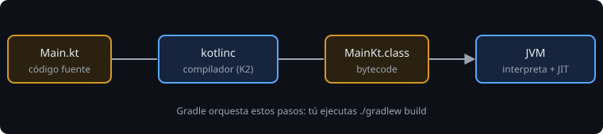

# Qué es Kotlin hoy

> Kotlin no es "Java con otra sintaxis": es el lenguaje que Google recomienda para Android, que corre en la JVM, en JavaScript y en código nativo, y que ya viene con casi todo lo que en Java necesitabas una librería para hacer.

## 🎯 Objetivos

- Explicar qué es un lenguaje **compilado a bytecode** y dónde encaja la JVM
- Situar Kotlin en el mapa: Android, servidor, multiplataforma
- Distinguir el **lenguaje** (Kotlin), el **compilador** (K2), la **JVM** y la **biblioteca estándar**
- Escribir y ejecutar el programa mínimo
- Saber qué vas a construir en 42 semanas

## 1. Qué problema resuelve

Un programa es una lista de instrucciones. Un lenguaje de programación te deja escribirlas en un idioma legible y se encarga de traducirlas. Kotlin tiene tres decisiones de diseño que explican casi todo lo que viene después:

| Decisión | Qué significa | Qué te ahorra |
| --- | --- | --- |
| **Tipado estático** | Cada valor tiene un tipo conocido al compilar | Errores como sumar un texto a un número aparecen antes de ejecutar |
| **Seguridad frente a `null`** | Un `String` nunca es `null`; para eso existe `String?` | El clásico `NullPointerException` deja de ser una sorpresa |
| **Concisión** | Clases de datos, inferencia de tipos, expresiones en vez de sentencias | Menos ruido: lo que lees es lo que importa |

## 2. Cómo funciona

### 2.1 Compilado a bytecode

Kotlin **no** se traduce directamente a código máquina. El compilador (`kotlinc`, versión K2) produce **bytecode** en archivos `.class`, y la **JVM** (*Java Virtual Machine*) lo carga y lo ejecuta. Al principio lo interpreta; las partes que se repiten mucho las compila a código máquina mientras corre (*JIT*).



Consecuencias que verás en Android:

- El mismo código Kotlin corre en cualquier sistema con JVM. En Android el bytecode se convierte además a otro formato (DEX), pero eso llega en la fase 3.
- Kotlin y Java se mezclan en un mismo proyecto y se llaman entre sí.
- Lo que Kotlin añade (por ejemplo, la seguridad de `null`) lo verifica el compilador; en la JVM sigue habiendo `null` por debajo. Por eso el bytecode de `saludo(nombre: String)` empieza con una comprobación de que `nombre` no es nulo: lo verás con `javap` en el ejercicio 01.

### 2.2 El mapa

| Objetivo | Para qué se usa | En este bootcamp |
| --- | --- | --- |
| Kotlin/JVM | Android, servidores (Ktor, Spring) | Todo el bootcamp |
| Kotlin Multiplatform (KMP) | Compartir lógica entre Android, iOS y escritorio | Semana 41 (introducción) |
| Kotlin/JS y Kotlin/Native | Web y binarios nativos | Solo se mencionan |

### 2.3 Versiones y la regla de no usar `latest`

El bootcamp fija **Kotlin 2.4.21** y **JDK 21**. Todo el proyecto está pinado con versiones exactas (están en [`docs/stack-versions.md`](../../../docs/stack-versions.md)) y revisadas contra avisos de seguridad. Una versión "la más reciente" que cambia sola rompe builds que ayer funcionaban y puede traer vulnerabilidades sin que lo sepas.

## 3. El programa mínimo

```kotlin
fun main() {
    println("Hola, Kotlin")
}
```

- `fun` declara una función. `main` es el punto de entrada.
- No hace falta una clase ni `;` al final de la línea.
- `println` imprime una línea en la salida estándar.

En el Kotlin Playground (<https://play.kotlinlang.org>) puedes ejecutarlo sin instalar nada. Desde la próxima lección lo harás con Gradle.

## 4. Errores frecuentes

| Error | Causa | Arreglo |
| --- | --- | --- |
| "Kotlin es solo para Android" | Se enseña mucho en Android, pero es un lenguaje general | Recuerda el mapa de 2.2 |
| Confundir JDK con JRE | El JDK incluye el compilador y las herramientas (`javap`); el JRE solo ejecuta | Instala siempre el JDK |
| Tener Java 8/11 por defecto | `./gradlew` usa el `java` del `PATH` para arrancar | `java -version` debe decir 21 |

## ✅ Qué debes saber al terminar

- Kotlin se compila a bytecode y lo ejecuta una JVM.
- El tipado es estático y `null` está controlado por el sistema de tipos.
- Las versiones del curso están fijadas y por qué.
