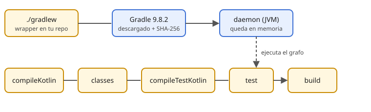

# Gradle mínimo

> Gradle es el programa que compila, prueba y empaqueta tu código, y que en la fase 3 construirá tu app Android. Esta semana solo necesitas tres comandos y entender un archivo de 25 líneas.

## 🎯 Objetivos

- Usar `./gradlew` y explicar por qué no se instala Gradle aparte
- Leer un `build.gradle.kts` mínimo y decir qué hace cada bloque
- Ejecutar `build`, `test` y `run`, y leer el resultado
- Saber qué es el *daemon* y qué es un grafo de tareas

## 1. El wrapper

Cada `starter/` contiene `gradlew`, `gradlew.bat` y `gradle/wrapper/`. Es el **wrapper**: un script que descarga la versión exacta de Gradle indicada en `gradle/wrapper/gradle-wrapper.properties`, verifica su suma **SHA-256** y la usa. Así todos los aprendices (y el servidor de CI) compilan con la misma versión.

```properties
distributionUrl=https\://services.gradle.org/distributions/gradle-9.8.2-bin.zip
distributionSha256Sum=21bd5da2de49b642904077f38c0efdc7778e92b3ed0889392dca61b97e389607
```

Nunca ejecutes `gradle` global en estos proyectos: usa siempre `./gradlew`. La 9.8.1 corrigió los avisos de seguridad de octubre de 2026 y usamos la 9.8.2 (ver `stack-versions.md`).



## 2. El archivo `build.gradle.kts`

```kotlin
plugins {                        // qué sabe hacer este proyecto
    kotlin("jvm") version "2.4.21"
    application
}

repositories { mavenCentral() }  // de dónde bajar dependencias

dependencies {                   // qué librerías usa
    testImplementation(platform("org.junit:junit-bom:6.1.3"))
    testImplementation(kotlin("test"))
    testRuntimeOnly("org.junit.platform:junit-platform-launcher")
}

kotlin {
    jvmToolchain(21)             // compilar siempre con JDK 21
    compilerOptions { allWarningsAsErrors.set(true) }
}

application { mainClass.set("MainKt") }
tasks.test { useJUnitPlatform() }
```

Está escrito en **Kotlin DSL**: es Kotlin real, con autocompletado en el IDE. Cada bloque es una llamada a una función con una lambda; lo entenderás del todo en la semana 9.

`testImplementation` quiere decir "esta librería solo existe para los tests". El `platform(...)` fija las versiones de JUnit con un *BOM* (lista de versiones compatibles).

## 3. Los comandos de la semana

| Comando | Qué hace |
| --- | --- |
| `./gradlew build` | Compila, ejecuta los tests y empaqueta |
| `./gradlew test` | Compila y ejecuta solo los tests |
| `./gradlew run` | Compila y arranca `main()` |
| `./gradlew tasks` | Lista las tareas disponibles |
| `./gradlew --version` | Versiones de Gradle, Kotlin y JVM |

Una *tarea* depende de otras: `build` necesita `test`, que necesita `classes`, que necesita `compileKotlin`. Gradle construye ese grafo y ejecuta solo lo necesario; si nada cambió, marca la tarea `UP-TO-DATE` y no la repite.

El primer arranque es lento porque levanta el **daemon**: un proceso JVM que se queda en memoria para que las siguientes ejecuciones sean rápidas. Con `--no-daemon` no queda ninguno (útil en CI).

## 4. Leer la salida de un test

```
MainTest > saludaPorNombre() PASSED
MainTest > saludoConNombreEnBlancoEsMundo() FAILED
    kotlin.NotImplementedError: An operation is not implemented: Paso 3
BUILD FAILED
```

`TODO("Paso 3")` es una función estándar que lanza `NotImplementedError`: marca "aquí falta código" sin impedir que compile.

## 5. Errores frecuentes

| Error | Causa | Arreglo |
| --- | --- | --- |
| `Permission denied: ./gradlew` | Pérdida del bit ejecutable | `chmod +x gradlew` |
| `No matching toolchains found for ... JavaLanguageVersion{21}` | No hay JDK 21 instalado | Instala Temurin 21 (`docs/setup.md`) |
| Falla la descarga de Gradle | Red inestable | Repite `./gradlew --version` |
| Cambié `build.gradle.kts` y el IDE no lo ve | Hace falta sincronizar | "Reload Gradle project" en el IDE |

## ✅ Qué debes saber al terminar

- Siempre `./gradlew`, nunca un Gradle global.
- Qué hacen `plugins`, `repositories`, `dependencies` y `kotlin { }`.
- `build`, `test` y `run` son tareas que forman un grafo.
