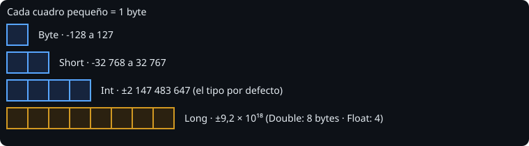
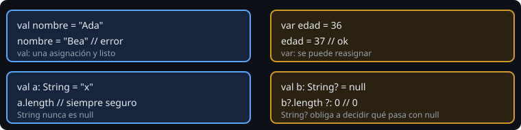

# Tipos, variables y nulos

> En Kotlin casi todo es una expresión con un tipo conocido. Aprender a elegir el tipo correcto y a decir `val` en vez de `var` te quita la mitad de los errores de la semana.

## 🎯 Objetivos

- Elegir entre `Int`, `Long`, `Double`, `Boolean`, `Char` y `String`
- Usar `val` por defecto y `var` solo cuando hace falta
- Dejar que la inferencia ponga el tipo sin perder claridad
- Convertir entre tipos de forma explícita
- Distinguir `String` de `String?` y tratar un `null` con `?.` y `?:`
- Saber por qué `Int.MAX_VALUE + 1` no es un error

## 1. Los tipos básicos



| Tipo | Ejemplo | Para qué |
| --- | --- | --- |
| `Int` | `42` | El entero por defecto |
| `Long` | `42L` | Enteros grandes (marcas de tiempo, ids) |
| `Double` | `3.14` | El decimal por defecto |
| `Float` | `3.14f` | Decimales de menor precisión (gráficos) |
| `Boolean` | `true` | Verdadero o falso |
| `Char` | `'a'` | Un carácter |
| `String` | `"hola"` | Texto inmutable |

Los tamaños salen de las constantes `Int.SIZE_BYTES`, `Long.SIZE_BYTES`… Un `Byte` solo se usa con datos binarios; un `Short`, casi nunca.

## 2. `val` y `var`



```kotlin
val nombre = "Ada"    // no se reasigna
var contador = 0      // se puede reasignar
contador += 1
```

Usa `val` siempre que puedas. Lo inmutable es más fácil de razonar y no se comparte mal entre hilos (semana 6). Para constantes de verdad, conocidas al compilar, existe `const val` fuera de las funciones:

```kotlin
const val COLUMN_WIDTH = 8
```

## 3. Inferencia y conversiones

El compilador deduce el tipo del lado derecho: `val x = 3.7` es `Double`. Escribes el tipo explícito cuando no hay valor inicial o quieres uno distinto: `val limite: Long = 10`.

A diferencia de otros lenguajes, **Kotlin no convierte tipos numéricos por ti**:

```kotlin
val a: Int = 3.7        // error de compilación
val b: Int = 3.7.toInt()  // 3: tú decides truncar
val c: Double = 7.toDouble() / 2   // 3.5
```

El mensaje real del compilador es `Initializer type mismatch: expected 'Int', actual 'Double'.` Es un error a tiempo de compilación, que es lo que queremos. En C++ habría compilado y habría perdido el `.7` sin avisar.

Las funciones de conversión se llaman `toInt()`, `toLong()`, `toDouble()`. Para pasar de `Double` a `Int`, `toInt()` **trunca** hacia cero: `-3.7.toInt()` es `-3`.

### División y desbordamiento

```kotlin
7 / 2        // 3    (los dos son Int: división entera)
7 / 2.0      // 3.5
Int.MAX_VALUE + 1   // -2147483648: da la vuelta, sin error
Math.addExact(Int.MAX_VALUE, 1)  // lanza ArithmeticException
```

En la JVM el desbordamiento de enteros está **definido**: da la vuelta (*wraparound*). No es un comportamiento indefinido como en C++, pero tampoco es lo que esperas. Si el valor importa (dinero, cantidades), usa `Math.addExact` o `Long`.

Los `Double` tampoco son exactos: `0.1 + 0.2 == 0.3` es `false`. Se comparan con una tolerancia (`abs(a - b) < epsilon`).

## 4. Nulos

```kotlin
val a: String = "x"     // nunca null
val b: String? = null   // puede ser null

b.length                // error de compilación
b?.length               // null si b es null; si no, la longitud
b?.length ?: 0          // 0 si todo lo anterior fue null
b!!.length              // NullPointerException si es null: evítalo
```

`?.` (llamada segura) y `?:` (operador Elvis) cubren el 90 % de los casos. `!!` significa "prometo que no es null, y si miento que explote": en código nuevo casi nunca está justificado.

## 5. Errores frecuentes

| Error | Causa | Arreglo |
| --- | --- | --- |
| `Val cannot be reassigned` | Usaste `val` y luego asignaste | Cambia a `var` solo si de verdad cambia |
| `Initializer type mismatch` | Mezclaste `Int` y `Double` | Convierte con `toInt()` / `toDouble()` |
| `Only safe (?.) or non-null asserted (!!.) calls are allowed` | Usaste un `String?` como `String` | `?.`, `?:` o una comprobación `if` |
| `7 / 2` da `3` | División entera | Convierte un operando a `Double` |

## ✅ Qué debes saber al terminar

- `val` por defecto, `var` cuando cambia.
- Kotlin no convierte números por ti; `toInt()` trunca.
- El desbordamiento da la vuelta, y los `Double` no se comparan con `==`.
- `String?` obliga a decidir qué pasa con `null`.
