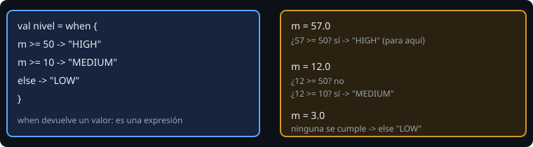

# `if` y `when` como expresiones

> En Kotlin, `if` y `when` no solo deciden qué ejecutar: **devuelven un valor**. Cuando lo asimilas, desaparecen la mitad de las variables temporales y de los `var`.

## 🎯 Objetivos

- Distinguir una **expresión** (tiene valor) de una **sentencia** (hace algo)
- Escribir `if`/`else` como expresión
- Usar `when` con argumento, con rangos, con `is` y sin argumento
- Saber qué pasa cuando `when` no cubre todos los casos

## 1. Expresión frente a sentencia

```kotlin
val mayor = if (a > b) a else b      // if es una expresión: devuelve a o b
```

No existe el operador ternario `a > b ? a : b`: `if` ya cumple ese papel. Cuando `if` se usa como expresión, **`else` es obligatorio**: el compilador necesita un valor en todos los caminos.

Si cada rama ocupa varias líneas, el valor es el de la **última expresión** del bloque:

```kotlin
val etiqueta = if (medida >= 50.0) {
    println("alta")
    "HIGH"        // este es el valor
} else {
    "OTHER"
}
```

## 2. `when`



`when` sustituye al `switch` de otros lenguajes y es bastante más potente. Evalúa las ramas **en orden** y se queda con la primera que se cumple.

```kotlin
// Con argumento: compara valores
when (n) {
    1 -> "Lunes"
    2, 3 -> "Martes o miércoles"     // varias coincidencias en una rama
    in 4..6 -> "Jueves a sábado"      // rango
    else -> "Otro"
}

// Con is: comprueba el tipo
when (valor) {
    is Int -> "entero"
    is String -> "texto de ${valor.length} letras"   // aquí valor ya es String
    else -> "otra cosa"
}

// Sin argumento: cada rama es una condición booleana
when {
    n % 15 == 0 -> "FizzBuzz"
    n % 3 == 0 -> "Fizz"
    else -> n.toString()
}
```

Dos detalles:

- No hay `break`: al ejecutar una rama, `when` termina.
- **El orden importa en la forma sin argumento.** Si pones `n % 3 == 0` antes que `n % 15 == 0`, el 30 nunca llegará a "FizzBuzz".

### ¿Y si ningún caso se cumple?

Como expresión, `when` **debe ser exhaustivo**: o llevas `else`, o el compilador rechaza el código (`'when' expression must be exhaustive`). Como sentencia, no hace falta. Más adelante, con `enum` y `sealed`, el compilador comprobará la exhaustividad sin `else` (semana 5).

## 3. Operadores de comparación y lógicos

| Operador | Significa |
| --- | --- |
| `==`, `!=` | Igualdad por valor (llama a `equals`) |
| `===` | Misma referencia en memoria (casi nunca lo necesitas) |
| `<`, `<=`, `>`, `>=` | Orden |
| `&&`, `\|\|`, `!` | y, o, no (con cortocircuito) |
| `in`, `!in` | Pertenece a un rango o colección |

`&&` y `||` evalúan de izquierda a derecha y se detienen en cuanto saben el resultado: `texto != null && texto.length > 3` es seguro porque la segunda parte no se evalúa si `texto` es `null`.

## 4. Errores frecuentes

| Error | Causa | Arreglo |
| --- | --- | --- |
| `'if' must have both main and 'else' branches if used as an expression` | `if` como valor sin `else` | Añade `else` |
| `'when' expression must be exhaustive` | Falta `else` | Añade `else` o cubre todos los casos |
| Una rama nunca se ejecuta | Una rama anterior ya la cubre | Ordena de lo más específico a lo más general |
| `if (x = 3)` | Asignación en lugar de comparación | `==`; en Kotlin ni siquiera compila |

## ✅ Qué debes saber al terminar

- `if` y `when` devuelven valor.
- `when` evalúa en orden, acepta rangos, `is` y puede ir sin argumento.
- Como expresión, `when` necesita `else`.
