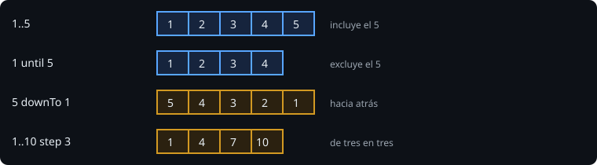

# Bucles y rangos

> Repetir algo es sencillo; repetirlo sin errores de "uno de más" o "uno de menos" es lo que se aprende con los rangos.

## 🎯 Objetivos

- Recorrer rangos con `for` usando `..`, `until`, `downTo` y `step`
- Usar `while` y `do ... while`
- Salir antes con `break`, `continue` y `return`
- Acumular resultados en una lista mutable
- Saber qué es `Unit` y qué es `Nothing`

## 1. Rangos



| Expresión | Valores | Nota |
| --- | --- | --- |
| `1..5` | 1, 2, 3, 4, 5 | Incluye el final |
| `1 until 5` | 1, 2, 3, 4 | Excluye el final (útil con tamaños) |
| `5 downTo 1` | 5, 4, 3, 2, 1 | Hacia atrás |
| `1..10 step 3` | 1, 4, 7, 10 | De tres en tres |
| `5..1` | (vacío) | Un rango hacia atrás sin `downTo` está **vacío**, no da error |

Un rango también responde a `in`: `if (edad in 18..65)`, `if (c !in 'a'..'z')`.

## 2. `for`

```kotlin
for (i in 1..3) println(i)
for (c in "Kot") println(c)               // recorre los caracteres
for ((indice, c) in "Kot".withIndex()) println("$indice:$c")
```

`for` solo recorre cosas que se puedan iterar: rangos, textos, listas. No existe el `for (i = 0; i < n; i++)` clásico: se escribe `for (i in 0 until n)`.

## 3. `while` y `do ... while`

```kotlin
var d = 2
while (d * d <= n) {      // comprueba ANTES de cada vuelta
    if (n % d == 0) return false
    d++
}

do {                      // ejecuta una vez y comprueba DESPUÉS
    intento++
} while (intento < 3)
```

Usa `for` cuando sabes cuántas vueltas o qué recorres; `while` cuando la condición de parada depende de lo que ocurre dentro.

## 4. `break`, `continue` y `return`

| Palabra | Efecto |
| --- | --- |
| `break` | Sale del bucle |
| `continue` | Salta a la siguiente vuelta |
| `return` | Sale de la **función**, con o sin valor |

Para salir de un bucle exterior desde uno interior se usa una etiqueta: `fuera@ for (...) { for (...) { if (x) break@fuera } }`. Casi siempre es más claro extraer el bucle a una función y usar `return`.

## 5. Acumular en una lista

```kotlin
val resultado = mutableListOf<Int>()      // lista que sí admite cambios
for (i in 5 downTo 1) resultado.add(i)
return resultado                           // se devuelve como List<Int>
```

`listOf(...)` crea una lista **de solo lectura**; `mutableListOf()` una que admite `add` y `remove`. Las colecciones se estudian a fondo en la semana 3; por ahora basta con `add`, `size` y recorrerlas con `for`.

## 6. `Unit` y `Nothing`

- `Unit` es el "no devuelvo nada útil" de una función (lo que en otros lenguajes es `void`). Es el tipo por defecto cuando no escribes retorno.
- `Nothing` es el tipo de una expresión que **nunca termina con normalidad**: `throw ...`, `TODO()`. Por eso `TODO("Paso 1")` compila en cualquier función, sea cual sea su tipo de retorno.

## 7. Errores frecuentes

| Error | Causa | Arreglo |
| --- | --- | --- |
| El bucle no se ejecuta | Rango vacío: `5..1` | `5 downTo 1` |
| Una vuelta de más o de menos | Confundir `..` con `until` | Escribe el caso más pequeño a mano |
| Bucle infinito | La condición de `while` nunca cambia | Actualiza la variable dentro |
| `for (i in 0..lista.size)` falla | El último índice es `size - 1` | `0 until lista.size` |

## ✅ Qué debes saber al terminar

- `..`, `until`, `downTo`, `step` y que un rango al revés está vacío.
- `for` para recorrer, `while` para condiciones.
- `mutableListOf` + `add` para acumular.
- `Unit` y `Nothing`.
