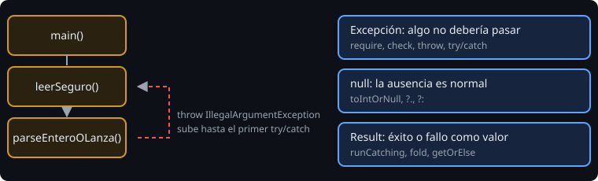

# Errores y excepciones

> Los errores no son un caso raro que se arregla después: son parte del diseño. Decidir **dónde** se detecta un dato incorrecto y **cómo** se comunica es lo que separa un programa que falla con un mensaje claro de uno que corrompe datos en silencio.

## 🎯 Objetivos

- Lanzar y capturar excepciones con `throw` y `try`/`catch`/`finally`
- Usar `require`, `check` y `error` para validar
- Usar `try` y `runCatching` como expresiones
- Elegir entre excepción, `null` y `Result`

## 1. El camino de un error



Una excepción es un objeto que se **lanza** (`throw`) y que sube por la pila de llamadas hasta que algún `try/catch` la **captura**. Si nadie lo hace, el programa termina mostrando la traza.

Kotlin no tiene *checked exceptions*: el compilador no te obliga a declarar ni a capturar nada. La disciplina es tuya.

## 2. `try`, `catch`, `finally`

```kotlin
val n = try {
    texto.toInt()
} catch (e: NumberFormatException) {
    -1
} finally {
    println("intento terminado")   // se ejecuta siempre
}
```

`try` es una **expresión**: su valor es la última expresión del bloque que se ejecutó. `finally` sirve para liberar recursos o dejar rastro; su valor se ignora.

Captura la excepción **más específica** que sepas tratar. `catch (e: Exception)` que se traga todo y sigue es de los peores hábitos: oculta bugs reales.

## 3. Validar con `require`, `check` y `error`

| Función | Lanza | Se usa para |
| --- | --- | --- |
| `require(cond) { "mensaje" }` | `IllegalArgumentException` | Validar **argumentos** al entrar en la función |
| `check(cond) { "mensaje" }` | `IllegalStateException` | Validar el **estado** (no se puede cerrar algo ya cerrado) |
| `error("mensaje")` | `IllegalStateException` | "Esto no debería pasar" |
| `requireNotNull(x) { "..." }` | `IllegalArgumentException` | Exigir que no sea `null` y obtener el valor sin `?` |

```kotlin
fun dividir(a: Double, b: Double): Double {
    require(b != 0.0) { "b no puede ser 0" }
    return a / b
}
```

El mensaje es una lambda (`{ ... }`), así que solo se construye si falla. Escribe mensajes que digan **qué valor llegó**: `"measure inválida: $measure"`.

## 4. `runCatching` y `Result`

```kotlin
val r: Result<Int> = runCatching { parseEnteroOLanza(texto) }

r.getOrNull()                 // el valor, o null
r.getOrElse { -1 }            // el valor, o -1
r.fold(
    onSuccess = { "OK:$it" },
    onFailure = { "ERROR:${it.message}" },
)
```

`runCatching` ejecuta un bloque y devuelve un `Result` que representa éxito o fallo **como valor**. Es práctico para convertir una excepción en otra cosa sin escribir un `try/catch` entero. Pero atrapa **todo** (incluidos errores de programación), así que no lo uses para esconder bugs.

## 5. ¿Excepción, `null` o `Result`?

| Usa | Cuando | Ejemplo |
| --- | --- | --- |
| `require`/`throw` | El que llama violó el contrato; es un bug | `dividir(1.0, 0.0)` |
| `null` | La ausencia es normal y quien llama puede decidir | `parseEntero("abc")` |
| `Result` | El fallo importa y quieres transportarlo como dato | `runCatching { ... }` |

## 6. Errores frecuentes

| Error | Causa | Arreglo |
| --- | --- | --- |
| Un `catch` vacío | Silencia el fallo | Trata, registra o relanza |
| `catch (e: Exception)` en todas partes | Captura de más | La excepción concreta |
| Mensaje inútil: `"error"` | No dice qué falló | Incluye el valor y la regla |
| Lanzar para el flujo normal | Más lento y confuso | Usa `null` o una condición |

## ✅ Qué debes saber al terminar

- `throw`, `try/catch/finally`, y que `try` es una expresión.
- `require` valida argumentos; `check`, estado.
- `runCatching` + `fold` y cuándo usarlo.
- Excepción, `null` o `Result`: la regla de la tabla.
