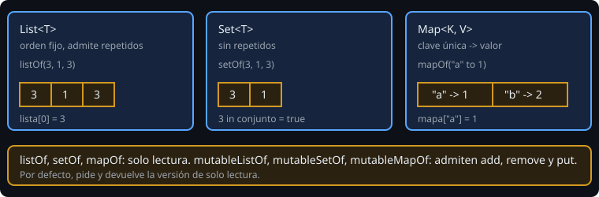

# Listas, conjuntos y mapas

> Casi todo programa real trabaja con **muchos** datos del mismo tipo. Kotlin da tres colecciones básicas y una regla de oro: por defecto, de solo lectura.

## 🎯 Objetivos

- Elegir entre `List`, `Set` y `Map` según el problema
- Distinguir una colección de **solo lectura** de una **mutable**
- Acceder a elementos sin provocar excepciones inesperadas
- Recorrer listas y mapas con `for` y desestructuración

## 1. Las tres colecciones



| Tipo | Garantiza | Cuándo |
| --- | --- | --- |
| `List<T>` | Orden y posición; admite repetidos | Una secuencia: observaciones por orden de llegada |
| `Set<T>` | Sin repetidos; consulta rápida de pertenencia | "¿Ya vi este código?" |
| `Map<K, V>` | Clave única → valor | Cantidad por código, nota por alumno |

```kotlin
val lista = listOf(3, 1, 3)           // [3, 1, 3]
val conjunto = setOf(3, 1, 3)         // [3, 1]
val mapa = mapOf("a" to 1, "b" to 2)  // "a" to 1 crea un Pair
```

## 2. Solo lectura frente a mutable

`listOf`, `setOf` y `mapOf` devuelven colecciones **de solo lectura**: no tienen `add` ni `remove`. Para cambiar, existen `mutableListOf`, `mutableSetOf` y `mutableMapOf`.

```kotlin
val acumulado = mutableListOf<Int>()
acumulado.add(5)
acumulado += 7                 // lo mismo que add; aquí val no importa
```

Reglas prácticas:

- **Declara y devuelve la versión de solo lectura** (`List<Int>`), aunque por dentro construyas una mutable. Quien recibe la lista no puede romperla.
- "Solo lectura" significa que **tú** no puedes modificarla a través de ese tipo; si alguien más guarda una referencia mutable a la misma lista, verás cambios. En la práctica, copia (`toList()`) si necesitas una instantánea.
- `val` y "mutable" son cosas distintas: un `val` de `MutableList` no se reasigna, pero su contenido sí cambia.

## 3. Acceder sin romper

| Operación | Si falla |
| --- | --- |
| `lista[i]` | `IndexOutOfBoundsException` |
| `lista.getOrNull(i)` | `null` |
| `lista.first()` / `lista.last()` | `NoSuchElementException` si está vacía |
| `lista.firstOrNull()` | `null` |
| `mapa["clave"]` | `null` (el tipo es `V?`) |
| `mapa.getValue("clave")` | `NoSuchElementException` |
| `mapa.getOrElse("clave") { 0 }` | el valor alternativo |

Las variantes `...OrNull` encajan con lo que aprendiste de `?.` y `?:`: `mapa["a"] ?: 0`.

## 4. Recorrer

```kotlin
for (x in lista) println(x)
for ((i, x) in lista.withIndex()) println("$i: $x")
for ((clave, valor) in mapa) println("$clave -> $valor")   // desestructura Map.Entry
```

La **desestructuración** `(clave, valor)` saca los componentes de un `Pair` o de una entrada de mapa en una sola línea. Las `data class` también la admiten.

## 5. Conjuntos y mapas: operaciones útiles

```kotlin
val a = setOf(1, 2, 3); val b = setOf(2, 3, 4)
a intersect b          // [2, 3]
a union b              // [1, 2, 3, 4]
a - b                  // [1]           (a subtract b)
2 in a                 // true

val inventario = mapOf("tornillos" to 10)
val nuevo = inventario + ("tuercas" to 3)   // mapa NUEVO; el original no cambia
```

Ten presente que los operadores `+` y `-` sobre colecciones **crean una colección nueva**. Es el estilo "inmutable" que verás en Compose.

## 6. Errores frecuentes

| Error | Causa | Arreglo |
| --- | --- | --- |
| `IndexOutOfBoundsException` | Índice fuera de rango | `getOrNull` o `0 until lista.size` |
| `Unresolved reference: add` | La lista es de solo lectura | Usa `mutableListOf` o crea una nueva con `+` |
| `ConcurrentModificationException` | Modificas una lista mientras la recorres | Construye otra lista o usa `filter` |
| `mapa["x"] + 1` no compila | `mapa["x"]` es `Int?` | `(mapa["x"] ?: 0) + 1` |

## ✅ Qué debes saber al terminar

- `List`, `Set` y `Map`, y cuándo cada una.
- Solo lectura por defecto, mutable cuando de verdad acumulas.
- `getOrNull`, `firstOrNull`, `mapa[clave] ?: 0`.
- Los operadores `+`, `-`, `intersect` crean colecciones nuevas.
