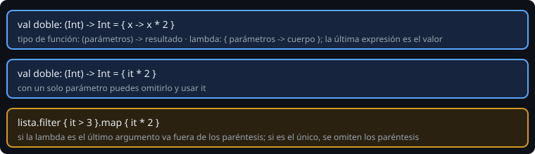

# Lambdas y funciones de orden superior

> Una función de orden superior recibe o devuelve **otra función**. Es la idea que hace que `filter`, `map` y todo Jetpack Compose se lean como se leen.

## 🎯 Objetivos

- Leer y escribir tipos de función como `(Int) -> Int`
- Escribir lambdas con parámetro explícito, con `it` y como último argumento
- Declarar funciones que reciben lambdas
- Entender que una lambda **captura** las variables a su alrededor
- Usar referencias a funciones (`::`)

## 1. Funciones como valores



En Kotlin una función es un valor más: puedes guardarla en una variable, pasarla y devolverla.

```kotlin
val doble: (Int) -> Int = { x -> x * 2 }
val suma: (Int, Int) -> Int = { a, b -> a + b }
val saludar: () -> Unit = { println("hola") }

doble(4)         // 8
suma(2, 3)       // 5
```

- `(Int) -> Int` es un **tipo de función**: recibe un `Int`, devuelve un `Int`.
- Una **lambda** se escribe entre llaves: `{ parámetros -> cuerpo }`. La última expresión del cuerpo es el valor que devuelve; no se escribe `return`.
- Con **un solo parámetro**, puedes omitirlo y usar `it`: `{ it * 2 }`. Úsalo en lambdas cortas; si el cuerpo ocupa varias líneas, ponle nombre al parámetro.

## 2. Funciones que reciben funciones

```kotlin
fun aplicarDosVeces(f: (Int) -> Int, x: Int): Int = f(f(x))

aplicarDosVeces({ it * 3 }, 2)     // 18
```

**Convención de la lambda final:** si la lambda es el último parámetro, se escribe **fuera** de los paréntesis, y si es el único, se omiten los paréntesis:

```kotlin
fun contarSi(lista: List<Int>, predicado: (Int) -> Boolean): Int { ... }

contarSi(lista) { it > 6 }         // en vez de contarSi(lista, { it > 6 })
lista.filter { it > 6 }
```

De ahí sale la sintaxis de Compose: `Column { Text("hola") }` es una función cuya última (y única) lambda describe el contenido.

## 3. Capturar variables (closures)

```kotlin
fun crearSumador(n: Int): (Int) -> Int = { it + n }

val suma10 = crearSumador(10)
suma10(5)        // 15: la lambda "recuerda" n = 10
```

Una lambda puede **leer y modificar** las variables locales de la función que la rodea, incluso cuando esa función ya terminó:

```kotlin
var llamadas = 0
val contar = { llamadas++ }
contar(); contar()
println(llamadas)   // 2
```

Es potente, pero modifica con cuidado: una lambda que cambia estado externo es más difícil de razonar. Prefiere lambdas que **solo calculan y devuelven**.

## 4. Referencias a funciones

Si ya existe una función con la firma adecuada, no hace falta escribir la lambda:

```kotlin
fun esPar(n: Int) = n % 2 == 0

lista.filter(::esPar)              // referencia a una función
palabras.map(String::length)       // referencia a un método
palabras.map { it.length }         // equivalente
```

## 5. `return` dentro de una lambda

- Una lambda devuelve su **última expresión**.
- Con `forEach`, `map`, etc. (funciones `inline`), un `return` sin etiqueta sale de la **función que las contiene**, no de la lambda:

```kotlin
fun primerNegativo(lista: List<Int>): Int? {
    lista.forEach { if (it < 0) return it }   // sale de primerNegativo
    return null
}
```

- Para salir solo de la lambda se usa una etiqueta: `forEach { if (it < 0) return@forEach }` (equivale a un `continue`).

`inline` es la palabra que explica esto: el compilador copia el cuerpo de la función en el sitio de la llamada, y por eso el `return` puede saltar hasta fuera. Escribir tus propias funciones `inline` queda para más adelante.

## 6. Errores frecuentes

| Error | Causa | Arreglo |
| --- | --- | --- |
| `Type mismatch: inferred type is Unit but Int was expected` | La lambda termina con una sentencia, no una expresión con valor | Que la última línea sea el valor |
| `Cannot infer a type for this parameter` | Lambda sin contexto de tipos | Declara el tipo: `{ x: Int -> x * 2 }` |
| Resultado inesperado con `it` anidado | `it` de la lambda interior tapa al de la exterior | Nombra los parámetros |
| `return` no permitido | Lambda que no es `inline` | `return@etiqueta` o reestructura |

## ✅ Qué debes saber al terminar

- `(A) -> B` es un tipo; `{ x -> ... }` y `{ it ... }` son valores de ese tipo.
- La lambda final va fuera de los paréntesis.
- Las lambdas capturan variables.
- `::función` y `Tipo::método` como atajo.
