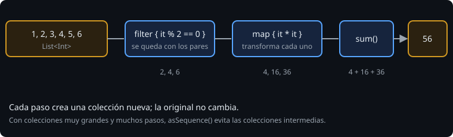

# `map`, `filter`, `fold` y compañía

> Casi todos los bucles que escribirías para recorrer una lista tienen un nombre. Aprender ese vocabulario es lo que hace que una transformación de datos se lea de un vistazo.

## 🎯 Objetivos

- Transformar con `map`/`mapNotNull`, filtrar con `filter`, resumir con `sum`/`fold`
- Buscar con `find`, `any`, `all`, `none`, `count`
- Ordenar con `sortedBy` y comparadores compuestos
- Encadenar operaciones y saber qué devuelve cada una

## 1. El pipeline



```kotlin
val resultado = listOf(1, 2, 3, 4, 5, 6)
    .filter { it % 2 == 0 }     // [2, 4, 6]
    .map { it * it }            // [4, 16, 36]
    .sum()                      // 56
```

Cada operación **no modifica la lista original**: devuelve una nueva. Leídas de arriba abajo cuentan lo que pasa: "los pares, al cuadrado, sumados".

## 2. Vocabulario

### Transformar y filtrar

| Función | Qué hace | Ejemplo |
| --- | --- | --- |
| `map { }` | Una transformación por elemento | `nombres.map { it.length }` |
| `mapNotNull { }` | Como `map` y descarta los `null` | `textos.mapNotNull { it.toIntOrNull() }` |
| `filter { }` / `filterNot { }` | Deja / quita los que cumplen | `lista.filter { it > 0 }` |
| `flatMap { }` | `map` que devuelve listas y las aplana | `frases.flatMap { it.split(" ") }` |
| `distinct()` / `distinctBy { }` | Sin repetidos | `codigos.distinct()` |
| `take(n)`, `drop(n)`, `takeLast(n)` | Primeros, saltar, últimos | `lista.take(3)` |

### Resumir

| Función | Qué hace | Si está vacía |
| --- | --- | --- |
| `sum()` / `sumOf { }` | Suma | `0` |
| `count { }` | Cuántos cumplen | `0` |
| `average()` | Media | `NaN` |
| `maxOrNull()`, `minOrNull()` | Mayor / menor | `null` |
| `maxByOrNull { }`, `minByOrNull { }` | El elemento con mayor / menor clave | `null` |
| `maxOf { }`, `minOf { }` | El mayor / menor **valor** de una clave | **lanza** `NoSuchElementException` |
| `fold(inicial) { acc, x -> }` | Resumen general con valor inicial | el `inicial` |
| `reduce { acc, x -> }` | Como `fold` sin inicial | **lanza** `UnsupportedOperationException` |

```kotlin
val total = lista.fold(0) { acc, x -> acc + x }
```

Si no sabes si la lista puede estar vacía, usa las variantes `...OrNull` o `fold`. Cuando de verdad no puede estarlo, `maxOf` comunica esa intención.

### Preguntar

| Función | Responde |
| --- | --- |
| `any { }` | ¿Alguno cumple? |
| `all { }` | ¿Todos cumplen? (en una lista vacía: `true`) |
| `none { }` | ¿Ninguno cumple? |
| `find { }` / `firstOrNull { }` | El primero que cumple, o `null` |
| `contains` / `in` | ¿Está? |

### Ordenar

```kotlin
lista.sorted()                                  // de menor a mayor
lista.sortedDescending()
personas.sortedBy { it.edad }
personas.sortedByDescending { it.edad }
personas.sortedWith(compareByDescending<Persona> { it.edad }.thenBy { it.nombre })
```

`thenBy` desempata: mayor edad primero y, a igual edad, por nombre. Ordenar es **estable**: los empates conservan el orden original.

### Texto

```kotlin
listOf("a", "b", "c").joinToString(", ")                    // "a, b, c"
listOf("a", "b").joinToString(prefix = "[", postfix = "]")  // "[a, b]"
```

## 3. Elegir la herramienta

| Quiero... | Uso |
| --- | --- |
| Convertir cada elemento | `map` |
| Quedarme con algunos | `filter` |
| Un único valor a partir de todos | `sum`, `count`, `fold` |
| El mejor según un criterio | `maxByOrNull` |
| Saber si hay alguno | `any` |

Si el cuerpo de un `for` hace una sola de estas cosas, la función de colección es más corta y dice qué haces, no cómo. Si necesitas varias a la vez y la versión con colecciones se vuelve ilegible, un `for` es perfectamente válido.

## 4. Errores frecuentes

| Error | Causa | Arreglo |
| --- | --- | --- |
| `NoSuchElementException` en una lista vacía | `first()`, `maxOf`, `last()` | `firstOrNull`, `maxOrNull`... |
| `average()` da `NaN` | Lista vacía | Comprueba `isEmpty()` antes |
| El resultado sigue desordenado | `sorted()` devuelve una **nueva** lista | Usa su valor: `val ordenada = lista.sorted()` |
| `filter` y no pasa nada | Ignoraste el valor devuelto | `val r = lista.filter { ... }` |
| `sumOf` con tipos mezclados | La lambda devuelve `Int` y `Double` | Que todos sean del mismo tipo |

## ✅ Qué debes saber al terminar

- `map`, `filter`, `fold` y el resto del vocabulario.
- Qué función lanza excepción en una lista vacía y cuál devuelve `null`.
- Ordenar con `sortedBy` y desempatar con `thenBy`.
