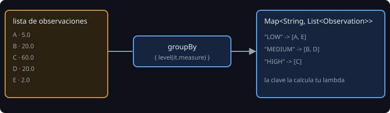

# Agrupar y combinar

> Una vez sabes filtrar y transformar, la pregunta siguiente es "¿cuántos hay de cada tipo?". Agrupar convierte una lista plana en un mapa con significado.

## 🎯 Objetivos

- Agrupar con `groupBy` y contar con `groupingBy().eachCount()`
- Construir mapas con `associate`, `associateBy` y `associateWith`
- Separar con `partition`, emparejar con `zip`, trocear con `chunked`
- Usar `Pair`, `Triple` y la desestructuración

## 1. `groupBy`



```kotlin
val porNivel: Map<String, List<Observation>> =
    observaciones.groupBy { level(it.measure) }
```

`groupBy` ejecuta tu lambda en cada elemento y los reúne según el resultado. Si añades una segunda lambda, también transformas los valores:

```kotlin
notas.groupBy({ it.first }, { it.second })     // Map<alumno, List<nota>>
```

Para pasar de listas a un resumen por grupo, `mapValues`:

```kotlin
notas.groupBy({ it.first }, { it.second })
    .mapValues { (_, lista) -> lista.sum() / lista.size }     // media por alumno
```

`(_, lista)` desestructura la entrada ignorando la clave con `_`.

## 2. Contar por grupo

```kotlin
"hola mundo".filter { it.isLetter() }.groupingBy { it }.eachCount()
// {h=1, o=2, l=1, a=1, m=1, u=1, n=1, d=1}
```

`groupingBy { ... }.eachCount()` cuenta sin crear las listas intermedias; es más eficiente que `groupBy` + `size` cuando solo quieres el número.

## 3. Construir mapas

| Función | Resultado |
| --- | --- |
| `associateWith { valor }` | Elemento → valor: `listOf("a","bb").associateWith { it.length }` → `{a=1, bb=2}` |
| `associateBy { clave }` | Clave → elemento: `personas.associateBy { it.id }` |
| `associate { clave to valor }` | Control total de ambos |

Si dos elementos producen la **misma clave** en `associateBy` o `associate`, gana el último y el otro se pierde en silencio. Para conservar todos, `groupBy`.

`associateWith` sirve para fijar las claves de antemano, incluso las que no aparecen en los datos:

```kotlin
listOf("LOW", "MEDIUM", "HIGH").associateWith { nivel -> lista.count { level(it.measure) == nivel } }
```

Así el informe siempre tiene las tres líneas, aunque alguna valga `0`.

## 4. Separar y emparejar

```kotlin
val (pares, impares) = (1..6).partition { it % 2 == 0 }    // dos listas
val parejas = listOf("a", "b").zip(listOf(1, 2))            // [(a, 1), (b, 2)]
(1..7).toList().chunked(3)                                  // [[1,2,3],[4,5,6],[7]]
listOf(1, 2, 3, 4).windowed(2)                              // [[1,2],[2,3],[3,4]]
```

`windowed` sirve para comparar elementos consecutivos (por ejemplo, la diferencia entre medidas seguidas).

## 5. `Pair` y `Triple`

```kotlin
val p = "OBS-001" to 12.5          // Pair<String, Double>
val (codigo, medida) = p           // desestructuración
p.first; p.second
```

`Pair` y `Triple` valen para devolver dos o tres valores de una función sin declarar una clase. Cuando el par significa algo ("código y medida"), una `data class` con nombres se lee mucho mejor: `Stats(count, min, max, average)` frente a un `Triple`.

## 6. Errores frecuentes

| Error | Causa | Arreglo |
| --- | --- | --- |
| Se pierden elementos al construir el mapa | Claves repetidas en `associateBy` | `groupBy` |
| `groupBy` no tiene la clave que esperabas | Solo aparecen las que tienen elementos | `associateWith` con claves fijas |
| `Pair<String, Double>` ilegible | `first` y `second` no dicen nada | `data class` |
| `chunked(0)` falla | Tamaño no positivo | Valida con `require` |

## ✅ Qué debes saber al terminar

- `groupBy` + `mapValues` para un resumen por grupo.
- `groupingBy().eachCount()` para contar.
- `associateWith` cuando las claves son fijas.
- `partition`, `zip`, `chunked`, `windowed`; `Pair` y desestructuración.
