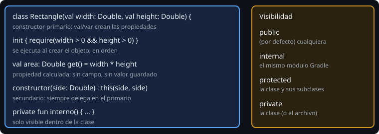

# Clases, propiedades y constructores

> Hasta ahora tus datos eran un `data class` y tus operaciones, funciones sueltas. Una **clase** junta ambos: datos que se protegen a sí mismos y operaciones que viven con ellos.

## 🎯 Objetivos

- Declarar una clase con constructor primario, `init` y constructores secundarios
- Distinguir parámetro de constructor, propiedad y variable local
- Escribir propiedades con `get`/`set` propios y propiedades calculadas
- Elegir visibilidad: `public`, `internal`, `protected`, `private`
- Hacer que un objeto sea **válido desde que existe**

## 1. Una clase



```kotlin
class Rectangle(val width: Double, val height: Double) {
    init {
        require(width > 0 && height > 0) { "lados > 0: $width x $height" }
    }

    constructor(side: Double) : this(side, side)

    val area: Double get() = width * height
}

val r = Rectangle(3.0, 4.0)     // sin "new"
r.area                          // 12.0
```

- El **constructor primario** va en la cabecera. Poner `val` o `var` delante de un parámetro **crea la propiedad**; sin ellos, es solo un parámetro que se puede usar en `init` y en inicializadores.
- `init` se ejecuta al crear el objeto. Es el sitio para **validar**: si algo está mal, el objeto no llega a existir.
- Un **constructor secundario** siempre delega en el primario con `this(...)`. Con valores por defecto en el primario casi nunca hace falta uno.
- Los inicializadores de propiedades y los bloques `init` se ejecutan **en el orden en que aparecen** en el archivo.

## 2. Propiedades

Una propiedad es un campo más un `get` y, si es `var`, un `set`. La sintaxis normal los genera sola. Puedes escribirlos tú:

```kotlin
class Temperature(initialCelsius: Double) {
    var celsius: Double = initialCelsius
        set(value) {
            require(value >= -273.15) { "bajo el cero absoluto: $value" }
            field = value              // "field" es el campo real
        }

    val fahrenheit: Double get() = celsius * 9 / 5 + 32     // calculada
}
```

- `field` se refiere al valor guardado. Sin él dentro de `set`, te llamarías a ti mismo sin fin.
- Una propiedad **calculada** (`get() = ...` sin inicializador) no guarda nada: se recalcula en cada lectura. Usa una para lo que **se deriva** de otros datos (`area`, `isSquare`, `fahrenheit`). Así nunca se desincroniza.
- Un `set` no se llama al inicializar la propiedad. Si el valor inicial también debe validarse, repite la validación en `init`.

### Modificar desde dentro, leer desde fuera

```kotlin
class Counter {
    var value: Int = 0
        private set                    // se lee fuera; solo la clase lo cambia
}
```

`private set` es la forma más barata de proteger un estado.

## 3. Visibilidad

| Modificador | Visible desde |
| --- | --- |
| `public` (por defecto) | cualquier sitio |
| `internal` | el mismo módulo Gradle |
| `protected` | la clase y sus subclases |
| `private` | la clase (o el archivo, si es de nivel superior) |

Regla: **empieza por `private` y abre solo lo necesario.** Cada miembro público es una promesa que tendrás que mantener.

## 4. Inicializar más tarde

| Herramienta | Para qué | Cuidado |
| --- | --- | --- |
| `lateinit var x: Tipo` | Valor que se asigna después (inyección, Android) | Acceder antes lanza `UninitializedPropertyAccessException`; no vale para tipos primitivos ni nulables |
| `val x by lazy { ... }` | Valor caro que se calcula la primera vez que se lee | El bloque se ejecuta una vez |

Úsalas con moderación: un objeto que existe a medias es un objeto que puede estar mal. Prefiere pasar todo por el constructor.

## 5. Errores frecuentes

| Error | Causa | Arreglo |
| --- | --- | --- |
| `Unresolved reference` a un parámetro dentro de un método | Sin `val`/`var` solo vive en `init` | Añade `val` o guárdalo |
| `StackOverflowError` en un `set` | Asignas a la propiedad en vez de a `field` | `field = value` |
| `Primary constructor call expected` | El secundario no delega | `: this(...)` |
| Objeto inválido que "funciona" | Sin validación en `init` | `require` en `init` |
| `lateinit property has not been initialized` | Lectura antes de asignar | Inicializa por constructor |

## ✅ Qué debes saber al terminar

- Constructor primario, `init`, secundarios que delegan.
- `val`/`var` en el constructor crean propiedades.
- `get`/`set`, `field`, propiedades calculadas y `private set`.
- Un objeto se valida al nacer.
