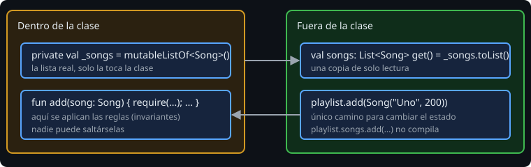

# Encapsulación y clases de datos

> Encapsular no es esconder por esconder: es que **nadie pueda dejar el objeto en un estado imposible**. Y una `data class` sabe compararse y copiarse, pero tiene reglas que conviene conocer.

## 🎯 Objetivos

- Proteger una colección interna con una propiedad de respaldo
- Definir invariantes y hacerlas cumplir en un único sitio
- Explicar qué generan las `data class` y qué **no** entra en `equals`
- Distinguir `==` de `===`
- Sobrescribir `toString`

## 1. La propiedad de respaldo



```kotlin
class Playlist {
    private val _songs = mutableListOf<Song>()
    val songs: List<Song> get() = _songs.toList()      // copia de solo lectura

    fun add(song: Song) {
        require(_songs.none { it.title == song.title }) { "título repetido: ${song.title}" }
        _songs.add(song)
    }
}
```

- `_songs` (con guion bajo) es la lista **mutable y privada**; `songs` es la vista pública.
- Devolver `_songs` tal cual, aunque con tipo `List`, deja que otro la convierta (`as MutableList`) o que vea cambios inesperados. **`toList()` devuelve una copia**: lo que ve el que llama no cambia después.
- La única forma de cambiar el estado es `add`, que aplica las reglas. No hay camino para saltárselas.

## 2. Invariantes

Una **invariante** es una condición que siempre debe cumplirse: "no hay dos canciones con el mismo título", "la temperatura no baja del cero absoluto", "una observación tiene código".

1. Escríbelas en una frase.
2. Hazlas cumplir **en el constructor y en cada método que cambie estado**.
3. Pruébalas con tests que intenten romperlas (`assertFailsWith`).

Si una invariante se comprueba en tres sitios distintos del programa, tarde o temprano se olvidará en el cuarto. Ponla dentro del objeto.

## 3. `data class` en profundidad

```kotlin
data class Song(val title: String, val seconds: Int) {
    var plays: Int = 0          // en el cuerpo: NO entra en equals/hashCode/toString/copy
}
```

Una `data class` genera, **solo con las propiedades del constructor primario**:

| Generado | Qué hace |
| --- | --- |
| `equals` / `hashCode` | Igualdad por valor |
| `toString` | `Song(title=Uno, seconds=200)` |
| `copy(...)` | Copia cambiando lo que indiques |
| `component1()...` | Desestructuración: `val (t, s) = song` |

Reglas:

- Necesita al menos un parámetro en el constructor primario, todos `val` o `var`.
- Dos `Song` con el mismo título y segundos son iguales aunque `plays` difiera: lo del cuerpo se ignora.
- Prefiere `val`: una `data class` inmutable se puede usar como clave de un `Map` o elemento de un `Set` sin sorpresas. Si cambias un `var` que forma parte de su `hashCode` mientras está en un `Set`, el elemento "se pierde".
- `copy` es la forma de "modificar" un objeto inmutable: `song.copy(seconds = 180)`.

## 4. Igualdad: `==` y `===`

| Operador | Compara | En una `class` normal | En una `data class` |
| --- | --- | --- | --- |
| `==` | Valor (llama a `equals`) | La misma instancia (`equals` por defecto) | Las propiedades del constructor |
| `===` | Identidad: ¿el mismo objeto? | Igual | Igual |

Una `class` normal con `==` sin `equals` propio dice `false` para dos objetos con los mismos datos. Si necesitas igualdad por valor y no quieres una `data class`, sobrescribe `equals` **y** `hashCode` juntos.

## 5. `toString`

```kotlin
class Version(val major: Int, val minor: Int) {
    override fun toString(): String = "$major.$minor"
}
println(Version(1, 2))     // 1.2
```

`override` es obligatorio: dice que sustituyes algo heredado de `Any`, la clase raíz de todo en Kotlin. Un buen `toString` hace los logs y los mensajes de error legibles.

## 6. Errores frecuentes

| Error | Causa | Arreglo |
| --- | --- | --- |
| La lista "de solo lectura" cambia sola | Devuelves la lista interna sin copiar | `toList()` |
| Dos objetos con los mismos datos dan `false` | `class` normal sin `equals` | `data class` o `equals`+`hashCode` |
| Un `data class` en un `Set` deja de encontrarse | Cambiaste un `var` del constructor | Usa `val` y `copy` |
| `data class` con `var` en el cuerpo que "no compara" | Lo del cuerpo no entra en `equals` | Muévelo al constructor si importa |
| `toString` muestra `Song@1b2c3d` | Sin `toString` en una `class` normal | `override fun toString()` o `data class` |

## ✅ Qué debes saber al terminar

- Propiedad de respaldo privada + vista de solo lectura por copia.
- Qué es una invariante y dónde se cumple.
- Qué genera una `data class`, y que solo cuenta el constructor primario.
- `==` por valor, `===` por identidad.
