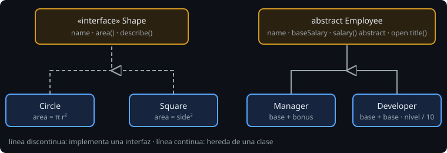

# Interfaces, herencia y composición

> Un mismo mensaje, comportamientos distintos según el objeto que lo recibe: eso es el polimorfismo, y es lo que permite que `payroll(empleados)` no sepa quién es gerente y quién programador.

## 🎯 Objetivos

- Declarar interfaces con propiedades y métodos por defecto
- Heredar con `open`, `abstract` y `override`
- Aprovechar el polimorfismo y los *smart casts*
- Elegir entre interfaz, herencia y composición
- Delegar con `by`

## 1. Interfaces



```kotlin
interface Shape {
    val name: String                       // propiedad abstracta
    fun area(): Double                     // método abstracto
    fun describe(): String = "$name con área ${area().format2()}"   // por defecto
}

class Square(val side: Double) : Shape {
    override val name: String = "Cuadrado"
    override fun area(): Double = side * side
}
```

- Una interfaz describe **qué** sabe hacer algo, no cómo. No guarda estado (sus propiedades no tienen campo).
- Una clase puede implementar **varias** interfaces. Si dos traen el mismo método por defecto, la clase debe resolver el conflicto (`super<A>.f()`).
- `override` es obligatorio al implementar.

## 2. Herencia

En Kotlin **todas las clases son `final` por defecto**: no se pueden heredar a menos que digas `open`. Es una decisión deliberada: heredar acopla, y debe ser consciente.

```kotlin
abstract class Employee(val name: String, val baseSalary: Double) {
    abstract fun salary(): Double          // las subclases deben implementarla
    open fun title(): String = "Empleado"  // pueden sustituirla
}

class Manager(name: String, baseSalary: Double, val bonus: Double) : Employee(name, baseSalary) {
    override fun salary(): Double = baseSalary + bonus
    override fun title(): String = "Gerente"
}
```

| Palabra | Significa |
| --- | --- |
| `open` | Se puede heredar / sobrescribir |
| `abstract` | Sin implementación; la clase no se puede instanciar |
| `override` | Sustituye un miembro heredado (sigue siendo `open` salvo que pongas `final`) |
| `super.f()` | Llama a la versión de la clase padre |

La subclase debe llamar al constructor de la clase padre: `: Employee(name, baseSalary)`.

## 3. Polimorfismo

```kotlin
fun payroll(employees: List<Employee>): Double = employees.sumOf { it.salary() }
```

`payroll` no sabe si recibe un `Manager` o un `Developer`: llama a `salary()` y cada objeto responde según su clase. Añadir un tipo nuevo de empleado **no obliga a tocar** `payroll`. Esa es la ventaja.

### Preguntar por el tipo

```kotlin
fun describe(s: Shape): String =
    if (s is Circle) "radio ${s.radius}"     // smart cast: aquí s ya es Circle
    else s.describe()

val c = s as? Circle                          // Circle? : null si no lo es
```

`is` comprueba; tras comprobar, el compilador trata el valor como ese tipo (*smart cast*). `as?` convierte sin lanzar. Si te ves preguntando `is` por muchos tipos, probablemente falte un método en la interfaz.

## 4. ¿Interfaz, herencia o composición?

| Situación | Usa |
| --- | --- |
| Distintas clases "saben hacer lo mismo" | Interfaz |
| Una base con estado y lógica común, y una relación "es un" clara | Clase `abstract`/`open` |
| Quieres reutilizar comportamiento de otro objeto | **Composición**: tenerlo como propiedad |

"Prefiere composición sobre herencia": heredar te ata a la implementación del padre; componer, solo a su interfaz. Kotlin ayuda con la **delegación**:

```kotlin
interface Logger { fun log(msg: String) }
class ConsoleLogger : Logger { override fun log(msg: String) = println(msg) }

class Service(logger: Logger) : Logger by logger      // reenvía log() a "logger"
```

`by` genera por ti los métodos que reenvían a otro objeto.

## 5. Errores frecuentes

| Error | Causa | Arreglo |
| --- | --- | --- |
| `This type is final, so it cannot be inherited from` | La clase padre no es `open` | `open` (o `abstract`) |
| `'x' hides member of supertype and needs 'override' modifier` | Mismo nombre que un miembro heredado | `override` |
| `Class 'X' is not abstract and does not implement abstract member` | Falta implementar | Implementa todo lo abstracto |
| `Cannot create an instance of an abstract class` | `Employee(...)` directamente | Instancia una subclase |
| `Smart cast to 'X' is impossible` | La propiedad es `var` o puede cambiar | Copia a un `val` local |

## ✅ Qué debes saber al terminar

- Interfaz (qué), clase abstracta (qué + algo de cómo), composición (usar otro objeto).
- Todo es `final` hasta que dices `open`.
- `override`, `abstract`, `super`.
- Polimorfismo y `is`/`as?`.
- Delegación con `by`.
