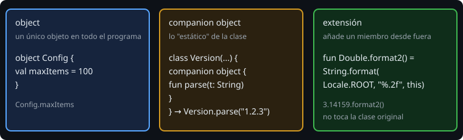

# `object`, `companion` y extensiones

> Tres herramientas que sustituyen a lo que en otros lenguajes se llama `static`, singleton y "utilidades": un objeto único, lo que pertenece a la clase misma, y funciones que se añaden a un tipo desde fuera.

## 🎯 Objetivos

- Declarar un `object` y un `companion object`
- Usar una fábrica en el companion (`Version.parse`)
- Escribir funciones y propiedades de extensión
- Implementar `Comparable` y sobrecargar operadores con criterio

## 1. `object`: un único objeto



```kotlin
object Config {
    const val MAX_ITEMS = 100
    var verbose = false
}

Config.MAX_ITEMS
```

Un `object` se crea una sola vez, de forma segura, la primera vez que se usa. Sirve para configuraciones fijas y para implementaciones sin estado. Un `object` con estado mutable global es un **estado compartido escondido**: dificulta los tests. Úsalo con moderación.

`const val` solo vale para tipos primitivos y `String`, y su valor debe conocerse al compilar.

## 2. `companion object`

Lo que en otros lenguajes es `static` aquí vive en el **companion**: un objeto asociado a la clase.

```kotlin
data class Version(val major: Int, val minor: Int, val patch: Int) : Comparable<Version> {
    companion object {
        fun parse(text: String): Version? {
            val p = text.split(".").map { it.toIntOrNull() ?: return null }
            if (p.size != 3 || p.any { it < 0 }) return null
            return Version(p[0], p[1], p[2])
        }
    }
}

Version.parse("1.2.3")       // se llama sobre la clase, no sobre una instancia
```

Una fábrica con nombre (`parse`, `of`, `fromLines`) tiene dos ventajas sobre un constructor: **puede devolver `null`** o un error cuando la entrada no es válida, y su nombre dice lo que hace. Es la forma habitual de crear objetos desde datos externos.

## 3. Funciones y propiedades de extensión

```kotlin
fun Double.format2(): String = String.format(Locale.ROOT, "%.2f", this)
val String.isCode: Boolean get() = Regex("[A-Z]{3}-[0-9]{3}").matches(this)

3.14159.format2()      // "3.14"
"ABC-123".isCode       // true
```

- Se declaran fuera de la clase y parecen miembros. Dentro, `this` es el **receptor** (el valor sobre el que se llama).
- **No** modifican la clase: se resuelven por el tipo declarado y **no pueden acceder a lo privado**. No sirven para romper la encapsulación.
- Son ideales para pequeñas utilidades de tipos que no controlas (`String`, `Double`, `List`) y para aislar el vocabulario del dominio (`Observation.level`).
- Si ya existe un miembro con la misma firma, **gana el miembro**.

## 4. `Comparable` y operadores

```kotlin
data class Version(val major: Int, val minor: Int, val patch: Int) : Comparable<Version> {
    override fun compareTo(other: Version): Int =
        compareValuesBy(this, other, { it.major }, { it.minor }, { it.patch })
}

listOf(Version(1, 10, 0), Version(1, 2, 0)).sorted()    // 1.2.0, 1.10.0
Version(2, 0, 0) > Version(1, 99, 99)                    // true
```

- Implementar `Comparable<T>` da orden natural: `sorted()`, `max()`, `<`, `>`.
- `compareValuesBy` compara por varias claves en cascada.
- **Operadores**: `operator fun plus(other: Point): Point` habilita `a + b`. Hay equivalentes para `-`, `*`, `[]` (`get`), `()` (`invoke`)... Sobrecárgalos solo cuando el significado sea obvio (sumar puntos sí; sumar dos observaciones, no).

## 5. Errores frecuentes

| Error | Causa | Arreglo |
| --- | --- | --- |
| `Version.parse` no se encuentra | Está fuera del `companion object` | Muévelo dentro |
| `Modifier 'const' is not applicable` | `const val` con un objeto o una lista | `val` normal |
| Un test afecta a otro | Un `object` guarda estado mutable | Pasa el estado como dependencia |
| La extensión "no funciona" | Hay un miembro con el mismo nombre | Renombra la extensión |
| `Cannot access 'x': it is private` desde una extensión | Las extensiones no ven lo privado | Expón lo necesario con un miembro público |

## ✅ Qué debes saber al terminar

- `object` para un único objeto; `companion object` para lo de la clase.
- Fábricas en el companion que pueden devolver `null`.
- Extensiones: cómodas, pero no rompen la encapsulación.
- `Comparable` y cuándo sobrecargar un operador.
