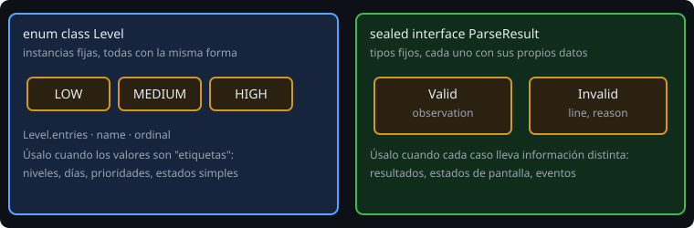
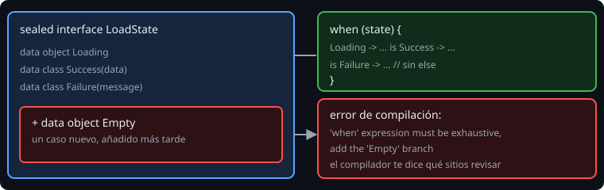

# Jerarquías selladas (`sealed`)

> Un enum dice "uno de estos valores". Una jerarquía sellada dice "uno de estos **tipos**, cada uno con sus propios datos". Es la herramienta para representar resultados, estados y eventos sin `null` ni banderas.

## 🎯 Objetivos

- Declarar una `sealed interface` con `data class` y `data object`
- Escribir un `when` exhaustivo sobre una jerarquía sellada
- Modelar estados y resultados con tipos en lugar de banderas
- Elegir entre `enum`, `sealed` y herencia abierta

## 1. El problema

Una lectura de una línea puede salir bien o mal. Con tipos sueltas, el resultado suele ser un `Observation?`: si es `null`, no sabes **por qué** falló. Con banderas:

```kotlin
class ParseResult(val ok: Boolean, val observation: Observation?, val reason: String?)
```

Esto permite estados imposibles (`ok = true` con `observation = null`). Una jerarquía sellada los hace **irrepresentables**.

## 2. `sealed interface`



```kotlin
sealed interface ParseResult {
    data class Valid(val observation: Observation) : ParseResult
    data class Invalid(val line: String, val reason: String) : ParseResult
}
```

- `sealed` significa que **todas las implementaciones están en el mismo paquete y módulo**, y se conocen al compilar. Nadie puede añadir una más desde fuera.
- Cada caso lleva **sus** datos: `Valid` tiene la observación; `Invalid`, la línea y el motivo. No hay campos que sobren.
- Un caso sin datos es un `data object` (singleton con `toString` legible): `data object Loading`.
- Funciona con `sealed class` si necesitas estado o constructor compartido; con `sealed interface` es más flexible (un tipo puede implementar varias).

## 3. `when` exhaustivo



```kotlin
fun describe(r: ParseResult): String = when (r) {
    is ParseResult.Valid -> "OK ${r.observation.code}"      // r ya es Valid (smart cast)
    is ParseResult.Invalid -> "descartada: ${r.reason}"
}
```

Sin `else`. Dentro de cada rama, el compilador **conoce el tipo concreto**, así que accedes a `r.observation` sin conversiones. Si añades `data object Skipped : ParseResult`, todos los `when` que no lo traten **dejan de compilar**.

Con `data object` no hace falta `is`: `LoadState.Loading -> ...`.

## 4. Estados de pantalla

El uso más común en Android:

```kotlin
sealed interface LoadState {
    data object Loading : LoadState
    data class Success(val data: List<String>) : LoadState
    data class Failure(val message: String) : LoadState
}
```

La interfaz solo puede estar en **un** estado a la vez, y cada estado trae lo que necesita. Más adelante, un `StateFlow<LoadState>` y un `when` en Compose dibujan la pantalla correcta (semana 28).

## 5. `enum`, `sealed` o herencia abierta

| Necesito | Uso |
| --- | --- |
| Un conjunto fijo de valores, todos iguales en forma | `enum` |
| Un conjunto fijo de casos, cada uno con datos distintos | `sealed` |
| Que cualquiera pueda añadir implementaciones (plugins) | `interface` o `open class` |

## 6. Errores frecuentes

| Error | Causa | Arreglo |
| --- | --- | --- |
| `'when' expression must be exhaustive` | Falta una rama | Añádela, o `else` si es lo que quieres |
| Subclase fuera del paquete | `sealed` exige el mismo paquete y módulo | Muévela |
| `Unresolved reference` a un dato en una rama | No hay smart cast (`when` sin `is`) | `is Caso ->` |
| Un `else` oculta un caso nuevo | `else` en un `when` sealed | Quita el `else` |
| `data class` sin parámetros | No se permite | `data object` |

## ✅ Qué debes saber al terminar

- `sealed` = tipos cerrados, cada uno con sus datos.
- `when` exhaustivo, sin `else`, con smart cast.
- Estados y resultados como tipos, no como banderas.
