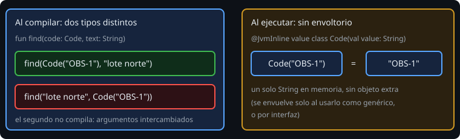

# Value classes: tipos que no se confunden

> Dos `String` valen igual para el compilador aunque uno sea un código y otro, un email. Una `value class` los separa sin pagar por ello en memoria.

## 🎯 Objetivos

- Explicar la "obsesión por los primitivos" y por qué es un riesgo
- Declarar una `value class` con validación
- Saber qué garantiza en tiempo de ejecución y cuándo se "envuelve"
- Distinguir `value class` de `typealias` y de `data class`

## 1. El problema

```kotlin
fun find(code: String, text: String): Observation? = ...

find("lote norte", "OBS-001")      // compila... y busca al revés
```

Todo es `String`: el compilador no sabe que son cosas distintas. Esto se llama **obsesión por los primitivos**, y los errores aparecen en ejecución, muchas veces lejos de su causa.

## 2. `value class`



```kotlin
@JvmInline
value class Code(val value: String) : Comparable<Code> {
    init { require(value.isNotBlank()) { "code en blanco" } }
    override fun compareTo(other: Code): Int = value.compareTo(other.value)
    override fun toString(): String = value
}

fun find(code: Code, text: String): Observation? = ...
find(Code("OBS-001"), "lote norte")      // ok
find("lote norte", Code("OBS-001"))      // no compila
```

- Tiene **una sola propiedad**, declarada en el constructor primario y `val`.
- Puede validar en `init`: un `Code` en blanco **no existe**, igual que una `Observation` inválida.
- Puede tener métodos, propiedades calculadas y implementar interfaces. **No puede heredar** ni ser heredada.
- Se compara **por valor**: `Code("A") == Code("A")`.

## 3. Qué pasa en ejecución

En la mayoría de los usos, el `Code` desaparece y el programa trabaja con el `String` que contiene: **sin objeto extra, sin coste**. Se "envuelve" en un objeto real cuando se usa como tipo **genérico** (`List<Code>`) o a través de una **interfaz**, y también como **nulable** si el valor que contiene es un primitivo (`Meters?` sobre un `Double`); un `Code?` sobre un `String` no se envuelve. Aun así, la seguridad de tipos en compilación se mantiene siempre.

`@JvmInline` es obligatorio en la JVM. Una consecuencia: los nombres de funciones que reciben una value class se modifican para Java (*name mangling*), por lo que llamarlas desde código Java es incómodo. En Android con Kotlin no importa.

## 4. ¿`value class`, `typealias` o `data class`?

| Herramienta | Qué crea | Tipo nuevo | Evita mezclar |
| --- | --- | --- | --- |
| `typealias Code = String` | Un **alias**: otro nombre para el mismo tipo | No | No: `Code` y `String` siguen siendo intercambiables |
| `value class Code(val value: String)` | Un tipo nuevo, sin coste habitual | Sí | Sí |
| `data class Code(val value: String)` | Un tipo nuevo, siempre con objeto | Sí | Sí, pero con coste en memoria |

Usa `value class` para envolver **un** valor con significado y reglas: identificadores, cantidades con unidad (`Meters`), emails, importes.

## 5. Cuándo merece la pena

- El valor tiene **reglas** (no vacío, no negativo, formato).
- Se **confunde fácilmente** con otro del mismo tipo base.
- Se pasa por muchas funciones.

No la uses para todo: un `Int` que es "un contador local" no necesita un tipo propio.

## 6. Errores frecuentes

| Error | Causa | Arreglo |
| --- | --- | --- |
| `Value class must have exactly one primary constructor parameter` | Dos propiedades | Una `data class` |
| `Value class cannot extend classes` | Intentas heredar | Implementa una interfaz o compón |
| `Value classes require @JvmInline` | Falta la anotación | `@JvmInline` |
| Pensar que `typealias` protege | Es solo un nombre | `value class` |
| Esperar `0` objetos siempre | Se envuelve en genéricos, interfaces y nulables de primitivos | Es normal; sigue siendo seguro |

## ✅ Qué debes saber al terminar

- La obsesión por los primitivos y su remedio.
- `@JvmInline value class` con una propiedad y validación en `init`.
- Sin coste habitual, con envoltorio en nulables, genéricos e interfaces.
- `typealias` no crea un tipo nuevo.
