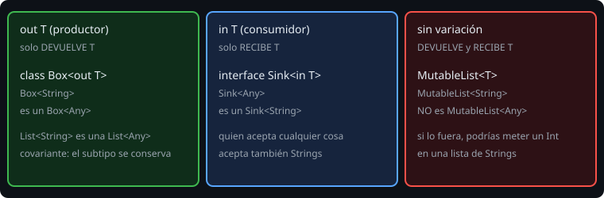

# Genéricos

> Una `List<String>` y una `List<Int>` son la misma idea con tipos distintos. Los genéricos permiten escribir esa idea **una vez**, y que el compilador compruebe los tipos en cada uso.

## 🎯 Objetivos

- Declarar clases y funciones genéricas
- Restringir un parámetro de tipo con `: Comparable<T>` y `where`
- Entender `out` e `in` (varianza) y por qué `MutableList` es invariante
- Usar `reified` con `inline` para conservar el tipo en ejecución

## 1. Clases y funciones genéricas

```kotlin
class Stack<T> {
    private val items = mutableListOf<T>()
    fun push(item: T) { items.add(item) }
    fun popOrNull(): T? = items.removeLastOrNull()
}

val s = Stack<Int>()
s.push(3)
s.push("tres")      // no compila: T es Int

fun <T> firstOrDefault(list: List<T>, default: T): T = list.firstOrNull() ?: default
```

`T` es un **parámetro de tipo**: se sustituye en cada uso. El compilador **infiere** el tipo casi siempre: `firstOrDefault(listOf(1), 0)` no necesita `<Int>`.

## 2. Restricciones

Sin restricción, `T` solo sabe lo que sabe `Any?`. Para poder comparar, hay que decirlo:

```kotlin
fun <T : Comparable<T>> maxOfTwo(a: T, b: T): T = if (a >= b) a else b

maxOfTwo(3, 9)               // 9
maxOfTwo("a", "b")           // "b"
maxOfTwo(Code("A"), Code("B"))   // funciona porque Code es Comparable<Code>
```

`T : Comparable<T>` es la **cota superior**: T debe ser comparable consigo mismo. Para varias cotas:

```kotlin
fun <T> copyIfBig(x: T) where T : CharSequence, T : Comparable<T> { ... }
```

## 3. Varianza



¿Es una `List<String>` una `List<Any>`? Depende de si la lista **produce** o **consume** el tipo.

| Declaración | Significa | Ejemplo |
| --- | --- | --- |
| `class Box<out T>` | Solo **devuelve** T (productor): `Box<String>` es un `Box<Any>` | `List<out E>` |
| `interface Sink<in T>` | Solo **recibe** T (consumidor): `Sink<Any>` es un `Sink<String>` | `Comparable<in T>` |
| `class X<T>` | Devuelve y recibe: sin relación entre `X<String>` y `X<Any>` | `MutableList<T>` |

`MutableList<String>` no es `MutableList<Any>` porque si lo fuera podrías hacer `lista.add(5)` en una lista de textos. Por eso `List` (solo lectura) es covariante y `MutableList` es invariante.

Con `out`, el compilador te **prohíbe** usar T en posición de entrada (un parámetro de método): garantiza el contrato. Regla: el que **produce** T lleva `out`; el que **consume** T lleva `in`.

`Nothing` es el subtipo de todo, por eso `Err : Outcome<Nothing>` encaja en cualquier `Outcome<T>` cuando `Outcome` es `out T`.

## 4. Borrado de tipos y `reified`

En la JVM los genéricos **se borran** al ejecutar: no puedes preguntar `x is T` dentro de una función genérica normal. Con `inline` y `reified` el compilador copia el cuerpo en cada llamada con el tipo real:

```kotlin
inline fun <reified T> List<*>.countOfType(): Int = count { it is T }

listOf("a", 1, "b").countOfType<String>()      // 2
```

- `reified` solo funciona con funciones `inline`.
- `List<*>` (proyección estrella) es "una lista de algo que no sé", de la que solo se puede leer como `Any?`.
- Una `inline fun` con una lambda también evita crear el objeto de la lambda; por eso `map` y `filter` son `inline`.

## 5. Un resultado genérico

```kotlin
sealed interface Outcome<out T> {
    data class Ok<T>(val value: T) : Outcome<T>
    data class Err(val message: String) : Outcome<Nothing>
}

fun <T, R> Outcome<T>.map(transform: (T) -> R): Outcome<R> = when (this) {
    is Outcome.Ok -> Outcome.Ok(transform(value))
    is Outcome.Err -> this          // un Err no depende de T
}
```

Combina `sealed`, genéricos, varianza y extensiones. La biblioteca estándar trae algo parecido: `Result<T>`.

## 6. Errores frecuentes

| Error | Causa | Arreglo |
| --- | --- | --- |
| `Type mismatch: required List<Any>, found MutableList<String>` | Invarianza | Pide `List<Any>` (solo lectura) |
| `Type parameter T is declared as 'out' but occurs in 'in' position` | `out T` como parámetro de método | Quita `out` o cambia el diseño |
| `Cannot use 'T' as reified type parameter` | La función no es `inline` | `inline fun <reified T>` |
| `Unresolved reference: compareTo` | `T` sin restricción | `T : Comparable<T>` |
| `Cannot check for instance of erased type` | `is List<String>` en ejecución | `is List<*>` |

## ✅ Qué debes saber al terminar

- Clases y funciones genéricas, con inferencia.
- Cotas superiores (`T : Comparable<T>`).
- `out` para productores, `in` para consumidores, invariantes por defecto.
- `inline` + `reified` para preguntar por el tipo.
