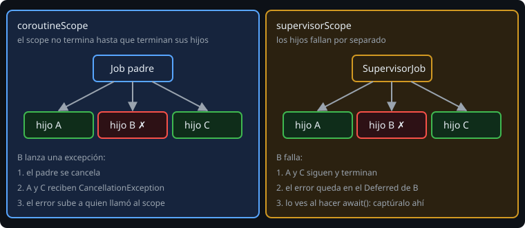

# Suspend, launch y async

> Un hilo cuesta memoria y no se puede tener un millón. Una coroutine es un trabajo que puede **pausarse sin ocupar un hilo** y continuar después. Esta lección enseña a escribirlas y, sobre todo, a no dejarlas sueltas.

## 🎯 Objetivos

- Declarar y llamar funciones `suspend`
- Lanzar trabajo con `launch` y `async` y esperar su resultado
- Explicar qué es la **concurrencia estructurada**
- Ejecutar varias llamadas a la vez con `coroutineScope`

## 1. `suspend`: una función que puede pausarse

```kotlin
suspend fun loadName(id: Int): String {
    delay(100)              // pausa 100 ms SIN bloquear el hilo
    return "visita-$id"
}
```

`suspend` solo dice: "esta función puede pausarse". Por eso solo se llama desde **otra función `suspend`** o desde una coroutine. No crea hilos ni hace nada en segundo plano por sí sola.

| | `Thread.sleep(100)` | `delay(100)` |
| --- | --- | --- |
| El hilo mientras espera | bloqueado, no hace nada | libre para otras coroutines |
| Se puede cancelar | no | sí |

## 2. Un punto de entrada: `runBlocking`

`main` no es `suspend` (en una app Android las coroutines las arrancan `viewModelScope` y compañía; llegan en la fase 3). Para probar en un `main` se usa `runBlocking`: **bloquea** el hilo actual hasta que terminan sus coroutines.

```kotlin
fun main() = runBlocking {
    println(loadName(1))
}
```

Úsalo solo en `main` y en pruebas. En código de verdad bloquear el hilo es justo lo que las coroutines evitan.

## 3. `launch` y `async`



| Constructor | Devuelve | Para qué |
| --- | --- | --- |
| `launch { ... }` | `Job` | Hacer algo y no esperar un valor ("dispara y olvida", pero el scope sí espera) |
| `async { ... }` | `Deferred<T>` | Calcular un valor: `await()` lo devuelve |

```kotlin
coroutineScope {
    val job = launch { sendLog() }              // no devuelve valor
    val a = async { loadName(1) }               // empieza ya
    val b = async { loadName(2) }               // empieza ya, a la vez que a
    println(a.await() + b.await())              // total: 100 ms, no 200
    job.join()                                  // esperar a un Job
}
```

La clave está en **cuándo** se llama a `await()`: si lanzas `async` y esperas en la misma línea (`async { ... }.await()`) has vuelto a hacerlo en secuencia.

## 4. Concurrencia estructurada

Toda coroutine vive dentro de un **scope**, y un scope no termina hasta que terminan todas sus hijas. De ahí salen tres garantías:

1. **No se pierde trabajo**: si el scope terminó, sus hijas terminaron.
2. **Si se cancela el padre, se cancelan las hijas**.
3. **Si una hija falla, el error sube al padre** (y este cancela a las demás hijas). Esto cambia con `supervisorScope`, en la lección 3.

```kotlin
suspend fun <T> fetchAll(ids: List<Int>, fetch: suspend (Int) -> T): List<T> = coroutineScope {
    ids.map { async { fetch(it) } }.awaitAll()      // todas a la vez, resultados en orden
}
```

`coroutineScope { }` crea un scope **dentro** de una función `suspend`, espera a sus hijas y relanza sus errores. Es el bloque que más vas a usar.

## 5. `GlobalScope`: no

`GlobalScope.launch { }` lanza una coroutine sin padre: nadie la cancela, nadie espera su resultado y su error se pierde. Kotlin lo marca como API delicada (`@DelicateCoroutinesApi`). Si necesitas una coroutine "más larga" que la función actual, recibe un `CoroutineScope` como parámetro o define uno con dueño.

## 6. Errores frecuentes

| Error | Causa | Arreglo |
| --- | --- | --- |
| `Suspend function 'x' should be called only from a coroutine or another suspend function` | Llamada a `suspend` desde código normal | Hazla `suspend` o llámala dentro de `launch`/`runBlocking` |
| Las llamadas van una tras otra | `await()` justo después de `async` | Lanza todos los `async` primero, espera después |
| El programa termina antes de que la coroutine haga nada | `launch` en `GlobalScope` o scope sin esperar | Usa `coroutineScope` o espera con `join()` |
| `Unresolved reference: launch` | Falta la dependencia o el `import` | `kotlinx-coroutines-core` y `import kotlinx.coroutines.launch` |
| La app se congela | `runBlocking` en el hilo de la interfaz | Nunca; usa un scope con dueño |

## ✅ Qué debes saber al terminar

- `suspend` pausa sin bloquear; `delay` no es `Thread.sleep`.
- `launch` devuelve un `Job`, `async` un `Deferred` con `await()`.
- Un scope espera a todas sus hijas; cancelar al padre cancela a las hijas.
- `coroutineScope { ids.map { async { ... } }.awaitAll() }` ejecuta en paralelo y conserva el orden.
