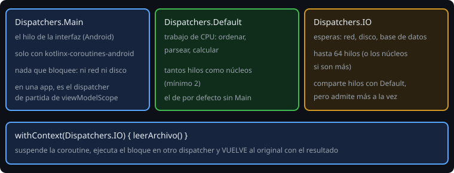

# Dispatchers y contexto

> Una coroutine no es un hilo, pero **corre en uno**. El `Dispatcher` decide cuál. Elegirlo bien es la diferencia entre una app fluida y una congelada.

## 🎯 Objetivos

- Distinguir `Main`, `Default` e `IO`
- Cambiar de dispatcher con `withContext`
- Entender qué es un `CoroutineContext` y cómo se combina
- Recibir el dispatcher como parámetro para poder probar el código

## 1. Los tres dispatchers



| Dispatcher | Para | Detalle |
| --- | --- | --- |
| `Dispatchers.Default` | CPU: ordenar, parsear, calcular | Tantos hilos como núcleos (mínimo 2). Es el de por defecto |
| `Dispatchers.IO` | Esperar: red, disco, base de datos | Hasta 64 hilos; comparte hilos con `Default` |
| `Dispatchers.Main` | Interfaz de Android | Solo existe con `kotlinx-coroutines-android` (fase 3) |

Un bucle que calcula no gana nada con `IO`; una lectura de red tampoco con `Default` si hay muchas a la vez. La regla práctica: **esperar → IO, calcular → Default**.

## 2. `withContext`: cambiar de hilo y volver

```kotlin
suspend fun readLines(path: String): List<String> =
    withContext(Dispatchers.IO) {
        File(path).readLines()          // bloqueante: por eso va en IO
    }
```

`withContext` suspende la coroutine, ejecuta el bloque en el dispatcher indicado y **vuelve al original** con el resultado. Quien llama no necesita saber qué dispatcher se usa dentro: la función es **segura para llamar desde cualquier hilo** (*main-safe*). Es la convención que seguirás en toda la fase de arquitectura.

## 3. El contexto

Un `CoroutineContext` es un conjunto de elementos con clave, y se combina con `+`:

```kotlin
val scope = CoroutineScope(SupervisorJob() + Dispatchers.Default + CoroutineName("sync"))
```

| Elemento | Qué aporta |
| --- | --- |
| `Job` / `SupervisorJob` | La jerarquía y la cancelación |
| `CoroutineDispatcher` | En qué hilo corre |
| `CoroutineName` | Un nombre que aparece en depuración |
| `CoroutineExceptionHandler` | Qué hacer con un error no capturado |

Una hija **hereda** el contexto de su padre y puede cambiar partes: `launch(Dispatchers.IO) { ... }` conserva el `Job` padre pero cambia el dispatcher. Dentro de una función `suspend` puedes leer el contexto actual con `coroutineContext`.

## 4. Inyecta el dispatcher

Un `Dispatchers.IO` escrito a mano dentro de una clase obliga a que las pruebas usen hilos reales. La alternativa es recibirlo:

```kotlin
class Importer(private val io: CoroutineDispatcher = Dispatchers.IO) {
    suspend fun load(path: String): List<String> = withContext(io) { File(path).readLines() }
}
```

En producción nadie cambia nada; en una prueba se pasa un dispatcher de prueba (lección 5).

## 5. Limitar el paralelismo

`Dispatchers.IO.limitedParallelism(4)` crea una "vista" que usa como máximo 4 hilos a la vez. Útil cuando un recurso admite pocas conexiones. Para limitar **coroutines** (no hilos) se usa un `Semaphore` (lección 4).

## 6. Errores frecuentes

| Error | Causa | Arreglo |
| --- | --- | --- |
| La interfaz se congela | Trabajo bloqueante en `Main` | `withContext(Dispatchers.IO)` |
| `Module with the Main dispatcher is missing` | Usar `Dispatchers.Main` sin la dependencia (o en una prueba) | En una app, `kotlinx-coroutines-android`; en una prueba, `Dispatchers.setMain` |
| La prueba tarda segundos de verdad | `delay` en un dispatcher real | `runTest` con tiempo virtual (lección 5) |
| El resultado llega en otro orden | Se asume que el dispatcher mantiene el orden | Espera con `await`, no supongas |
| `withContext` dentro de un bucle muy caliente | Cada cambio de contexto cuesta | Cambia de dispatcher una vez, fuera del bucle |

## ✅ Qué debes saber al terminar

- Esperar → `IO`, calcular → `Default`, interfaz → `Main`.
- `withContext` cambia de dispatcher y vuelve; una función así es *main-safe*.
- El contexto se compone con `+` y las hijas lo heredan.
- Recibe el dispatcher como parámetro para poder probar.
