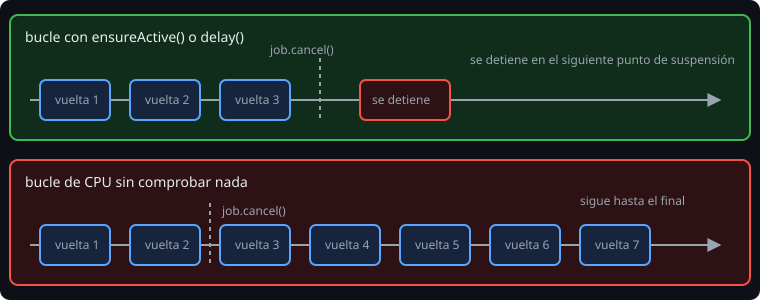

# Cancelación y excepciones

> Cancelar no mata una coroutine: **le pide que pare**, y ella tiene que colaborar. Entender esto evita fugas, trabajo inútil y los errores más raros de Kotlin asíncrono.

## 🎯 Objetivos

- Cancelar con `cancel` y esperar con `join` / `cancelAndJoin`
- Hacer cooperativo un bucle de CPU con `ensureActive`
- Poner tiempo límite con `withTimeout` y `withTimeoutOrNull`
- Limpiar recursos con `try/finally` y `NonCancellable`
- Elegir entre `coroutineScope` y `supervisorScope`, y saber qué hace un `CoroutineExceptionHandler`

## 1. La cancelación es cooperativa



`job.cancel()` marca la coroutine como cancelada. Se detiene en el siguiente **punto de suspensión** cancelable (`delay`, `await`, `withContext`, `send`...), donde se lanza una `CancellationException`. Un bucle de CPU sin suspensiones **no se entera**:

```kotlin
for (item in items) {
    ensureActive()          // lanza CancellationException si ya la cancelaron
    process(item)
}
```

Alternativas: `yield()` (también cede el hilo) o comprobar `isActive`. Dentro de una función `suspend`, `coroutineContext.ensureActive()` hace lo mismo.

## 2. `CancellationException` no es un error

Es la **señal** de cancelación. Se propaga hacia arriba sin que el padre se considere fallado. Por eso este código es un fallo clásico:

```kotlin
try {
    fetch()
} catch (e: Exception) {            // también atrapa CancellationException
    log(e)
}
```

La coroutine sigue "viva" aunque la hayan cancelado. Las dos salidas correctas:

```kotlin
catch (e: CancellationException) { throw e }     // relanzarla primero
catch (e: Exception) { log(e) }
```

Lo mismo vale para `runCatching`, que también atrapa la cancelación: no lo uses alrededor de código `suspend` sin tenerlo en cuenta.

## 3. Tiempo límite

```kotlin
val data = withTimeoutOrNull(2_000) { fetch() }     // null si tarda más
val data = withTimeout(2_000) { fetch() }           // lanza TimeoutCancellationException
```

`TimeoutCancellationException` **es** una `CancellationException`: si la atrapas con un `catch (e: CancellationException)` para "relanzar todo", un tiempo agotado se propagará como si fuera una cancelación ajena. Para un valor por defecto, `withTimeoutOrNull` es más limpio.

## 4. Limpiar al cancelar

`finally` se ejecuta aunque cancelen la coroutine, pero **dentro de una coroutine cancelada cualquier suspensión cancelable lanza al instante**. Para limpiar con suspensión hace falta `NonCancellable`:

```kotlin
suspend fun withResource(block: suspend () -> Unit) {
    open()
    try {
        block()
    } finally {
        withContext(NonCancellable) {       // este bloque no se interrumpe
            close()                         // puede suspender
        }
    }
}
```

Úsalo solo para limpieza breve: es una zona donde la cancelación no funciona.

## 5. Excepciones: `coroutineScope` frente a `supervisorScope`

| | `coroutineScope` | `supervisorScope` |
| --- | --- | --- |
| Falla una hija | Cancela a las demás y relanza el error | Las demás siguen |
| Dónde ves el error | En quien llamó al scope | En el `Deferred` (`await`) de esa hija |
| Úsalo cuando | Todas las partes hacen falta o ninguna | Las partes son independientes |

```kotlin
suspend fun runAll(tasks: List<suspend () -> Int>): List<Result<Int>> = supervisorScope {
    tasks.map { async { it() } }.map { runCatching { it.await() } }
}
```

Con `async`, el error **espera** en el `Deferred` hasta que llamas a `await`. Con `launch`, el error sube enseguida.

## 6. `CoroutineExceptionHandler`

Es la red de seguridad para una excepción **que nadie capturó** en una coroutine `launch` raíz. No sirve para recuperarse: sirve para anotar.

```kotlin
val handler = CoroutineExceptionHandler { _, e -> errors += e.message ?: "sin mensaje" }
val scope = CoroutineScope(SupervisorJob() + handler)
```

Dos reglas que sorprenden:

- Solo funciona en la coroutine **raíz** del scope. Puesto en un `launch` hijo, se ignora y el error sube al padre.
- No atrapa nada de `async`: ese error espera al `await`.

## 7. Errores frecuentes

| Error | Causa | Arreglo |
| --- | --- | --- |
| Cancelan y la coroutine sigue | Bucle sin puntos de suspensión | `ensureActive()` en cada vuelta |
| `catch (e: Exception)` y la cancelación "desaparece" | Se traga `CancellationException` | Relánzala primero |
| `finally` con `delay` no espera | Coroutine ya cancelada | `withContext(NonCancellable)` |
| El `CoroutineExceptionHandler` no se llama | Está en una hija, o el error es de `async` | Ponlo en el scope raíz; captura con `await` |
| Un fallo hace caer a todas las hermanas | `coroutineScope` donde bastaba `supervisorScope` | Cambia de scope si son independientes |
| `TimeoutCancellationException` sale hasta arriba | `withTimeout` sin capturar | `withTimeoutOrNull` |

## ✅ Qué debes saber al terminar

- Cancelar es pedir; la coroutine debe colaborar (`ensureActive`, suspensiones).
- No te tragues `CancellationException`.
- `withTimeoutOrNull` para valores por defecto.
- `finally` + `NonCancellable` para limpiar con suspensión.
- `supervisorScope` cuando las hijas son independientes; el error de `async` espera al `await`.
