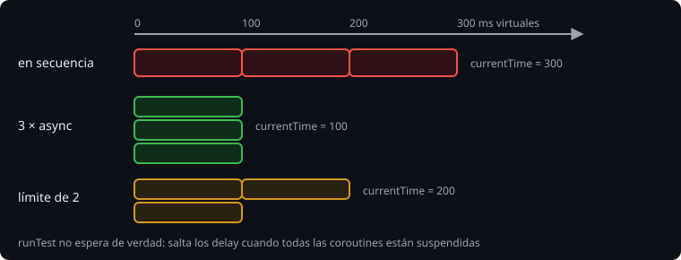

# Probar coroutines

> Una prueba con `delay(5_000)` que tarda cinco segundos de verdad es una prueba que nadie ejecuta. `runTest` trae un reloj **virtual**: salta las esperas y te dice cuánto habrían durado.

## 🎯 Objetivos

- Escribir pruebas con `runTest`
- Leer el tiempo virtual con `currentTime` y controlarlo con `advanceTimeBy`
- Probar cancelación, tiempo límite y concurrencia sin esperar
- Entender `StandardTestDispatcher` y `UnconfinedTestDispatcher`

## 1. La dependencia

```kotlin
dependencies {
    implementation(platform("org.jetbrains.kotlinx:kotlinx-coroutines-bom:1.11.0"))
    implementation("org.jetbrains.kotlinx:kotlinx-coroutines-core")
    testImplementation("org.jetbrains.kotlinx:kotlinx-coroutines-test")
}
```

Un solo BOM fija la versión de todos los artefactos de coroutines. Es la misma idea que el BOM de JUnit.

## 2. `runTest` y el tiempo virtual



```kotlin
@Test
fun fetchAllRunsInParallel() = runTest {
    val result = fetchAll(listOf(3, 1, 2)) { id -> delay(100); id * 10 }
    assertEquals(listOf(30, 10, 20), result)
    assertEquals(100, currentTime)          // en paralelo: 100 ms virtuales, no 300
}
```

Cuando todas las coroutines están suspendidas esperando un `delay`, el planificador de pruebas **adelanta el reloj** hasta la siguiente. La prueba dura milisegundos de verdad.

Eso convierte el **tiempo** en algo que se comprueba: "tres fuentes de 100 ms con paralelismo 1 tardan 300 ms" es una aserción exacta, no un `Thread.sleep` con margen.

## 3. Controlar el reloj a mano

| Función | Hace |
| --- | --- |
| `currentTime` | Milisegundos virtuales transcurridos |
| `advanceTimeBy(ms)` | Avanza el reloj; no ejecuta lo que vence justo en `ms` |
| `runCurrent()` | Ejecuta lo que vence ahora |
| `advanceUntilIdle()` | Avanza hasta que no queda nada pendiente |
| `backgroundScope` | Scope para coroutines que no terminan (se cancela solo al acabar la prueba) |

```kotlin
val ticks = mutableListOf<Int>()
val job = startCountdown(5, 100) { ticks += it }
delay(250)                  // la prueba también está en el reloj virtual
job.cancelAndJoin()
assertEquals(listOf(5, 4, 3), ticks)
```

## 4. Dispatchers de prueba

`runTest` usa un `StandardTestDispatcher`: las coroutines **no empiezan** hasta que la prueba suspende (o llamas a `runCurrent`). Es lo que quieres casi siempre, porque hace el orden predecible.

`UnconfinedTestDispatcher` ejecuta cada coroutine nada más lanzarla, sin esperar. Útil cuando solo quieres ver el efecto, no el orden.

Si tu clase recibe el dispatcher como parámetro (lección 2), pásale `StandardTestDispatcher(testScheduler)` para que comparta el reloj de la prueba. Si usa `Dispatchers.Main`, se sustituye con `Dispatchers.setMain(testDispatcher)` y se restaura con `resetMain()`.

## 5. APIs experimentales

En `1.11.0`, `currentTime` y `produce` siguen marcadas `@ExperimentalCoroutinesApi`. Como el proyecto compila con `allWarningsAsErrors`, hay que aceptarlo **de forma explícita** en el archivo que las usa:

```kotlin
@file:OptIn(ExperimentalCoroutinesApi::class)
```

Es deliberado: el compilador te obliga a decidir que usas algo que puede cambiar.

## 6. Qué probar

| Comportamiento | Cómo |
| --- | --- |
| Paralelismo | `currentTime` igual al más lento, no a la suma |
| Límite de concurrencia | Contador atómico del máximo simultáneo y `currentTime` |
| Tiempo límite | Resultado por defecto y `currentTime` igual al límite |
| Cancelación | `cancelAndJoin()` y lo que quedó hecho |
| Limpieza | Lo que escribió el `finally` y cuánto tardó |
| Error aislado | Resultados de las hermanas con `getOrNull()` |

## 7. Errores frecuentes

| Error | Causa | Arreglo |
| --- | --- | --- |
| `This declaration needs opt-in` | API experimental con `-Werror` | `@file:OptIn(ExperimentalCoroutinesApi::class)` |
| La prueba termina antes de que corra la coroutine | `StandardTestDispatcher` sin ceder | `advanceUntilIdle()`, `join()` o `delay` |
| La prueba no termina | Coroutine infinita en el scope de la prueba | `backgroundScope` |
| `currentTime` sale 0 | Todo se ejecutó sin `delay` o con un dispatcher real | Usa `delay` y el dispatcher de la prueba |
| Una prueba con `Dispatchers.Default` tarda de verdad | Los hilos reales no usan el reloj virtual | Para tiempo, inyecta el dispatcher de prueba |
| La prueba falla por tiempo máximo agotado | Una espera que nunca termina (un canal sin `close()`, un `join` de algo infinito) | Revisa qué coroutine no acaba |

## ✅ Qué debes saber al terminar

- `runTest` salta los `delay` y `currentTime` mide el tiempo virtual.
- La concurrencia, los límites y los tiempos límite se comprueban con aserciones exactas.
- `StandardTestDispatcher` es el normal; inyecta dispatchers para probar clases.
- Las APIs experimentales exigen `@OptIn` visible.
