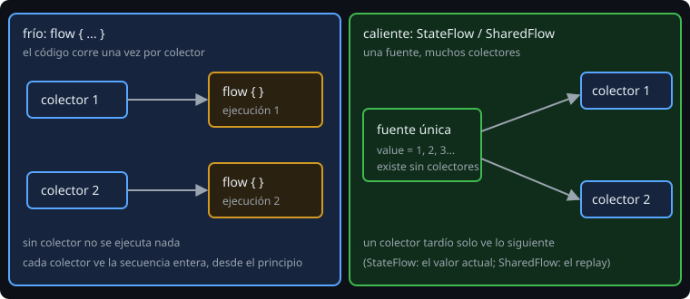

# Flujos fríos y operadores

> Una función `suspend` devuelve **un** valor. Un `Flow` devuelve **varios, a lo largo del tiempo**: lecturas de un sensor, filas de una base de datos, el progreso de una descarga. Es la pieza que la semana 6 dejó fuera.

## 🎯 Objetivos

- Crear un flujo con `flow { }`, `flowOf` y `asFlow`
- Explicar por qué un flujo es **frío**
- Encadenar operadores intermedios (`map`, `filter`, `take`, `scan`, `transform`)
- Recoger con operadores terminales (`collect`, `toList`, `first`, `fold`)

## 1. Un flujo es una receta

```kotlin
fun ticker(count: Int, periodMs: Long): Flow<Int> = flow {
    for (i in 1..count) {
        delay(periodMs)
        emit(i)                 // entrega un valor a quien esté recogiendo
    }
}
```

`ticker(3, 100)` **no ejecuta nada**: devuelve la receta. La función que lo crea ni siquiera es `suspend`. El bloque corre cuando alguien **recoge** el flujo:

```kotlin
val flow = ticker(3, 100)
flow.collect { println(it) }      // aquí empieza: 1, 2, 3
flow.collect { println(it) }      // otra vez desde cero: 1, 2, 3
```

Eso es ser **frío**: sin colector no hay trabajo, y cada colector provoca una ejecución propia. `collect` es una función `suspend`: espera hasta que el flujo termina.



## 2. Otras formas de crearlo

| Constructor | Para qué |
| --- | --- |
| `flow { emit(x) }` | Lo general; puede suspender |
| `flowOf(1, 2, 3)` | Valores ya conocidos |
| `listOf(1, 2).asFlow()` | Convertir una colección |
| `emptyFlow()` | Un flujo vacío |
| `channelFlow { send(x) }` | Cuando varias coroutines emiten (lección 5) |

## 3. Operadores intermedios

Se parecen a los de las colecciones (semana 3), pero son **perezosos** y pueden suspender:

```kotlin
flowOf(1, 2, 3, 4)
    .filter { it % 2 == 0 }
    .map { it * 10 }
    .collect { println(it) }          // 20, 40
```

| Operador | Hace |
| --- | --- |
| `map`, `filter` | Transformar y descartar |
| `take(n)`, `drop(n)` | Quedarse con los primeros n / saltarlos |
| `scan(init) { acc, x -> }` | Acumulado: emite el inicial y cada paso |
| `transform { }` | Emitir 0, 1 o varios valores por cada entrada |
| `onEach { }` | Efecto lateral sin cambiar el valor |
| `distinctUntilChanged()` | Omitir valores iguales **consecutivos** |

Un operador propio es solo una extensión de `Flow`:

```kotlin
fun Flow<Int>.runningSum(): Flow<Int> = scan(0) { acc, n -> acc + n }.drop(1)
```

## 4. Operadores terminales

Arrancan la ejecución. Son `suspend`.

| Terminal | Devuelve |
| --- | --- |
| `collect { }` | Nada; ejecuta el bloque con cada valor |
| `toList()` / `toSet()` | Todos los valores |
| `first()` / `firstOrNull { }` | El primero (que cumpla); **cancela** el origen |
| `single()` | El único valor; falla si hay 0 o más de 1 |
| `fold(init) { }` / `reduce { }` | Un solo valor acumulado |
| `launchIn(scope)` | Recoge en otra coroutine y devuelve un `Job` |

`take(n)` y `first` terminan el flujo en cuanto tienen lo que querían, y esa terminación **cancela el código de `flow { }`**: el origen no sigue emitiendo hasta cien si solo pediste seis.

## 5. Flow frente a las alternativas

| Necesitas | Usa |
| --- | --- |
| Un valor, una vez | `suspend fun f(): T` |
| Una lista completa, de golpe | `suspend fun f(): List<T>` |
| Varios valores a lo largo del tiempo | `Flow<T>` |
| Pasar datos entre coroutines concretas | `Channel` (semana 6) |

## 6. Errores frecuentes

| Error | Causa | Arreglo |
| --- | --- | --- |
| No pasa nada al llamar a la función | El flujo es frío y nadie lo recoge | `collect`, `toList`, `launchIn` |
| El código del flujo se ejecuta dos veces | Dos colectores sobre el mismo flujo frío | Es lo normal; si no lo quieres, `stateIn`/`shareIn` (lección 4) |
| `collect` no devuelve nunca | El flujo es infinito (o es un `StateFlow`) | `take(n)`, `first()` o cancelar la coroutine |
| Un `collect` bloquea el código que va después | `collect` suspende hasta el final | `launchIn(scope)` o `launch { collect }` |
| `Unresolved reference: collect` con un lambda | Import antiguo | Usa el miembro `collect { }` sin importar nada |

## ✅ Qué debes saber al terminar

- Un flujo frío es una receta: se ejecuta por cada colector y no antes.
- Los operadores intermedios son perezosos; los terminales arrancan todo.
- `take`/`first` cancelan el origen.
- Un operador propio es una extensión de `Flow<T>`.
