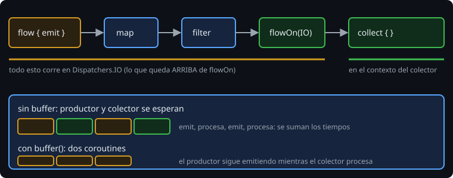

# Contexto, buffer y velocidad

> ¿En qué hilo corre cada parte de un flujo? ¿Qué pasa si el productor es más rápido que el colector? Dos preguntas con respuesta corta, y los errores de la lección 1 que se evitan sabiendo las dos.

## 🎯 Objetivos

- Explicar la **preservación del contexto** de un flujo
- Cambiar el dispatcher del origen con `flowOn`
- Elegir entre `buffer`, `conflate` y `collectLatest`
- Reconocer cuándo el productor "se espera" al colector

## 1. Un flujo corre en el contexto del colector

```kotlin
withContext(Dispatchers.Main) {
    ticker(3, 100).collect { show(it) }      // el cuerpo de flow { } corre en Main
}
```

Por defecto, `flow { }` se ejecuta en la coroutine de quien recoge. Por eso **no** se debe cambiar de contexto dentro de `flow { }`:

```kotlin
flow {
    withContext(Dispatchers.IO) { emit(readLine()) }    // IllegalStateException: Flow invariant is violated
}
```

El flujo lo prohíbe: quien recoge debe poder confiar en que los valores llegan en su contexto.

## 2. `flowOn`: cambiar el origen



```kotlin
fun readLines(path: String): Flow<String> = flow {
    File(path).forEachLine { emit(it) }          // bloqueante
}.flowOn(Dispatchers.IO)
```

`flowOn` cambia el dispatcher de **todo lo que tiene por encima** (el `flow { }` y los operadores anteriores) y no toca lo de abajo, que sigue en el contexto del colector. Quien llama no necesita saber qué hilo se usa: la función es *main-safe*, igual que con `withContext` en la semana 6.

Internamente, `flowOn` pone una coroutine y un canal entre las dos partes.

## 3. Productor rápido, colector lento

Sin ayuda, cada `emit` **espera** a que el colector termine con el valor anterior. Si emitir tarda 100 ms y procesar 300 ms, cada valor cuesta 400 ms.

| Operador | Qué pasa con lo que sobra | Úsalo cuando |
| --- | --- | --- |
| `buffer()` | Se guarda en una cola (64 por defecto); el productor sigue | Se necesitan **todos** los valores y no hay prisa |
| `conflate()` | Se descartan los intermedios; el colector ve el **último** | Solo importa el valor más reciente (un contador, una posición) |
| `collectLatest { }` | Si llega un valor nuevo, **se cancela** el bloque del anterior | Mostrar el último resultado y no terminar trabajo viejo |

```kotlin
sensor.conflate().collect { slowDraw(it) }       // dibuja lo último, se salta lo intermedio
sensor.collectLatest { slowDraw(it) }            // además cancela el dibujo en curso
```

Ninguno es "mejor": `buffer` conserva todo y puede crecer; `conflate` pierde valores a propósito. Decide por el dominio. En la Bitácora, una lista de lecturas se bufferiza; el contador de la pantalla se *conflata*.

## 4. Cuándo se nota

Con `runTest` (lección 5) el tiempo es virtual, así que se puede medir sin esperar: con productor de 100 ms por valor y colector de 300 ms, 3 valores cuestan 1 200 ms sin `buffer` y 1 000 ms con él (el productor trabaja mientras el colector procesa).

## 5. Errores frecuentes

| Error | Causa | Arreglo |
| --- | --- | --- |
| `Flow invariant is violated` | `withContext` o `launch` dentro de `flow { }` | `flowOn`, o `channelFlow` si emiten varias coroutines |
| Los operadores de después de `flowOn` siguen en el hilo del colector | `flowOn` solo afecta a lo anterior | Ponlo **después** de lo que quieres mover |
| Faltan valores con `conflate` | Es lo que hace | Usa `buffer` si los necesitas todos |
| La memoria crece | `buffer(Channel.UNLIMITED)` con productor muy rápido | Capacidad limitada y `onBufferOverflow` |
| El trabajo del colector no termina nunca | `collectLatest` cancela el bloque antes de acabar | Es lo esperado; si no, `collect` |

## ✅ Qué debes saber al terminar

- Un flujo corre en el contexto del colector; `flowOn` mueve **lo de arriba**.
- No se cambia de contexto dentro de `flow { }`.
- `buffer` guarda todo, `conflate` guarda lo último, `collectLatest` cancela lo viejo.
