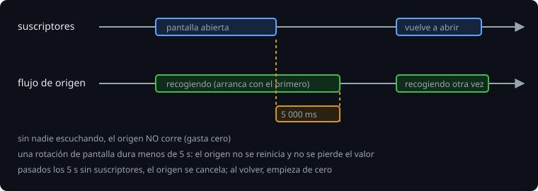

# StateFlow y SharedFlow

> Hasta ahora, cada colector tenía su propia ejecución. Para que **varios** miren el mismo dato (la lista de la Bitácora, un evento) hacen falta flujos **calientes**: existen aunque nadie los escuche.

## 🎯 Objetivos

- Modelar estado observable con `MutableStateFlow` y `update`
- Entender por qué un `StateFlow` ignora valores iguales
- Emitir eventos con `SharedFlow` y `replay`
- Convertir un flujo frío en caliente con `stateIn` y `WhileSubscribed`

## 1. `StateFlow`: un valor que se observa

```kotlin
class Counter {
    private val _count = MutableStateFlow(0)
    val count: StateFlow<Int> = _count.asStateFlow()     // solo lectura hacia fuera

    fun increment() = _count.update { it + 1 }
}
```

| Propiedad | Significa |
| --- | --- |
| Siempre tiene valor | `value` se lee sin suspender; hay que dar un valor inicial |
| Un colector recibe el **valor actual** y luego los cambios | Un colector tardío no se pierde nada importante |
| **Ignora valores iguales** (`equals`) | `value = 1` dos veces seguidas emite una sola vez |
| Nunca termina | `collect` sobre un `StateFlow` no vuelve; hay que cancelarlo |
| Es *conflated* | Un colector lento puede saltarse valores intermedios; siempre ve el último |

Por eso `StateFlow` sirve para **estado** (qué se ve ahora) y no para **eventos** (algo que ocurrió).

### `update`: atómico

`count.value = count.value + 1` es la carrera de datos de la semana 6: dos hilos leen el mismo valor. `update { }` hace la lectura, el cálculo y la escritura como una sola operación (reintenta si otro cambió el valor). Por eso **el bloque puede ejecutarse más de una vez**: no cambies nada fuera de él salvo asignar el resultado.

```kotlin
fun add(o: Observation): Boolean {
    var added = false
    _observations.update { current ->
        added = o !in current                  // se reasigna en cada reintento
        if (added) current + o else current
    }
    return added
}
```

Con una lista, usa listas **inmutables** (`current + o`, no `current.add(o)`): un `StateFlow` detecta el cambio comparando valores, y una lista mutada en sitio sería "igual" a sí misma.

## 2. `SharedFlow`: eventos

```kotlin
class EventBus(replay: Int = 0) {
    private val _events = MutableSharedFlow<String>(replay = replay)
    val events: SharedFlow<String> = _events.asSharedFlow()
    suspend fun publish(e: String) = _events.emit(e)
}
```

- Sin suscriptores y con `replay = 0`, un evento **se pierde**.
- Un suscriptor solo ve lo publicado **mientras está suscrito**; con `replay = n` recibe además los `n` últimos.
- `extraBufferCapacity` y `onBufferOverflow` deciden qué ocurre si un suscriptor va lento (por defecto, `emit` suspende).
- `tryEmit` emite sin suspender (devuelve `false` si no cabe).

| | `StateFlow` | `SharedFlow` |
| --- | --- | --- |
| Para | Estado | Eventos |
| Valor inicial | Obligatorio | No |
| Repite lo último a un suscriptor nuevo | Siempre | Según `replay` |
| Ignora valores iguales | Sí | No |

Un evento de una sola vez ("mostrar este aviso") con un `StateFlow` se pierde o se repite tras girar la pantalla. Más adelante verás `Channel` + `receiveAsFlow()` para eso; la idea de hoy es: **estado ≠ evento**.

## 3. De frío a caliente: `stateIn`

```kotlin
val state: StateFlow<List<Observation>> =
    repository.observeAll()                             // flujo frío (por ejemplo, de una base de datos)
        .stateIn(scope, SharingStarted.WhileSubscribed(5_000), emptyList())
```



| `SharingStarted` | El flujo de origen |
| --- | --- |
| `Eagerly` | Arranca ya y nunca para |
| `Lazily` | Arranca con el primer suscriptor y nunca para |
| `WhileSubscribed(ms)` | Corre mientras hay suscriptores; sigue `ms` ms tras irse el último |

`WhileSubscribed(5_000)` es la elección habitual en Android: una rotación de pantalla dura menos de 5 s, así que el origen no se reinicia; pero si la app pasa a segundo plano, el origen deja de gastar. `shareIn` hace lo mismo para un `SharedFlow`.

## 4. Errores frecuentes

| Error | Causa | Arreglo |
| --- | --- | --- |
| El `StateFlow` no emite al cambiar una lista | Se mutó la lista en sitio | Lista inmutable y `update { it + x }` |
| Un evento no llega a nadie | `SharedFlow` sin suscriptores y `replay = 0` | Suscribir antes de publicar, o `replay` |
| El aviso reaparece al volver a la pantalla | Un evento guardado en un `StateFlow` | Es estado, no evento: otra herramienta |
| `collect` en un `StateFlow` "se queda colgado" | Nunca termina | Es lo normal; lánzalo en su propia coroutine y cancélalo |
| Se pierden incrementos | `value = value + 1` desde varios hilos | `update { }` |
| El origen se reinicia en cada rotación | `Lazily`/`WhileSubscribed(0)` | `WhileSubscribed(5_000)` |

## ✅ Qué debes saber al terminar

- `StateFlow` = estado con valor inicial, ignora iguales, nunca termina.
- `update { }` es atómico y su bloque puede repetirse.
- `SharedFlow` = eventos; `replay` decide qué ve un suscriptor tardío.
- `stateIn(..., WhileSubscribed(5_000), inicial)` convierte lo frío en caliente sin gastar de más.
