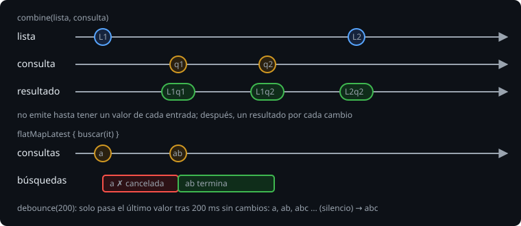

# Combinar flujos y probarlos

> Una pantalla real mezcla varias fuentes: la lista, lo que el usuario escribe, un filtro. Esta lección junta flujos con `combine`, cancela búsquedas viejas con `flatMapLatest` y los prueba con tiempo virtual.

## 🎯 Objetivos

- Combinar entradas con `combine`, `zip` y `merge`
- Esperar a que el usuario termine de escribir con `debounce`
- Cancelar trabajo obsoleto con `flatMapLatest`
- Emitir desde varias coroutines con `channelFlow`
- Probar flujos con `runTest`, `toList` y colectores en segundo plano

## 1. `combine`



```kotlin
fun searchResults(items: Flow<List<String>>, query: Flow<String>): Flow<List<String>> =
    combine(items, query) { list, q -> list.filter { it.contains(q, ignoreCase = true) } }
```

`combine` recalcula con **el último valor de cada entrada** cada vez que **cualquiera** cambia. No emite hasta que todas tienen al menos un valor (por eso con `StateFlow` funciona al momento: siempre tienen).

| Operador | Hace |
| --- | --- |
| `combine(a, b) { }` | Un resultado por cada cambio de a **o** b |
| `a.zip(b) { }` | Empareja el n-ésimo de a con el n-ésimo de b y espera |
| `merge(a, b)` | Mezcla los valores de ambos tal como llegan |

## 2. `debounce` y `distinctUntilChanged`

```kotlin
@OptIn(FlowPreview::class)
fun Flow<String>.settled(ms: Long): Flow<String> = debounce(ms).distinctUntilChanged()
```

`debounce(200)` espera 200 ms de silencio y deja pasar solo el último valor: así no buscas en cada tecla. En `1.11.0` sigue marcado como *preview*, y con `-Werror` hay que aceptarlo en el sitio de uso.

## 3. `flatMapLatest`

```kotlin
@OptIn(ExperimentalCoroutinesApi::class)
fun searchLatest(queries: Flow<String>, search: suspend (String) -> List<String>) =
    queries.flatMapLatest { q -> flow { emit(search(q)) } }
```

Cada consulta nueva **cancela** la búsqueda anterior. Sin él, una búsqueda lenta de `"a"` podría terminar **después** de la de `"ab"` y pisar el resultado bueno con uno viejo. Es el mismo principio que `collectLatest`, aplicado a la transformación.

## 4. `channelFlow`

Cuando varias coroutines tienen que emitir (una por cada fuente remota, por ejemplo), `flow { }` no sirve (viola la preservación del contexto). `channelFlow` te da un `send` seguro para concurrencia:

```kotlin
fun syncInto(sources: Map<String, ObservationSource>): Flow<SyncEvent> = channelFlow {
    for ((name, source) in sources) {
        launch { send(fetchEvent(name, source)) }       // un evento por fuente, al terminar
    }
}
```

El flujo termina cuando terminan todas las coroutines hijas. Si el colector cancela (con `take(1)`, por ejemplo), las hijas **se cancelan**: es concurrencia estructurada, la de la semana 6.

## 5. Probar flujos

La dependencia es la misma (`kotlinx-coroutines-test`), sin librerías extra.

**Flujo frío finito**: `toList()` y compara.

```kotlin
@Test
fun runningSum() = runTest {
    assertEquals(listOf(1, 3, 6, 10), flowOf(1, 2, 3, 4).runningSum().toList())
}
```

**Tiempo**: `currentTime` mide lo que tardaron los `delay` virtuales (semana 6).

**Flujo caliente o infinito**: no termina, así que se recoge en `backgroundScope` y se mira lo acumulado. Con `UnconfinedTestDispatcher` cada valor llega **al instante**, sin tener que ceder:

```kotlin
@Test
fun stateEmitsEveryChange() = runTest(UnconfinedTestDispatcher()) {
    val counter = Counter()
    val seen = mutableListOf<Int>()
    backgroundScope.launch { counter.count.collect { seen += it } }
    counter.increment()
    counter.increment()
    assertEquals(listOf(0, 1, 2), seen)
}
```

`backgroundScope` se cancela solo al acabar la prueba; así el `collect` infinito no la cuelga. Con el dispatcher estándar tendrías que llamar a `runCurrent()` para que el colector procese.

Para **cancelación**, `take(1)` y comprobar `currentTime` y los efectos: si la fuente lenta no terminó, no dejó rastro.

## 6. APIs en estado preview o experimental (1.11.0)

| API | Marca | Opt-in |
| --- | --- | --- |
| `debounce` | `@FlowPreview` | `@OptIn(FlowPreview::class)` |
| `flatMapLatest` | `@ExperimentalCoroutinesApi` | `@OptIn(ExperimentalCoroutinesApi::class)` |
| `currentTime`, `runCurrent`, `UnconfinedTestDispatcher` (en pruebas) | `@ExperimentalCoroutinesApi` | `@file:OptIn(ExperimentalCoroutinesApi::class)` |

Pon el `@OptIn` **en la función** que lo usa (o `@file:OptIn` en un archivo de pruebas), no en todo el proyecto: así se ve qué depende de algo que puede cambiar.

## 7. Errores frecuentes

| Error | Causa | Arreglo |
| --- | --- | --- |
| `combine` no emite nada | Una entrada aún no tiene valor | Dale un valor inicial (`StateFlow`, `onStart { emit(..) }`) |
| El resultado de una búsqueda vieja pisa al nuevo | Sin `flatMapLatest` | Cancelar lo obsoleto |
| La prueba no termina | `collect` de un flujo infinito en el scope de la prueba | `backgroundScope.launch { ... }` |
| `seen` está vacío tras emitir | Dispatcher estándar: el colector aún no ha corrido | `UnconfinedTestDispatcher`, o `runCurrent()` |
| `This declaration is in a preview state` | `debounce` con `-Werror` | `@OptIn(FlowPreview::class)` |
| `Flow invariant is violated` al emitir desde `launch` | `flow { launch { emit } }` | `channelFlow` |

## ✅ Qué debes saber al terminar

- `combine` recalcula con el último valor de cada entrada.
- `debounce` espera silencio; `flatMapLatest` cancela lo viejo.
- `channelFlow` permite emitir desde varias coroutines y cancela al hijo si el colector se va.
- Un flujo infinito se prueba con `backgroundScope` y un dispatcher sin esperas.
