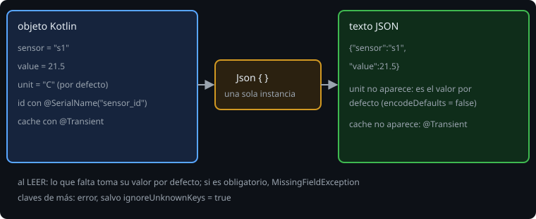

# JSON con kotlinx.serialization

> Un archivo, una respuesta de red o un dato guardado son **texto**; tu programa trabaja con **objetos**. `kotlinx.serialization` traduce entre los dos sin reflexión: el compilador genera el código en tiempo de compilación.

## 🎯 Objetivos

- Añadir el plugin y la dependencia al `build.gradle.kts`
- Convertir un objeto en JSON y de vuelta con `@Serializable`
- Controlar el formato con `@SerialName`, `@Transient`, valores por defecto y `Json { }`
- Distinguir un error de formato de un error de validación

## 1. Preparar el proyecto

```kotlin
plugins {
    kotlin("jvm") version "2.4.21"
    kotlin("plugin.serialization") version "2.4.21"     // genera los serializadores
}

dependencies {
    implementation(platform("org.jetbrains.kotlinx:kotlinx-serialization-bom:1.12.0"))
    implementation("org.jetbrains.kotlinx:kotlinx-serialization-json")
}
```

El **plugin** va con la **misma versión de Kotlin** que el compilador; la **biblioteca** tiene su propia versión (aquí 1.12.0, el BOM fija todas las piezas). Sin el plugin, `@Serializable` no hace nada.

## 2. Ida y vuelta

```kotlin
@Serializable
data class Reading(val sensor: String, val value: Double, val unit: String = "C")

val text = Json.encodeToString(Reading("s1", 21.5))     // {"sensor":"s1","value":21.5}
val back = Json.decodeFromString<Reading>(text)          // Reading(sensor=s1, value=21.5, unit=C)
```



Fíjate en que `unit` **no se escribió**: valía lo mismo que su valor por defecto. Es el comportamiento por defecto (`encodeDefaults = false`) y mantiene el JSON corto. Si quieres que aparezca siempre (por ejemplo `version` en un archivo), activa `encodeDefaults = true`.

## 3. Leer lo que no se controla

| Situación al leer | Resultado por defecto |
| --- | --- |
| Falta una propiedad **con** valor por defecto | Se usa el valor por defecto |
| Falta una propiedad **sin** valor por defecto | `MissingFieldException` |
| Hay una clave que la clase no tiene | `SerializationException` (a menos que `ignoreUnknownKeys = true`) |
| Un valor de tipo equivocado | `SerializationException` |
| `null` en una propiedad no nula | `SerializationException` |

```kotlin
private val json = Json {
    ignoreUnknownKeys = true      // un servidor puede añadir campos sin romperte
    encodeDefaults = true
}
```

Crea **una sola** instancia de `Json` y reutilízala. Con `-Werror` el compilador avisa si la creas en cada llamada: `Redundant creation of Json format. Creating instances for each use can be slow.`

Otras opciones útiles: `prettyPrint = true` (sangría de 4 espacios, para mostrar), `explicitNulls = false` (no escribir ni exigir `null`), `coerceInputValues = true` (un valor inválido de un enum o un `null` donde no cabe se sustituye por el valor por defecto) y `namingStrategy = JsonNamingStrategy.SnakeCase` (`measureUnit` pasa a `measure_unit` sin anotar cada propiedad).

## 4. `@SerialName` y `@Transient`

```kotlin
@Serializable
data class Sensor(
    @SerialName("sensor_id") val id: String,       // otra clave en el JSON
    val location: String,
    @Transient val cache: String = "",             // no se escribe ni se lee; necesita valor por defecto
)
// {"sensor_id":"s1","location":"norte"}
```

`@SerialName` desacopla el nombre del JSON del nombre en el código: puedes renombrar la propiedad sin romper los archivos que ya existen.

## 5. Dos tipos de error

`SerializationException` es la raíz de los errores de la biblioteca, y **extiende `IllegalArgumentException`**. Tienes dos clases de fallo:

- **De formato**: JSON roto, tipo equivocado, campo ausente → `SerializationException` (y `MissingFieldException` para el campo ausente).
- **De validación**: el `init { require(...) }` de tu clase falla al construir el objeto durante la lectura. La biblioteca lo **envuelve** en un `SerializationException` y deja el original como **causa**:

```kotlin
try {
    Json.decodeFromString<Reading>("""{"sensor":" ","value":1}""")
} catch (e: SerializationException) {
    println(e.cause?.message)          // "sensor en blanco"
}
```

Así conviertes el error en un **motivo legible** para el usuario, igual que `ParseResult.Invalid` en la semana 5:

```kotlin
@OptIn(ExperimentalSerializationApi::class)     // MissingFieldException es experimental
fun decodeSafely(text: String): Decoded = try {
    Decoded.Ok(json.decodeFromString(text))
} catch (e: MissingFieldException) {
    Decoded.Invalid("campo obligatorio ausente")
} catch (e: SerializationException) {
    Decoded.Invalid(e.cause?.message ?: "JSON inválido")
}
```

Captura primero la clase más específica. Y no muestres `e.message` al usuario: es largo y cambia entre versiones.

## 6. Errores frecuentes

| Error | Causa | Arreglo |
| --- | --- | --- |
| `Serializer for class 'X' is not found` | Falta `@Serializable` o el plugin | Anota la clase y comprueba el `plugins { }` |
| `Redundant creation of Json format` | `Json { }` dentro de una función | Una instancia `private val json` |
| `Encountered an unknown key 'x'` | El JSON trae algo que no conoces | `ignoreUnknownKeys = true`, si es lo que quieres |
| `Field 'x' is required ... but it was missing` | Propiedad sin valor por defecto | Dale un valor por defecto, o es un archivo inválido |
| Un campo con valor por defecto no sale en el JSON | `encodeDefaults = false` | `encodeDefaults = true` |
| `This declaration needs opt-in` | API marcada como experimental | `@OptIn(ExperimentalSerializationApi::class)` en la función |
| `Transient` no compila | Falta valor por defecto | `@Transient val x: T = ...` |

## ✅ Qué debes saber al terminar

- El plugin genera los serializadores; la biblioteca y el plugin tienen versiones propias.
- Los valores por defecto no se escriben salvo `encodeDefaults = true`.
- Una única instancia de `Json`, configurada una vez.
- Errores de formato y de validación llegan como `SerializationException`; la causa lleva tu mensaje.
