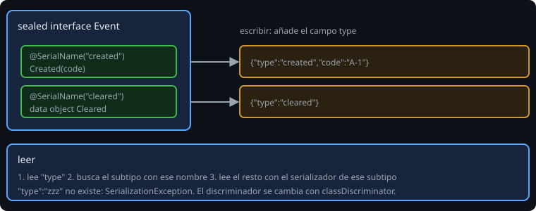

# Tipos propios y polimorfismo

> Tu modelo ya no es solo `String` e `Int`: hay enums, value classes y jerarquías selladas (semana 5). Esta lección enseña cómo se escriben en JSON y cómo escribir tu propio serializador cuando el formato por defecto no sirve.

## 🎯 Objetivos

- Serializar `enum` y `value class` con un formato limpio
- Serializar una jerarquía `sealed` con un discriminador
- Escribir un `KSerializer` propio
- Saber cuándo conviene cada herramienta

## 1. Enums

```kotlin
@Serializable
enum class Priority {
    @SerialName("low") LOW,
    @SerialName("medium") MEDIUM,
    @SerialName("high") HIGH,
}
```

Sin `@SerialName`, el JSON lleva el nombre de la constante (`"HIGH"`). Con él, el **nombre en el archivo** es independiente del código: puedes renombrar `HIGH` a `URGENT` sin romper los archivos. También sirve como clave de un `Map`: `mapOf(Priority.LOW to 1)` se escribe `{"low":1}`.

Si el archivo trae un valor que el enum no tiene, la lectura falla con `SerializationException`. Con `coerceInputValues = true` y un valor por defecto en la propiedad, se usa el valor por defecto en su lugar.

## 2. Value classes

```kotlin
@Serializable
@JvmInline
value class Code(val value: String)

@Serializable
data class Task(val tag: Code, val priority: Priority)
// {"tag":"riego","priority":"high"}
```

Una `value class` se escribe como **su valor suelto**, no como un objeto `{"value":"riego"}`. Y se sigue ejecutando su `init`: un código en blanco **falla al leer**, con el mensaje de tu `require` como causa (lección 1).

## 3. Jerarquías selladas



```kotlin
@Serializable
sealed interface Event {
    @Serializable @SerialName("created") data class Created(val code: String) : Event
    @Serializable @SerialName("cleared") data object Cleared : Event
}

Json.encodeToString<Event>(Event.Created("A-1"))    // {"type":"created","code":"A-1"}
Json.encodeToString<Event>(Event.Cleared)           // {"type":"cleared"}
Json.decodeFromString<Event>("""{"type":"cleared"}""")   // Cleared
```

El campo `type` se llama **discriminador** y se añade solo. Dos detalles que sorprenden:

- Hay que escribir con el **tipo base** (`encodeToString<Event>(...)`, o una `List<Event>`). Si el tipo estático es el subtipo (`encodeToString(Event.Created("A-1"))`), no se escribe `type`: el compilador sabe cuál es y no hace falta.
- `"type":"zzz"` (un nombre que no existe) es un `SerializationException`. Un `when` exhaustivo sobre el resultado de leer sigue siendo seguro: el compilador conoce todos los subtipos.

Para cambiar el nombre del campo: `Json { classDiscriminator = "tipo" }`. Es la forma natural de guardar resultados como `ParseResult` o eventos `SyncEvent` (semana 7).

## 4. Un serializador propio

Cuando el formato por defecto no sirve (por ejemplo, una medida que viaja como texto con dos decimales), escribes un `KSerializer`:

```kotlin
object Fixed2Serializer : KSerializer<Double> {
    override val descriptor: SerialDescriptor = PrimitiveSerialDescriptor("Fixed2", PrimitiveKind.STRING)

    override fun serialize(encoder: Encoder, value: Double) =
        encoder.encodeString(String.format(Locale.ROOT, "%.2f", value))

    override fun deserialize(decoder: Decoder): Double = decoder.decodeString().toDouble()
}

@Serializable
data class Measurement(@Serializable(with = Fixed2Serializer::class) val value: Double)
// {"value":"12.50"}
```

- El `descriptor` describe la **forma** del dato (aquí, un `String`).
- `serialize` y `deserialize` son simétricos: lo que uno escribe, el otro lo lee.
- `@Serializable(with = ...)` se pone en una propiedad (solo ella usa el serializador) o en una clase (todas sus apariciones).
- `Locale.ROOT` otra vez: `String.format` sin él usaría la coma decimal del sistema (semana 1).

## 5. Elegir

| Necesitas | Usa |
| --- | --- |
| Cambiar el nombre en el JSON | `@SerialName` |
| Un enum o una `value class` | `@Serializable` y nada más |
| Casos distintos con datos distintos | `sealed` + `@SerialName` por subtipo |
| Un formato especial para un tipo | `KSerializer` propio |
| Un tipo de una biblioteca que no controlas | `KSerializer` propio y `@Serializable(with = ...)` o un módulo |

## 6. Errores frecuentes

| Error | Causa | Arreglo |
| --- | --- | --- |
| El JSON no lleva `type` | Escribes con el tipo del subtipo | `encodeToString<Event>(e)` |
| `Serializer for subclass 'x' is not found` | Nombre de subtipo desconocido, o subtipo sin `@Serializable` | Anota cada subtipo; revisa el `@SerialName` |
| `Level does not contain element with name 'HIGH'` | El archivo usa el nombre del código, no el `@SerialName` | Usa los nombres del `@SerialName` |
| El serializador propio no se aplica | Falta `@Serializable(with = ...)` | Ponlo en la propiedad o en la clase |
| `deserialize` lanza `NumberFormatException` | Texto que no es un número | Es un `IllegalArgumentException`: conviértelo en `SerializationException` si quieres un solo tipo de error |
| `data object` no se serializa | Falta `@Serializable` en el objeto | Anótalo |

## ✅ Qué debes saber al terminar

- Los enums llevan `@SerialName` por constante; las `value class` viajan como su valor.
- Una jerarquía `sealed` se escribe con un `type` y se lee eligiendo el subtipo por ese nombre.
- Se escribe con el tipo base para que aparezca el discriminador.
- Un `KSerializer` son un `descriptor` y dos funciones simétricas.
