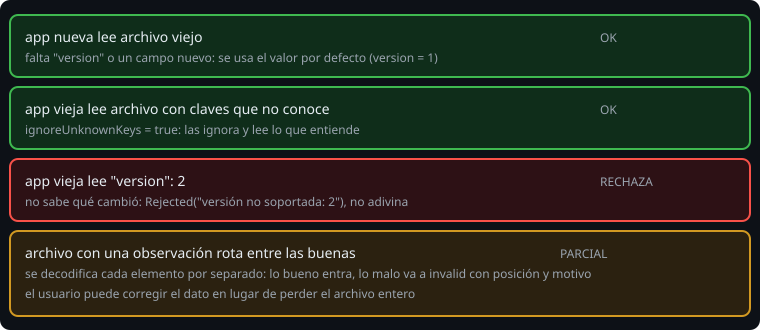

# JSON dinámico y evolución del formato

> Un archivo que escribiste hoy lo leerá una versión de tu app dentro de un año; y un archivo que llegó de fuera puede venir roto. Esta lección trabaja con el **árbol** del JSON para leer con tolerancia y para que el formato pueda crecer sin romper a nadie.

## 🎯 Objetivos

- Recorrer un JSON como árbol (`JsonElement`) y construirlo con `buildJsonObject`
- Decodificar **cada elemento por separado** para tolerar los rotos
- Evolucionar un formato con versión y valores por defecto
- Rechazar con un motivo claro lo que no se entiende

## 1. El árbol: `JsonElement`

```kotlin
val root = Json.parseToJsonElement(text)        // JsonObject, JsonArray o JsonPrimitive (o JsonNull)
if (root is JsonObject) {
    val domain = (root["domain"] as? JsonPrimitive)?.content
    val items = root["observations"] as? JsonArray
}
```

| Tipo | Qué es |
| --- | --- |
| `JsonObject` | Un mapa de `String` a `JsonElement` |
| `JsonArray` | Una lista de `JsonElement` |
| `JsonPrimitive` | Un texto (`isString`), un número o un booleano; `intOrNull`, `doubleOrNull`, `content` |
| `JsonNull` | `null` |

Ojo: las propiedades de acceso rápido `jsonObject`, `jsonArray` y `jsonPrimitive` **lanzan `IllegalArgumentException`** (no `SerializationException`) si el elemento es de otro tipo. Para código que no debe lanzar, usa `as?`.

`parseToJsonElement` lanza `SerializationException` si el texto no es JSON.

## 2. Construir un árbol

Un DSL, que es una lambda con receptor (lección 4):

```kotlin
val summary = buildJsonObject {
    put("domain", "agro")
    put("total", 2)
    putJsonObject("levels") { put("LOW", 1); put("MEDIUM", 1) }
    putJsonArray("codes") { add("A-1"); add("A-2") }
}.toString()
// {"domain":"agro","total":2,"levels":{"LOW":1,"MEDIUM":1},"codes":["A-1","A-2"]}
```

Útil cuando no merece la pena una clase `@Serializable` (una respuesta ad hoc, un fragmento).

## 3. Tolerar lo roto: decodificar elemento a elemento

Decodificar el archivo entero de golpe falla si **una** observación es mala. Con el árbol decides:

```kotlin
val valid = mutableListOf<Observation>()
val invalid = mutableListOf<InvalidItem>()
items.forEachIndexed { index, element ->
    try {
        valid += json.decodeFromJsonElement<Observation>(element)
    } catch (e: SerializationException) {
        invalid += InvalidItem(index, reasonOf(e))
    }
}
```

Lo bueno entra; lo malo se anota con su **posición** y un **motivo**. Quien lo importó puede corregir el dato en lugar de perder el archivo. Es el mismo patrón que `ParseResult` y `fromLines` de la semana 5, aplicado a JSON.

Mapeo de motivos que usa el proyecto:

| Fallo | Motivo |
| --- | --- |
| `MissingFieldException` | `campo obligatorio ausente` |
| Tu `init` lanzó (causa `IllegalArgumentException`) | El mensaje de la causa: `description en blanco` |
| Otro `SerializationException` (tipo equivocado, no es un objeto) | `valor no válido` |

## 4. Evolucionar un formato



Un archivo guardado vive más que el código. Reglas para que pueda crecer:

1. **Incluye una `version`** desde el primer día (`const val FORMAT_VERSION = 1`) y escríbela siempre (`encodeDefaults = true`).
2. **Un campo nuevo lleva valor por defecto**: los archivos viejos siguen leyéndose.
3. **`ignoreUnknownKeys = true`** en lectura: una versión vieja ignora lo que no conoce.
4. **Un cambio incompatible sube la versión.** Quien lee una versión **mayor** que la suya no adivina: rechaza con un motivo (`versión no soportada: 2`).
5. **Comprueba la versión antes de decodificar el resto**: una versión futura puede tener una estructura que ni siquiera se parece. Por eso se lee con el árbol: primero `root["version"]`, después `decodeFromJsonElement`.
6. **Nunca renombres sin `@SerialName`**: el nombre en el archivo es un contrato.

## 5. Datos que vienen de fuera

Un archivo importado es **entrada no confiable**, como las líneas de la semana 5: la lectura no debe lanzar hacia fuera, debe validar (tu `init`) y debe explicar. Eso es `importFile(text): Imported`, con `Ok(domain, observations, invalid)` o `Rejected(reason)`, y nada de excepciones que escapen.

## 6. Errores frecuentes

| Error | Causa | Arreglo |
| --- | --- | --- |
| `Element class JsonLiteral is not a JsonArray` | `jsonArray` sobre algo que no lo es | `as? JsonArray` y rechaza si es `null` |
| Un solo elemento malo tira todo el import | Decodificas la lista de golpe | Elemento a elemento |
| Una versión futura se lee mal en silencio | `ignoreUnknownKeys` sin comprobar la versión | Rechaza si `version > FORMAT_VERSION` |
| `version` ausente da error | Sin valor por defecto | `val version: Int = 1` / trata la ausencia como 1 |
| El archivo nuevo rompe a la app vieja | Campo nuevo obligatorio | Con valor por defecto, o sube la versión |
| `intOrNull` lee `"1"` como 1 | Los números entre comillas se aceptan | Comprueba `isString` si te importa |

## ✅ Qué debes saber al terminar

- `parseToJsonElement` y `as?` para recorrer sin lanzar; `buildJsonObject` para construir.
- Decodificar por elementos para tolerar los rotos y dar motivos.
- Versión desde el principio, valores por defecto para lo nuevo, rechazo para lo futuro.
- Un archivo de fuera es entrada no confiable: no lanza, valida y explica.
