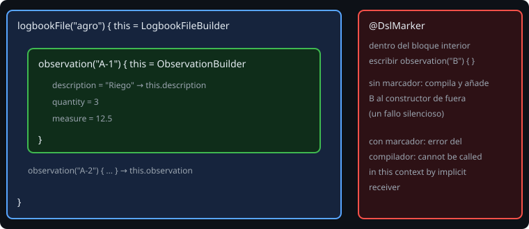

# Lambdas con receptor y DSLs

> `dependencies { implementation("...") }` en un `build.gradle.kts` parece un lenguaje nuevo. No lo es: es Kotlin, con una lambda cuyo `this` es otro objeto. Esta lección te enseña el truco, que ya has usado sin saberlo con `buildString`, `apply` y `buildJsonObject`.

## 🎯 Objetivos

- Escribir y llamar a una función con una lambda **con receptor**
- Construir un objeto paso a paso con un *builder*
- Controlar el alcance con `@DslMarker`
- Usar operadores (`get`, `contains`, `plus`, `unaryPlus`) para que el código lea natural

## 1. Lambda con receptor

Un tipo función normal: `(Int) -> Unit`. Con receptor: `StringBuilder.() -> Unit`. Dentro de la lambda, el receptor es `this` y sus miembros se llaman **sin prefijo**:

```kotlin
fun build(block: StringBuilder.() -> Unit): String {
    val sb = StringBuilder()
    sb.block()                  // ejecuta la lambda con sb como receptor
    return sb.toString()
}

val s = build {
    append("hola")              // this.append(...)
    append(" mundo")
}
```

Es lo que hacen `buildString`, `buildList`, `apply`, `with` y `buildJsonObject`.

## 2. Un *builder*



```kotlin
@LogbookDsl
class ObservationBuilder(private val code: String) {
    var description: String = ""        // obligatoria
    var quantity: Int = 1               // por defecto
    var measure: Double = 0.0

    fun build(): Observation {
        check(description.isNotBlank()) { "description obligatoria en $code" }
        return Observation(code, description, quantity, measure)
    }
}

fun observation(code: String, block: ObservationBuilder.() -> Unit): Observation =
    ObservationBuilder(code).apply(block).build()

val o = observation("A-1") {
    description = "Riego norte"
    quantity = 3
}
```

Patrón: **un constructor mutable** que la lambda rellena, y un `build()` que **valida** y devuelve el objeto **inmutable**. Lo obligatorio se comprueba al final con un mensaje claro (`check` → `IllegalStateException`, `require` → `IllegalArgumentException`).

Anidar es repetir el patrón:

```kotlin
val file = logbookFile("agro") {
    observation("A-1") { description = "Riego"; quantity = 3 }
    observation("A-2") { description = "Plaga" }
}
```

## 3. `@DslMarker`: el alcance

Dentro del bloque interior, `this` es la `ObservationBuilder`, pero también se pueden llamar los miembros del constructor **exterior** (receptor implícito). Sin protección, este código compila:

```kotlin
logbookFile("agro") {
    observation("A") {
        description = "x"
        observation("B") { description = "y" }     // ¡añade B al archivo, no a A!
    }
}
```

Es un fallo silencioso. `@DslMarker` lo evita:

```kotlin
@DslMarker
annotation class LogbookDsl

@LogbookDsl class LogbookFileBuilder(...)
@LogbookDsl class ObservationBuilder(...)
```

Con las dos clases marcadas, el compilador dice: `'fun observation(...)' cannot be called in this context with an implicit receiver. Use an explicit receiver if necessary.` Si de verdad lo quieres, usas el receptor explícito (`this@logbookFile.observation(...)`).

Otra trampa: dentro del **miembro** `observation` del constructor exterior, escribir `observation(code, block)` se llama **a sí mismo** (el miembro gana a la función de nivel superior). Construye con `ObservationBuilder(code).apply(block).build()`.

## 4. Operadores para que lea natural

Los operadores son funciones con nombres fijos:

| Escribes | Función | Ejemplo |
| --- | --- | --- |
| `logbook["A-1"]` | `operator fun get(code)` | Devuelve la observación o `null` |
| `"A-1" in logbook` | `operator fun contains(code)` | `Boolean` |
| `a + b` | `operator fun plus(other)` | Un `Logbook` nuevo |
| `+"texto"` dentro de un bloque | `operator fun String.unaryPlus()` | Añade una línea a la sección |
| `x(…)` | `operator fun invoke(...)` | Un objeto que se llama como función |

```kotlin
class SectionBuilder {
    private val items = mutableListOf<String>()
    fun line(text: String) { items += text }
    operator fun String.unaryPlus() { items += this }     // dentro del bloque: +"texto"
}
```

Y con `infix`, una función de un argumento se llama sin puntos: `1 to "uno"`, `a shouldBe b`. Úsalo con moderación.

## 5. Cuándo NO hacer un DSL

Un DSL añade una capa que el equipo debe aprender. Vale la pena cuando:

- se **repite** la construcción de estructuras anidadas (configuración, informes, pruebas),
- el resultado se **lee** como una declaración,
- lo pueden usar personas que no conocen el modelo interno.

No lo hagas para una función con tres parámetros: ahí bastan los **argumentos con nombre** y los valores por defecto.

## 6. Errores frecuentes

| Error | Causa | Arreglo |
| --- | --- | --- |
| `cannot be called in this context with an implicit receiver` | `@DslMarker` protege el alcance | Receptor explícito, o replantea el bloque |
| La llamada interior se añade al objeto equivocado | Falta `@DslMarker` en los constructores | Marca todos los constructores del mismo DSL |
| `StackOverflowError` en un miembro `observation` | Se llama a sí mismo | Usa el constructor interno, no la función de nivel superior |
| `Unresolved reference: description` | La lambda no tiene el receptor | Tipo `ObservationBuilder.() -> Unit`, no `() -> Unit` |
| Olvidas validar lo obligatorio | El constructor deja pasar vacíos | `check`/`require` en `build()` con un mensaje claro |
| El objeto resultante se puede cambiar | `build()` devuelve el constructor | Devuelve una copia inmutable (`toList()`, `data class`) |

## ✅ Qué debes saber al terminar

- `T.() -> Unit` da un `this` implícito; es el mecanismo de `apply` y de los DSL.
- Builder mutable por dentro, objeto inmutable y validado por fuera.
- `@DslMarker` en todos los constructores evita llamadas al ámbito exterior.
- Los operadores (`get`, `contains`, `plus`, `unaryPlus`) hacen que el código lea natural.
