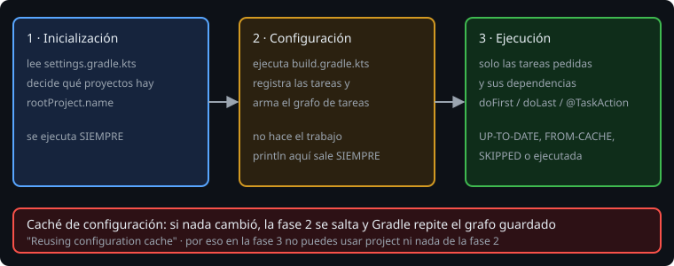

# Un build de Gradle por dentro

> Hasta ahora copiaste `build.gradle.kts` sin leerlo. Es un programa Kotlin que Gradle **ejecuta** para saber qué hay que construir. Entender **cuándo** se ejecuta cada línea explica la mayoría de los errores de Gradle.

## 🎯 Objetivos

- Reconocer las piezas de un proyecto Gradle y qué hace cada una
- Distinguir las tres fases de un build y qué se ejecuta en cada una
- Explicar por qué `tasks.register` es mejor que `tasks.create`

## 1. Las piezas

```
bitacora/
├── settings.gradle.kts     # qué proyectos hay (y su nombre)
├── build.gradle.kts        # qué plugins usa y qué tareas define
├── gradle.properties       # valores de configuración (versión, flags de Gradle)
├── gradlew, gradlew.bat    # el wrapper: descarga la versión exacta de Gradle
├── gradle/wrapper/         # qué versión (y su SHA-256)
└── build/                  # lo que genera el build; se borra con `clean`
```

- **Proyecto**: una carpeta con su `build.gradle.kts`. Esta semana hay uno solo; más adelante en la fase 2 habrá varios.
- **Plugin**: añade tareas y convenciones. `kotlin("jvm")` añade `compileKotlin`, `test`, `jar`; `application` añade `run`.
- **Tarea** (*task*): una unidad de trabajo con nombre (`compileKotlin`, `test`, `jar`). Un build es un **grafo de tareas**.
- **Wrapper**: por eso nunca instalas Gradle. `./gradlew` descarga la versión fijada en `gradle/wrapper/gradle-wrapper.properties`.

## 2. Las tres fases



1. **Inicialización**: lee `settings.gradle.kts` y decide qué proyectos forman el build.
2. **Configuración**: ejecuta cada `build.gradle.kts` **entero**. Aquí se aplican plugins y se **registran** tareas. Todavía no se hace ningún trabajo.
3. **Ejecución**: corre solo las tareas pedidas y sus dependencias.

Se ve con un `println` en cada sitio:

```kotlin
println("CONFIG: se evalúa el archivo")                // fase 2: siempre

tasks.register("hello") {
    println("CONFIG: se configura hello")               // fase 2, solo si hello se necesita
    doFirst { println("EXEC: primero") }                // fase 3
    doLast  { println("Hola desde Gradle") }            // fase 3
}
```

Al ejecutar `./gradlew hello` sale primero lo de configuración y después lo de ejecución. Y **también sale `CONFIG:` si pides cualquier otra tarea**, aunque `hello` no se ejecute: en la configuración, el archivo se evalúa entero. Por eso **nada pesado va fuera de una acción**: leer un archivo grande o llamar a la red ahí retrasa *todos* los comandos, hasta `./gradlew tasks`.

> 🔬 Medido en Gradle 9.8.2: `./gradlew hello` en un build con una tarea `lazy` registrada con `register` y otra `eager` con `create` imprime el cuerpo de `eager` aunque pidas otra tarea, y el de `lazy` solo si se necesita.

## 3. `register` frente a `create`

```kotlin
tasks.create("a") { /* ... */ }      // se crea Y se configura YA, la pidas o no
tasks.register("b") { /* ... */ }    // solo se registra; el bloque corre si hace falta
```

`register` es **perezoso**: el bloque de configuración solo se ejecuta si la tarea entra en el grafo. En un proyecto con cientos de tareas, la diferencia es segundos. **Usa siempre `register`**; `create` es la forma antigua.

## 4. Salida de una ejecución

Cada línea `> Task :nombre` termina en un **resultado**:

| Resultado | Significa |
| --- | --- |
| *(nada)* | La tarea se ejecutó |
| `UP-TO-DATE` | Entradas y salidas iguales que la última vez: no hizo nada |
| `FROM-CACHE` | Se restauró la salida de la caché, sin ejecutar |
| `SKIPPED` | Una condición (`onlyIf`) la saltó |
| `NO-SOURCE` | No tenía entradas (por ejemplo, no hay código Java) |

Verás cómo se llegan a producir en las lecciones 2 a 4.

## 5. Dónde preguntarle a Gradle

```bash
./gradlew tasks                       # tareas con grupo y descripción
./gradlew help --task hello           # detalle de una tarea: tipo, grupo, descripción
./gradlew bundle --dry-run            # el orden, sin ejecutar nada (todas salen SKIPPED)
./gradlew properties                  # propiedades del proyecto
```

## ✅ Comprueba

- [ ] ¿Qué se ejecuta si pides `./gradlew hello` y en `build.gradle.kts` hay un `println` suelto?
- [ ] ¿Por qué no se instala Gradle y se usa `./gradlew`?
- [ ] ¿Qué diferencia hay entre `UP-TO-DATE` y `SKIPPED`?
