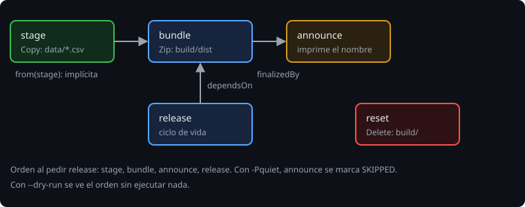

# Tareas y dependencias

> Una tarea hace una cosa. Un build útil es un **grafo**: unas tareas necesitan lo que produjeron otras. Gradle ordena el grafo; tú declaras las relaciones.

## 🎯 Objetivos

- Definir tareas con `tasks.register`, con grupo y descripción
- Usar las tareas incluidas (`Copy`, `Zip`, `Delete`)
- Relacionar tareas con `dependsOn`, `finalizedBy` y dependencias implícitas
- Leer valores sin romper la caché con `providers`

## 1. Registrar una tarea

```kotlin
tasks.register("hello") {
    group = "bitacora"                       // aparece en ./gradlew tasks
    description = "Saluda desde Gradle"      // aparece en ./gradlew help --task hello
    doLast { println("Hola desde Gradle") }
}
```

Una tarea **sin grupo** no aparece en `./gradlew tasks`: es una tarea interna. Ponerle grupo y descripción es parte de dejar el build usable.

## 2. Tareas ya hechas

Casi nunca escribes la acción tú; Gradle trae tipos:

```kotlin
val stage = tasks.register<Copy>("stage") {
    from("data") {
        include("*.csv")
        rename { "obs-$it" }                              // a.csv -> obs-a.csv
    }
    into(layout.buildDirectory.dir("stage"))
}

val bundle = tasks.register<Zip>("bundle") {
    from(stage)                                            // los archivos que produce stage
    archiveFileName = "bitacora-${project.version}.zip"
    destinationDirectory = layout.buildDirectory.dir("dist")
}

tasks.register<Delete>("reset") { delete(layout.buildDirectory) }
```

- `layout.buildDirectory` es la carpeta `build/`. **No escribas `"build/stage"` a mano**: así Gradle conoce la ruta y se puede mover.
- `from(stage)` pasa la **tarea** (no su carpeta): Gradle entiende que `bundle` necesita antes lo que `stage` produce. Es una **dependencia implícita**, la mejor forma: no hay que acordarse de declararla.



## 3. Declarar relaciones

| Relación | Qué hace |
| --- | --- |
| `dependsOn("x")` | `x` debe ejecutarse **antes**; si pides esta, `x` se ejecuta también |
| `finalizedBy("y")` | `y` se ejecuta **justo después**, aunque pidas solo esta |
| `mustRunAfter("z")` | Si las dos están en el grafo, `z` va antes; **no** hace que `z` entre |
| `onlyIf { ... }` | La tarea se salta (`SKIPPED`) si la condición es falsa |

```kotlin
val bundle = tasks.register<Zip>("bundle") {
    /* ... */
    finalizedBy("announce")
}

val quiet = providers.gradleProperty("quiet")
tasks.register("announce") {
    onlyIf { !quiet.isPresent }                            // ./gradlew bundle -Pquiet la salta
    val file = bundle.flatMap { it.archiveFile }
    doLast { println("Paquete listo: ${file.get().asFile.name}") }
}

tasks.register("release") { dependsOn(bundle) }           // tarea de ciclo de vida: sin acciones
```

Una **tarea de ciclo de vida** no hace nada por sí misma; es un nombre para un conjunto (`build`, `assemble` y `check` lo son). Es lo que debes pedir: `./gradlew release`.

> 🔬 Medido: `./gradlew release` ejecuta `:stage`, `:bundle`, `:announce`, `:release`, en ese orden. Con `-Pquiet`, `:announce` sale `SKIPPED`.

## 4. Valores: `providers`

Para leer una propiedad (`-Pquiet`, o una entrada de `gradle.properties`) **no** uses `project.property("quiet")` ni `project.hasProperty` dentro de una acción: usa un *provider*:

```kotlin
val domain = providers.gradleProperty("bitacora.domain")        // Provider<String>, perezoso
println(domain.orNull)                                           // null si no existe
```

Un `Provider` es un valor que se calcula **cuando se necesita**, y Gradle sabe de dónde viene. Es lo que permite que la tarea sepa que su resultado depende de esa propiedad (lección 3) y que la caché de configuración funcione (lección 4).

Orden de prioridad: `-Pnombre=valor` en la línea de comandos **gana** a `gradle.properties`. (Medido con `p=1` en el archivo y `-Pp=9`: la tarea ve 9.)

## 5. Errores frecuentes

| Error | Causa |
| --- | --- |
| La tarea no aparece en `./gradlew tasks` | Falta `group` |
| `bundle` se ejecuta sin esperar a `stage`, o no ve sus archivos | Usaste una ruta de texto (`from("build/stage")`) en vez de `from(stage)`: Gradle no sabe que hay relación |
| Una condición `onlyIf` siempre vale lo mismo | La evaluaste fuera del bloque; debe leerse dentro (`{ ... }`) |
| `announce` no se ejecuta tras `bundle` | Falta `finalizedBy`, o `bundle` no se ejecutó (falló antes) |

## ✅ Comprueba

- [ ] ¿Qué diferencia hay entre `dependsOn` y `finalizedBy`?
- [ ] ¿Por qué es mejor `from(stage)` que `from("build/stage")`?
- [ ] ¿Qué es una tarea de ciclo de vida y para qué sirve?
