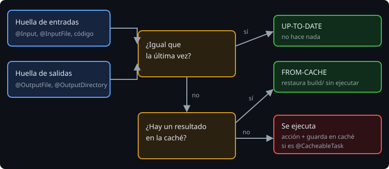

# Entradas, salidas y up-to-date

> Gradle no es rápido porque haga las cosas deprisa, sino porque **no las repite**. Para eso necesita saber qué entra y qué sale de cada tarea. Si no lo declaras, no puede ahorrarte nada.

## 🎯 Objetivos

- Explicar cómo decide Gradle que una tarea está al día
- Escribir una clase de tarea propia con `@Input`, `@InputFile` y `@OutputFile`
- Diagnosticar por qué una tarea se ejecuta de más (o de menos)

## 1. Cómo decide Gradle



Antes de una tarea, Gradle calcula una **huella** (*hash*) de sus entradas y mira sus salidas. Si coinciden con las de la última ejecución, la marca `UP-TO-DATE` y no hace nada. Pruébalo con el `stage` de la lección 2:

| Qué haces | Resultado de `stage` |
| --- | --- |
| Primera vez | se ejecuta |
| Nada cambió | `UP-TO-DATE` |
| Añades una línea a `data/notes.txt` | `UP-TO-DATE`: no es un `.csv`, no es una entrada |
| Añades una línea a `data/a.csv` | se ejecuta |
| Borras `build/stage` | se ejecuta (falta la salida) |

> 🔬 Medido con TestKit: la segunda ejecución de `release` marca `stage`, `bundle` y `release` como `UP_TO_DATE`, y tarda 116 ms frente a 11 s de la primera (esta incluye arrancar Gradle).

`Copy` y `Zip` ya declaran sus entradas y salidas. Con una tarea propia, **las declaras tú**.

## 2. Una tarea propia

```kotlin
abstract class CountLines : DefaultTask() {
    @get:InputFile
    abstract val source: RegularFileProperty            // entrada: un archivo

    @get:Input
    abstract val skipHeader: Property<Boolean>          // entrada: un valor

    @get:OutputFile
    abstract val report: RegularFileProperty            // salida: un archivo

    @TaskAction
    fun count() {
        val lines = source.get().asFile.readLines().filter { it.isNotBlank() }
        val n = if (skipHeader.get()) maxOf(0, lines.size - 1) else lines.size
        report.get().asFile.writeText("lines=$n\n")
    }
}
```

Tres detalles:

- La clase es **abstracta** y las propiedades son `abstract val`: Gradle genera la implementación. Nunca las inicialices tú.
- `RegularFileProperty`, `DirectoryProperty` y `Property<T>` son *providers* **asignables**: se les da valor al registrar la tarea.
- La acción (`@TaskAction`) lee de las propiedades, **no del proyecto**.

Se registra, y se **conecta** con las propiedades del build:

```kotlin
tasks.register<CountLines>("countObservations") {
    source = layout.projectDirectory.file("data/observations.csv")
    skipHeader = providers.gradleProperty("skipHeader").map { it.toBoolean() }.orElse(true)
    report = layout.buildDirectory.file("reports/lines.txt")
}
```

Ahora `-PskipHeader=false` **cambia una entrada**, y la tarea se vuelve a ejecutar sin que se lo digas. Y vuelve a `UP-TO-DATE` si repites con el mismo valor.

> 🔬 Medido: con `-PskipHeader=false` el informe dice `lines=4` (la cabecera cuenta); repetido, `UP_TO_DATE`; sin la bandera, se ejecuta de nuevo y dice `lines=3`.

## 3. Si falta una entrada

```
A problem was found with the configuration of task ':countObservations' (type 'Build_gradle.CountLines').
  Input file does not exist
    Type 'Build_gradle.CountLines' property 'source' specifies file '.../observations.csv' which doesn't exist
```

Gradle valida antes de ejecutar: el mensaje dice **la tarea, la propiedad y el archivo**. Una anotación es también documentación.

## 4. Lo que olvidas anotar es un bug

| Olvido | Efecto |
| --- | --- |
| Una entrada sin `@Input` | La tarea se queda `UP-TO-DATE` cuando debería ejecutarse (datos viejos) |
| Una salida sin `@OutputFile` | Gradle no ve que alguien la borró; no se regenera |
| Una entrada que cambia siempre (una fecha) | La tarea nunca está al día; el build es lento y no reproducible |

Para forzar una ejecución: `./gradlew countObservations --rerun`. Para toda la cadena, `--rerun-tasks`. Si necesitas esto a menudo, falta declarar algo.

## ✅ Comprueba

- [ ] ¿Por qué cambiar `notes.txt` no vuelve a ejecutar `stage`?
- [ ] ¿Qué pasa si `skipHeader` no tiene `@Input`?
- [ ] ¿Por qué las clases de tarea son `abstract` y sus propiedades `abstract val`?
