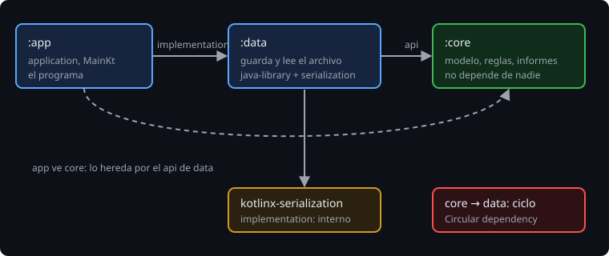
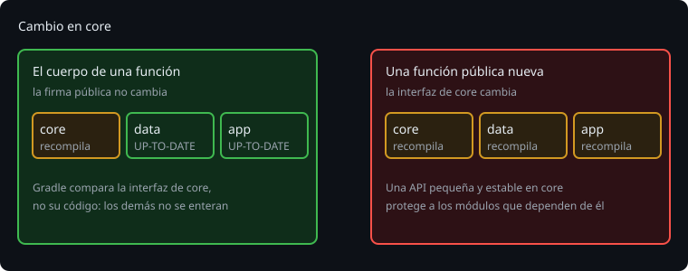

# Dependencias entre módulos

> Un módulo usa a otro con una línea. La decisión importante no es *que* dependa, sino **cuánto deja ver**: `api` o `implementation`.

## 🎯 Objetivos

- Declarar una dependencia entre módulos con `project(":x")`
- Elegir entre `api` e `implementation` y explicar la consecuencia
- Entender por qué un cambio interno no recompila a los demás
- Reconocer y evitar un ciclo

## 1. `project(":x")`

```kotlin
// data/build.gradle.kts
dependencies {
    api(project(":core"))
}

// app/build.gradle.kts
dependencies {
    implementation(project(":data"))
}
```



## 2. `api` o `implementation`

Con el plugin `java-library` (junto a `kotlin("jvm")`) hay dos formas:

| | `implementation` | `api` |
| --- | --- | --- |
| Quien depende de mi módulo | **no** ve esa dependencia al compilar | **sí** la ve |
| Cuándo | Es un **detalle interno** (la biblioteca de JSON que uso para guardar) | Sus tipos aparecen en **mi API pública** (una función que recibe o devuelve un tipo de `core`) |

La regla: **si un tipo de X aparece en una firma pública de mi módulo, X va en `api`; si no, en `implementation`.** Por defecto, `implementation`.

En la Bitácora, `data` expone `encode(observations: List<Observation>)`: `Observation` es de `core`, así que va con `api`. `kotlinx-serialization` solo se usa dentro: `implementation`.

Si lo pones mal, el compilador te lo dice:

```
e: .../app/src/main/kotlin/Main.kt:2:16 Cannot access class 'Observation'. Check your module classpath for missing or conflicting dependencies.
e: .../Main.kt:2:30 Unresolved reference 'Observation'.
```

(Es lo que ocurre si `data` usa `implementation(project(":core"))` y `app` usa `Observation` sin declararlo.) Hay dos arreglos: `api` en `data` (si es parte de su API) o una dependencia directa en `app` (si `app` necesita `core` por sí mismo).

### Dos classpaths

Gradle mantiene **dos** listas de dependencias por módulo: la de **compilación** (`compileClasspath`) y la de **ejecución** (`runtimeClasspath`). `implementation` solo oculta en la de compilación; en ejecución todo está presente.

```bash
./gradlew :app:dependencies --configuration compileClasspath
./gradlew :app:dependencies --configuration runtimeClasspath
```

> 🔬 Medido: con `implementation(libs.serialization.json)` en `data`, `app` ve `project ':data'` y `project ':core'` al compilar y **no** ve `kotlinx-serialization`; en `runtimeClasspath` sí aparece. Con `api(...)`, aparece también al compilar: ahora `app` podría usarla, y una actualización de esa biblioteca puede romperlo.

## 3. Por qué un cambio interno no recompila a los demás



Gradle no compara el **código** de `core`, sino su **interfaz** (lo público). Si cambias solo el cuerpo de una función, la interfaz es igual y `data` y `app` se quedan `UP-TO-DATE`. Si añades una función pública, la interfaz cambia y se recompilan los dos.

> 🔬 Medido con un cambio de cuerpo (`count` → `this.count`): `:core:compileKotlin` se ejecuta; `:data:compileKotlin` y `:app:compileKotlin`, `UP-TO-DATE`. Con una función pública nueva (`fun List<Observation>.codes()`), las tres se ejecutan.

Por eso una API **pequeña** en `core` acelera el build de todos: cuanto menos público, menos cambios de interfaz.

## 4. Ciclos

Si `core` dependiera de `data` (y `data` de `core`), ninguno podría compilarse antes que el otro. Gradle lo detecta:

```
Circular dependency between the following tasks:
:core:compileJava
+--- :core:compileJava (*)
+--- :core:compileKotlin
...
```

La solución nunca es "configurar" el ciclo: es **mover lo compartido** a un módulo del que ambos dependan, o **invertir** la dependencia con una interfaz (una interfaz en `core` que `data` implementa).

## 5. Reglas prácticas

| Regla | Por qué |
| --- | --- |
| Las dependencias van `app → data → core`, nunca al revés | `core` es lo estable |
| `implementation` por defecto; `api` solo si el tipo sale en tu API | Menos cosas expuestas = menos recompilación |
| Nunca expongas el detalle de la biblioteca (sus tipos) en la API | Cambiar de biblioteca no rompe a nadie |
| `core` en Kotlin puro, sin Android ni formatos | Se prueba en milisegundos |

## ✅ Comprueba

- [ ] ¿Cuándo usas `api` y cuándo `implementation`?
- [ ] ¿Por qué cambiar el cuerpo de una función de `core` no recompila `app`?
- [ ] ¿Cómo se rompe un ciclo entre dos módulos?
