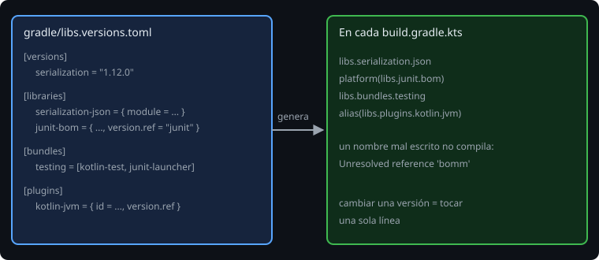

# Version catalogs

> Con tres módulos, la versión de Kotlin está en tres sitios, y la de JUnit, en dos. Un día cambias una y olvidas las otras. El **catálogo de versiones** es un solo archivo donde vive cada versión, una vez.

## 🎯 Objetivos

- Escribir un `libs.versions.toml` con versiones, bibliotecas, *bundles* y plugins
- Usar el catálogo desde los módulos con `libs.…`
- Declarar los plugins una vez en el raíz (`apply false`)

## 1. El archivo

Gradle carga automáticamente `gradle/libs.versions.toml` y lo expone como `libs`:

```toml
[versions]
kotlin = "2.4.21"
serialization = "1.12.0"
junit = "6.1.3"

[libraries]
junit-bom = { module = "org.junit:junit-bom", version.ref = "junit" }
junit-launcher = { module = "org.junit.platform:junit-platform-launcher" }
kotlin-test = { module = "org.jetbrains.kotlin:kotlin-test", version.ref = "kotlin" }
serialization-bom = { module = "org.jetbrains.kotlinx:kotlinx-serialization-bom", version.ref = "serialization" }
serialization-json = { module = "org.jetbrains.kotlinx:kotlinx-serialization-json" }

[bundles]
testing = ["kotlin-test", "junit-launcher"]

[plugins]
kotlin-jvm = { id = "org.jetbrains.kotlin.jvm", version.ref = "kotlin" }
kotlin-serialization = { id = "org.jetbrains.kotlin.plugin.serialization", version.ref = "kotlin" }
```



- **`[versions]`**: nombres para versiones. Cada una, una sola vez.
- **`[libraries]`**: una biblioteca por entrada: `module = "grupo:nombre"` y `version.ref` (o sin versión, si la fija un BOM, como `serialization-json`, que la toma de `serialization-bom`).
- **`[bundles]`**: un grupo que se añade de una vez (`testing`).
- **`[plugins]`**: los plugins con su versión.

## 2. Usarlo

Los guiones del nombre se vuelven puntos: `serialization-json` → `libs.serialization.json`.

```kotlin
// core/build.gradle.kts
plugins {
    alias(libs.plugins.kotlin.jvm)
    `java-library`
}

dependencies {
    testImplementation(platform(libs.junit.bom))
    testImplementation(libs.bundles.testing)
}

// data/build.gradle.kts
dependencies {
    implementation(platform(libs.serialization.bom))
    implementation(libs.serialization.json)
}
```

Ventajas sobre escribir las cadenas a mano:

- **Una versión, un sitio.** Subir Kotlin es tocar una línea.
- **Autocompletado** y comprobación: un nombre mal escrito no compila.

> 🔬 Medido: con `libs.junit.bomm` en un módulo, Gradle falla antes de ejecutar nada: `Script compilation error ... Unresolved reference 'bomm'`.

Una advertencia: el catálogo **no** da seguridad por sí solo. Una versión de la lista sigue sin estar comprobada contra CVEs: eso lo haces tú al actualizarla (en `docs/stack-versions.md` está cómo).

## 3. Los plugins, una vez, en el raíz

Si cada módulo escribe `alias(libs.plugins.kotlin.jvm)` y el raíz no lo menciona, Kotlin se carga una vez por módulo y avisa:

```
The Kotlin Gradle plugin was loaded multiple times in different subprojects, which is not supported and may break the build.
...
If the parent project does not need the plugin, add 'apply false' to the plugin line.
```

La solución es la del propio mensaje: declararlo en el raíz, **sin aplicarlo**:

```kotlin
// build.gradle.kts (raíz)
plugins {
    alias(libs.plugins.kotlin.jvm) apply false
    alias(libs.plugins.kotlin.serialization) apply false
}
```

Los módulos lo siguen aplicando con `alias(libs.plugins.kotlin.jvm)` (sin `apply false`). Si el raíz **sí** necesita el plugin (como el raíz del proyecto de esta semana, que ejecuta tests), lo aplica sin `apply false`; los módulos siguen igual.

## 4. Atajo opcional: `projects.core`

Gradle puede generar accesos a los módulos: `api(projects.core)` en vez de `api(project(":core"))`. Es una **función en incubación**: hay que activarla en `settings.gradle.kts` con `enableFeaturePreview("TYPESAFE_PROJECT_ACCESSORS")`, y Gradle avisa `Type-safe project accessors is an incubating feature`.

> 🔬 Medido en Gradle 9.8.2: sin esa línea, `projects.core` da `Unresolved reference 'core'`; con ella, compila. Para este curso se usa `project(":core")`, que no cambia.

## 5. Qué va al catálogo y qué no

- Va todo lo que lleva **versión**: bibliotecas, BOM y plugins, aunque solo los use un módulo: así hay un único sitio para ver todas las versiones.
- No va lo que no es una versión (una URL, una ruta, un número de configuración).

## ✅ Comprueba

- [ ] ¿Cómo se llama en un `build.gradle.kts` la entrada `serialization-json` del catálogo?
- [ ] ¿Por qué `serialization-json` no tiene `version.ref`?
- [ ] ¿Qué hace `apply false` y por qué se usa en el raíz?
