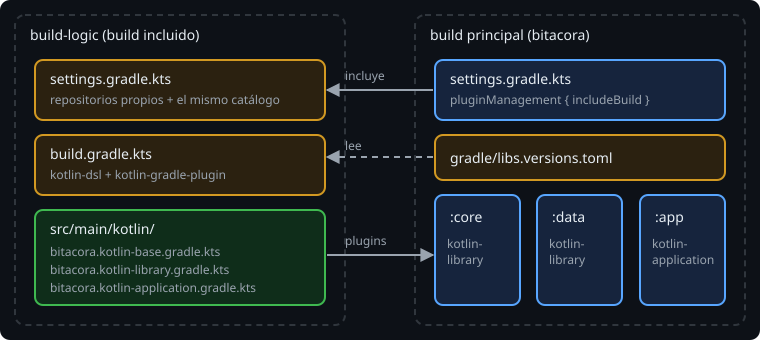

# De la configuración repetida a un plugin

> La semana pasada dejaste a propósito el mismo `kotlin { }` y el mismo `tasks.test` en los tres módulos. Esta semana los mueves a un **plugin tuyo**, con nombre, y cada módulo pasa a decir solo qué es: una biblioteca o un programa.

## 🎯 Objetivos

- Explicar qué es un plugin de Gradle y qué es un *convention plugin*
- Comparar los sitios donde puede vivir la lógica de build: script suelto, `buildSrc` y un build incluido
- Incluir un build de plugins (`build-logic`) desde `settings.gradle.kts`

## 1. Qué es un plugin

Un **plugin** es código que recibe un proyecto y lo configura: añade tareas, extensiones, configuraciones de dependencias... Ya usas varios:

| Plugin | Qué hace al aplicarlo |
| --- | --- |
| `java-library` | Añade `api` / `implementation` y las tareas `jar`, `test`... |
| `application` | Añade `run`, `distZip` y la extensión `application { }` |
| `org.jetbrains.kotlin.jvm` | Añade `compileKotlin` y la extensión `kotlin { }` |

Un **convention plugin** es un plugin **tuyo** cuya única misión es aplicar **tus convenciones**: qué JDK, qué opciones del compilador, qué framework de pruebas. No inventa nada: aplica otros plugins y los configura como acordó el equipo.

```kotlin
// antes: core/build.gradle.kts (20 líneas, casi iguales en los tres módulos)
plugins {
    alias(libs.plugins.kotlin.jvm)
    `java-library`
}
dependencies { /* las de prueba */ }
kotlin { jvmToolchain(21); compilerOptions { allWarningsAsErrors.set(true) } }
tasks.test { useJUnitPlatform() }

// después (al final de la semana)
plugins {
    id("bitacora.kotlin-library")
}
```

## 2. Dónde puede vivir la lógica de build

| Opción | Cómo se usa | Pega |
| --- | --- | --- |
| Script suelto | `apply(from = "gradle/kotlin.gradle.kts")` | Sin accesos tipados (`kotlin { }` no existe dentro), sin `plugins { }`; difícil de leer y de probar |
| `buildSrc/` | Carpeta especial: Gradle la compila **siempre**, antes de configurar nada, y la pone a disposición de todos los scripts | Es implícita: nada en `settings` dice que existe; no se puede ejecutar como un build normal |
| **Build incluido** (`build-logic/`) | Un build normal, con su `settings.gradle.kts`, que el principal incluye con `pluginManagement { includeBuild("build-logic") }` | Una línea más en `settings` |

Este curso usa **`build-logic`**: es explícito (está escrito en `settings`), se puede construir y probar solo (`./gradlew -p build-logic build`) y es la estructura de los proyectos Android de referencia, como [Now in Android](https://github.com/android/nowinandroid/tree/main/build-logic). En la fase 3 añadirás ahí los convention plugins de Android.

> 🔬 Medido en Gradle 9.8.2: el mismo cambio en un convention plugin tiene el mismo efecto sobre los módulos con `buildSrc` que con `build-logic` (la lección 4 explica cuál y cómo evitarlo). La diferencia no es de velocidad, es de claridad: `build-logic` es un build como cualquier otro.

## 3. Dos builds en una carpeta



```
bitacora/
├── settings.gradle.kts          # incluye build-logic y los módulos
├── build.gradle.kts
├── gradle/libs.versions.toml    # un solo catálogo para los dos builds
├── build-logic/                 # otro build: compila los convention plugins
│   ├── settings.gradle.kts
│   ├── build.gradle.kts
│   └── src/main/kotlin/bitacora.kotlin-base.gradle.kts
├── core/
├── data/
└── app/
```

`build-logic` **no es un módulo** del build principal: no aparece en `include`, no sale en `./gradlew projects` y tiene sus propios repositorios. Se incluye como fuente de plugins:

```kotlin
// settings.gradle.kts
pluginManagement {
    includeBuild("build-logic")
}

dependencyResolutionManagement { /* igual que la semana 10 */ }

rootProject.name = "bitacora"
include(":core", ":data", ":app")
```

Cuando un módulo pide `id("bitacora.kotlin-base")`, Gradle busca en los builds incluidos, construye `build-logic` si hace falta y aplica el plugin. Lo ves en la salida: las tareas de `build-logic` llevan su nombre delante (`:build-logic:compileKotlin`, `:build-logic:jar`) y, si nada cambió, quedan `UP-TO-DATE`.

> 🔬 Medido: en un `settings.gradle.kts`, Gradle evalúa el bloque `pluginManagement { }` antes que el resto aunque esté al final. Por convención se escribe el primero: es lo primero que se lee.

## 4. Qué no es un convention plugin

- **No es `subprojects { }`**. Con `subprojects` el raíz empuja configuración a todos; con un convention plugin cada módulo **pide** la suya, con una línea que se ve en su propio archivo.
- **No es un sitio para decidir por módulo**. Si escribes `if (project.name == "app")` dentro de un plugin, en realidad necesitas dos plugins.
- **No sustituye al catálogo**. El catálogo guarda versiones; el plugin, decisiones. Las dos cosas siguen separadas (lección 3).

## ✅ Comprueba

- [ ] ¿Qué diferencia hay entre un plugin cualquiera y un convention plugin?
- [ ] ¿Por qué `build-logic` no aparece en `./gradlew projects`?
- [ ] Da una ventaja de `build-logic` frente a `buildSrc`.
