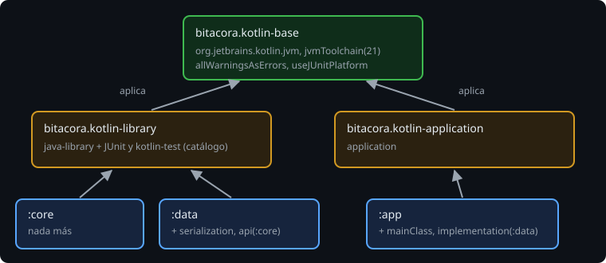
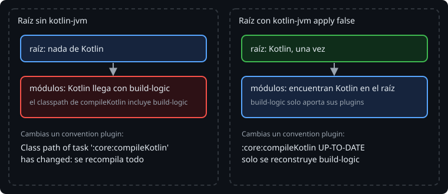

# Componer convention plugins

> Un solo plugin para todo acaba lleno de `if`. Lo que funciona es una **base** común y un plugin por **tipo de módulo** encima: biblioteca o programa. Y una línea del raíz, que parece sobrar, decide si un cambio en `build-logic` recompila todo.

## 🎯 Objetivos

- Componer convention plugins: uno aplica otro
- Decidir qué va en un convention plugin y qué se queda en el módulo
- Explicar por qué el raíz sigue declarando el plugin de Kotlin con `apply false`

## 1. Una base y un plugin por tipo de módulo



```kotlin
// bitacora.kotlin-library.gradle.kts
plugins {
    id("bitacora.kotlin-base")
    `java-library`
}
// + las dependencias de prueba del catálogo (lección 3)

// bitacora.kotlin-application.gradle.kts
plugins {
    id("bitacora.kotlin-base")
    application
}
```

Un convention plugin aplica otro con `id(...)`, igual que un módulo. Los dos plugins de encima no repiten nada de la base: si mañana el JDK pasa a 25, se cambia **un** archivo.

Gradle aplica cada plugin **una sola vez** por proyecto: si dos plugins aplican la base, el segundo no hace nada. No hay que vigilar el orden ni las repeticiones.

## 2. Los módulos, después

```kotlin
// core/build.gradle.kts
plugins {
    id("bitacora.kotlin-library")
}

// data/build.gradle.kts
plugins {
    id("bitacora.kotlin-library")
    alias(libs.plugins.kotlin.serialization)
}

dependencies {
    api(project(":core"))
    implementation(platform(libs.serialization.bom))
    implementation(libs.serialization.json)
}

// app/build.gradle.kts
plugins {
    id("bitacora.kotlin-application")
}

dependencies {
    implementation(project(":data"))
}

application {
    mainClass.set("MainKt")
}
```

Cada archivo dice **qué es** el módulo (el plugin) y **qué tiene de propio** (sus dependencias, su `mainClass`). Un módulo nuevo de tipo biblioteca son tres líneas.

## 3. Qué va dónde

| Va en un convention plugin | Se queda en el módulo |
| --- | --- |
| Lo que es igual **por definición** en todos los módulos de un tipo: JDK, opciones del compilador, JUnit, `java-library` | Las dependencias propias (`api(project(":core"))`, serialization) |
| Bibliotecas que usan **todos** los de ese tipo (las de prueba) | Plugins que solo usa ese módulo (`kotlin-serialization` en `data`) |
| | Lo que identifica al módulo (`mainClass`) |

Señales de que algo está en el sitio equivocado:

- Un `if (project.name == ...)` dentro de un plugin: hacen falta dos plugins.
- Un plugin que aplica serialization "por si acaso": todos los módulos cargan algo que solo usa uno.
- Un módulo que vuelve a escribir `jvmToolchain`: está pisando su convention plugin.

## 4. La línea del raíz

Con los convention plugins, el `kotlin { }` ya no está en ningún módulo, y parece que el raíz puede quedarse vacío. Mejor no:

```kotlin
// build.gradle.kts (raíz)
plugins {
    alias(libs.plugins.kotlin.jvm) apply false
    alias(libs.plugins.kotlin.serialization) apply false
}
```



Gradle carga las clases de un plugin en un **cargador de clases** (*classloader*), y los módulos buscan primero en el del raíz. Según lo que diga el raíz:

| Raíz | Qué pasa | 🔬 Medido en Gradle 9.8.2 |
| --- | --- | --- |
| Vacío | El plugin de Kotlin llega con `build-logic` a unos módulos y con `alias(libs.plugins.kotlin.serialization)` a `data`: dos cargas | `The Kotlin Gradle plugin was loaded multiple times in different subprojects` |
| Solo `kotlin.serialization apply false` | Sin aviso, pero Kotlin se carga junto con `build-logic`. Su classpath **incluye el jar de `build-logic`**: cualquier cambio en un convention plugin cambia el classpath de `compileKotlin` | `Class path of task ':core:compileKotlin' has changed`: los tres `compileKotlin` se ejecutan otra vez |
| `kotlin.jvm apply false` (y serialization) | Kotlin se carga una vez, desde el raíz; `build-logic` solo aporta sus plugins | Tras el mismo cambio, `:core:compileKotlin UP-TO-DATE` en los tres módulos |

> 🔬 Medido: el mismo resultado de la segunda fila con `buildSrc` en lugar de `build-logic`. El cambio fue añadir `description = "Bitácora"` a `bitacora.kotlin-application`: un plugin que `core` ni siquiera aplica. Para ver el motivo, `./gradlew :core:compileKotlin --info`.

Regla: **el raíz declara con `apply false` todos los plugins de terceros que usan los módulos**, como en la semana 10. Los convention plugins no la sustituyen.

## ✅ Comprueba

- [ ] ¿Cómo aplica un convention plugin a otro?
- [ ] ¿Por qué `kotlin-serialization` no va en `bitacora.kotlin-library`?
- [ ] ¿Qué pasa con los `compileKotlin` de los módulos si cambias un convention plugin y el raíz no declara `kotlin-jvm`?
