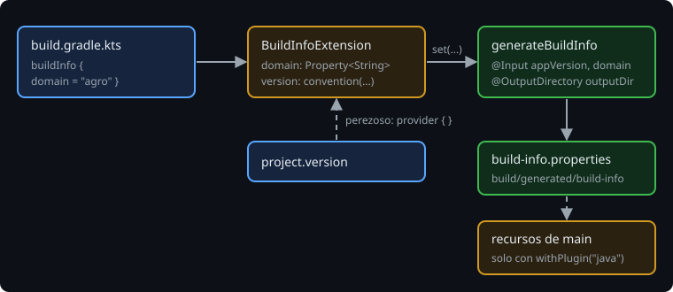

# Extensiones y propiedades perezosas

> Un plugin con parámetros necesita un sitio donde el usuario los escriba: una **extensión**, el bloque `buildInfo { }`. El detalle importante es **cuándo** se leen esos valores: si el plugin los lee pronto, todavía no existen.

## 🎯 Objetivos

- Crear una extensión con propiedades `Property<T>`
- Dar valores por defecto con `convention`
- Conectar la extensión con una tarea sin leer ningún valor al configurar

## 1. La extensión

```kotlin
abstract class BuildInfoExtension {
    abstract val domain: Property<String>
    abstract val version: Property<String>
}
```

Abstracta, como las tareas de la semana 9: Gradle crea la implementación. En el plugin se crea con un nombre:

```kotlin
val extension = project.extensions.create("buildInfo", BuildInfoExtension::class.java)
```

Y el usuario escribe, en su `build.gradle.kts`:

```kotlin
buildInfo {
    domain = "agro"
}
```

El acceso `buildInfo { }` lo genera Gradle porque el plugin se aplicó en el bloque `plugins { }`: es el mismo mecanismo que da `kotlin { }` o `application { }`.

## 2. El orden del build



```kotlin
plugins {
    id("bitacora.build-info")   // 1. Gradle llama a apply(): crea la extensión, vacía
}

version = "1.2.0"               // 2. después

buildInfo {
    domain = "agro"             // 3. y después
}
```

`apply` se ejecuta en el paso 1. En ese momento, `domain` no tiene valor y `version` es `unspecified`. Si el plugin lee algo ahí, se equivoca o falla:

```kotlin
println(extension.domain.get())   // dentro de apply
```

```
Cannot query the value of extension 'buildInfo' property 'domain' because it has no value available.
```

> 🔬 Medido en Gradle 9.8.2, con el build de arriba.

## 3. Valores por defecto: `convention`

`convention` da un valor que se usa **si nadie pone otro**. Para `version`, lo natural es la versión del proyecto. Pero hay dos formas de escribirlo, y solo una funciona:

```kotlin
extension.version.convention(project.version.toString())                  // lee ahora: "unspecified"
extension.version.convention(project.provider { project.version.toString() })  // lee cuando haga falta
```

> 🔬 Medido: con la primera, el archivo generado dice `version=unspecified`, porque `version = "1.2.0"` llega después de `apply`. Con la segunda, dice `version=1.2.0`. `project.provider { }` es un valor **perezoso**: la lambda se ejecuta cuando alguien pide el valor, no al crearlo.

## 4. Conectar, no copiar

La tarea tampoco lee la extensión al configurar: **conecta** sus entradas con ella.

```kotlin
project.tasks.register("generateBuildInfo", GenerateBuildInfo::class.java) {
    appVersion.set(extension.version)    // un Provider, no un String
    domain.set(extension.domain)
    outputDir.set(project.layout.buildDirectory.dir("generated/build-info"))
}
```

`set(provider)` guarda **de dónde** sacar el valor. Gradle lo lee justo antes de ejecutar la tarea, cuando el usuario ya escribió todo. Si el usuario no da `domain`, Gradle lo detecta antes de ejecutar y dice qué falta:

```
A problem was found with the configuration of task ':generateBuildInfo' (type 'GenerateBuildInfo').
  In plugin 'bitacora.build-info' type 'GenerateBuildInfo' property 'domain' doesn't have a configured value
```

> 🔬 Medido: el plugin no tiene ni una línea de validación. Basta con que `domain` sea un `@Input` sin `convention`: Gradle se encarga del mensaje.

## 5. Lo que no hay que hacer

- **`.get()` dentro de `apply`**: lee antes de tiempo (sección 2).
- **`project.afterEvaluate { }`** para "esperar" a que el usuario escriba: funciona a veces, ordena mal cuando hay varios plugins, y el patrón de providers lo hace innecesario.
- **Propiedades normales (`var domain: String = ""`)** en la extensión: no son perezosas, no se conectan con tareas y no avisan si faltan.

## ✅ Comprueba

- [ ] ¿En qué momento se ejecuta `apply`, respecto a `buildInfo { }` del usuario?
- [ ] ¿Qué diferencia hay entre `convention(project.version.toString())` y `convention(project.provider { ... })`?
- [ ] ¿Por qué `appVersion.set(extension.version)` funciona aunque el usuario cambie la versión después?
