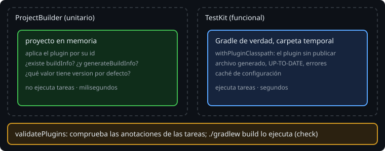

# Probar un plugin

> Hasta ahora los tests copiaban un proyecto entero y ejecutaban Gradle sobre la copia. Un plugin binario se prueba en dos niveles: **unitario**, con un proyecto en memoria, y **funcional**, con un build de prueba que usa el plugin sin publicarlo.

## 🎯 Objetivos

- Escribir pruebas unitarias de un plugin con `ProjectBuilder`
- Escribir pruebas funcionales con TestKit y `withPluginClasspath()`
- Usar `validatePlugins` para comprobar las anotaciones de las tareas

## 1. Dos niveles



| | `ProjectBuilder` | TestKit |
| --- | --- | --- |
| Qué crea | Un `Project` en memoria | Un build real en una carpeta temporal |
| Ejecuta tareas | No | Sí |
| Comprueba | Que existen la extensión y las tareas; valores por defecto | Archivos generados, `UP-TO-DATE`, errores, caché de configuración |
| Velocidad | Milisegundos | Segundos por test |

Regla: lo que se puede comprobar sin ejecutar, con `ProjectBuilder`; lo que solo se ve ejecutando, con TestKit.

## 2. Unitario: `ProjectBuilder`

```kotlin
import org.gradle.testfixtures.ProjectBuilder

@Test
fun theVersionDefaultsToTheProjectVersion() {
    val project = ProjectBuilder.builder().build()
    project.version = "2.0.0"
    project.pluginManager.apply("bitacora.build-info")
    assertEquals("2.0.0", project.extensions.getByType(BuildInfoExtension::class.java).version.get())
}
```

- `ProjectBuilder` viene con la API de Gradle (`kotlin-dsl` ya la trae): no hay que añadir nada.
- El plugin se aplica **por su id**, como lo haría un usuario. Funciona porque `java-gradle-plugin` pone el descriptor del plugin en el classpath de los tests. Si el id no está registrado:

```
org.gradle.api.plugins.UnknownPluginException: Plugin with id 'bitacora.build-info' not found.
```

> 🔬 Medido en Gradle 9.8.2: es el error de los tests unitarios del ejercicio 01 antes de escribir el bloque `gradlePlugin { }`.

## 3. Funcional: TestKit con `withPluginClasspath`

```kotlin
val dir = createTempDirectory("build-info").toFile()
File(dir, "settings.gradle.kts").writeText("rootProject.name = \"demo\"\n")
File(dir, "build.gradle.kts").writeText("""
    plugins {
        id("bitacora.build-info")
    }
    buildInfo {
        domain = "agro"
    }
""".trimIndent())

val result = GradleRunner.create()
    .withProjectDir(dir)
    .withPluginClasspath()
    .withArguments("generateBuildInfo")
    .build()
```

- **`withPluginClasspath()`** pone el plugin que estás probando a disposición del build de prueba, **sin publicarlo**. Lo hace posible la tarea `pluginUnderTestMetadata` de `java-gradle-plugin`, que se ejecuta antes de los tests.
- El build de prueba es **pequeño y escrito en el test**: cada test monta exactamente el caso que prueba (con `java`, sin `domain`...).
- Lo demás es lo que ya sabes: `result.task(":generateBuildInfo")?.outcome`, `buildAndFail()`, `result.output`.

## 4. `validatePlugins`

`java-gradle-plugin` añade una tarea que revisa las clases de tareas del plugin: que cada propiedad tenga su anotación (`@Input`, `@OutputDirectory`, `@Internal`...).

```
> Plugin validation failed with 1 problem
  Missing annotation
    Type 'GenerateBuildInfo' property 'domain' is missing an input or output annotation
```

> 🔬 Medido: sin `@get:Input` en `domain`, `./gradlew validatePlugins` falla con ese mensaje. Como forma parte de `check`, `./gradlew build` también falla. Una propiedad sin anotación es una entrada que Gradle no ve: la tarea quedaría `UP-TO-DATE` aunque cambie el dominio.

## 5. Qué probar en un plugin

| Quieres saber | Nivel |
| --- | --- |
| La extensión y la tarea existen, con grupo y descripción | Unitario |
| Los valores por defecto | Unitario |
| El archivo generado, con su contenido exacto | Funcional |
| El plugin funciona con y sin `java` | Funcional |
| `UP-TO-DATE` hasta que cambia una entrada | Funcional |
| El error cuando falta un valor | Funcional |
| La caché de configuración se reutiliza | Funcional |
| Las anotaciones de las tareas | `validatePlugins` |

## ✅ Comprueba

- [ ] ¿Qué puedes comprobar con `ProjectBuilder` y qué no?
- [ ] ¿Qué hace `withPluginClasspath()` y qué tarea lo hace posible?
- [ ] ¿Por qué una propiedad sin anotación es un error y no solo un descuido?
