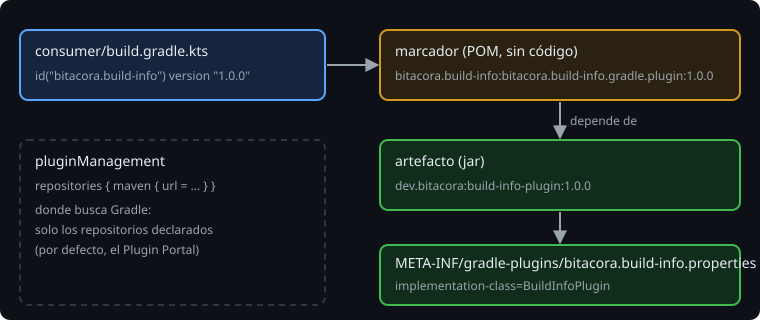

# Publicar y consumir un plugin

> Un plugin en `build-logic` solo lo usa tu proyecto. Para que lo use otro build hay que **publicarlo**: un jar con coordenadas y versión en un repositorio. El otro build lo pide con `id(...) version "..."`, como el plugin de Kotlin.

## 🎯 Objetivos

- Publicar un plugin en un repositorio Maven con `maven-publish`
- Explicar qué es el marcador de un plugin y cómo pasa Gradle del id al jar
- Consumir el plugin desde otro build, decidiendo de qué repositorios se fía

## 1. Publicar

```kotlin
plugins {
    `kotlin-dsl`
    `maven-publish`
}

group = "dev.bitacora"
version = "1.0.0"

publishing {
    repositories {
        maven {
            name = "local"
            url = uri(layout.buildDirectory.dir("repo"))
        }
    }
}
```

- **`group` y `version`** son las coordenadas; el nombre del artefacto es el del proyecto (`rootProject.name`).
- **El repositorio** puede ser cualquiera: aquí, una carpeta. En una empresa sería un servidor propio; para todo el mundo, el Gradle Plugin Portal.
- `java-gradle-plugin` y `maven-publish` juntos crean **dos publicaciones** sin que escribas ninguna: `pluginMaven` (el jar) y `buildInfoPluginMarkerMaven` (el marcador). `./gradlew publish` publica las dos.

> 🔬 Medido en Gradle 9.8.2, `./gradlew publish` deja en `build/repo`:
>
> ```
> bitacora/build-info/bitacora.build-info.gradle.plugin/1.0.0/bitacora.build-info.gradle.plugin-1.0.0.pom
> dev/bitacora/build-info-plugin/1.0.0/build-info-plugin-1.0.0.jar
> dev/bitacora/build-info-plugin/1.0.0/build-info-plugin-1.0.0.module
> dev/bitacora/build-info-plugin/1.0.0/build-info-plugin-1.0.0.pom
> ```

## 2. El marcador



`plugins { id("bitacora.build-info") version "1.0.0" }` no dice dónde está el jar. Gradle lo traduce a unas coordenadas fijas, `<id>:<id>.gradle.plugin:<versión>`, y busca ese **marcador**: un POM sin código cuya única dependencia es el artefacto de verdad:

```xml
<groupId>bitacora.build-info</groupId>
<artifactId>bitacora.build-info.gradle.plugin</artifactId>
<version>1.0.0</version>
<dependencies>
  <dependency>
    <groupId>dev.bitacora</groupId>
    <artifactId>build-info-plugin</artifactId>
    <version>1.0.0</version>
  </dependency>
</dependencies>
```

Así un jar puede tener **varios plugins** (un marcador por id) y las coordenadas del jar pueden ser las que quieras.

## 3. Consumir

```kotlin
// consumer/settings.gradle.kts
pluginManagement {
    repositories {
        maven {
            url = uri("../build/repo")
        }
    }
}

// consumer/build.gradle.kts
plugins {
    java
    id("bitacora.build-info") version "1.0.0"
}

buildInfo {
    domain = "obra"
}
```

Declarar `repositories` en `pluginManagement` **sustituye** al Plugin Portal: el consumidor solo busca donde le dices. Si la versión no existe, el mensaje dice dónde buscó:

```
Plugin [id: 'bitacora.build-info', version: '9.9.9'] was not found in any of the following sources:
...
- Plugin Repositories (could not resolve plugin artifact 'bitacora.build-info:bitacora.build-info.gradle.plugin:9.9.9')
  Searched in the following repositories:
    maven(file:/.../build/repo/)
```

> 🔬 Medido: sin el bloque `pluginManagement`, el mismo build busca en `Gradle Central Plugin Repository` (el Portal) y falla igual: el plugin no está publicado ahí. De dónde sale el código que ejecuta tu build es una decisión de seguridad, como los repositorios de la semana 10.

## 4. Una versión publicada no cambia

> 🔬 Medido: si cambias el código del plugin y vuelves a publicar **la misma** `1.0.0` en la carpeta, el consumidor recibe el código nuevo sin enterarse. Con un repositorio de carpeta no hay nada que lo impida.

Por eso un cambio se publica **con otra versión** (`1.1.0`) y el consumidor decide cuándo subir. Los repositorios públicos (Maven Central, el Plugin Portal) rechazan volver a publicar una versión: es la garantía de que `1.0.0` significa siempre lo mismo.

## 5. Cuándo publicar

| Situación | Dónde vive el plugin |
| --- | --- |
| Solo lo usa tu proyecto | `build-logic` (semana 11 y proyecto de esta semana) |
| Lo usan varios proyectos tuyos o de tu empresa | Publicado en un repositorio propio, con versiones |
| Lo puede usar cualquiera | Publicado en el Gradle Plugin Portal (fuera del alcance del curso) |

## ✅ Comprueba

- [ ] ¿Qué coordenadas tiene el marcador del plugin `bitacora.build-info` versión `1.0.0`?
- [ ] ¿Qué pasa con el Plugin Portal cuando un build declara `pluginManagement { repositories { ... } }`?
- [ ] ¿Por qué no se vuelve a publicar una versión ya publicada?
