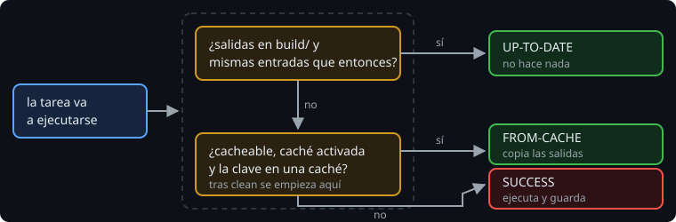

# Qué es la caché de build

> `UP-TO-DATE` ya te ahorra trabajo, pero solo si las salidas siguen en `build/`. La **caché de build** guarda esas salidas aparte, con una clave calculada a partir de las entradas. Sirven después de un `clean`, en otra carpeta y, con una caché remota, en otra máquina.

## 🎯 Objetivos

- Distinguir `UP-TO-DATE`, `FROM-CACHE` y `SUCCESS`
- Activar la caché de build y saber dónde guarda las cosas
- Distinguir la caché de build de la caché de configuración

## 1. Tres resultados



| Resultado | Qué ha pasado | Hace falta |
| --- | --- | --- |
| `UP-TO-DATE` | Las salidas que hay en `build/` corresponden a las entradas de ahora: no se hace nada | Que las salidas sigan en su sitio |
| `FROM-CACHE` | Las salidas se copian desde la caché, sin ejecutar la tarea | Caché activada, tarea cacheable, la misma clave guardada antes |
| `SUCCESS` | La tarea se ejecuta. Si es cacheable, sus salidas se guardan en la caché | Nada |

```
> Task :countObservations                ← primera vez: se ejecuta y se guarda
> Task :countObservations UP-TO-DATE     ← otra vez, sin cambios
$ ./gradlew clean
> Task :countObservations FROM-CACHE     ← build/ ya no está, la caché sí
```

> 🔬 Medido en Gradle 9.8.2 con la tarea del ejercicio 01: es exactamente esa secuencia.

## 2. Activarla

La caché de build está **desactivada** por defecto. Dos formas de activarla:

| Cómo | Alcance |
| --- | --- |
| `./gradlew build --build-cache` | Esa ejecución |
| `org.gradle.caching=true` en `gradle.properties` | Todas las ejecuciones del proyecto, de todo el equipo |

Lo normal es la segunda: está en el repositorio, así que nadie tiene que acordarse del flag. `--no-build-cache` la desactiva en una ejecución.

## 3. La caché local

Sin más configuración, la caché local vive en `~/.gradle/caches/build-cache-1` y la **comparten todos tus proyectos**. Gradle borra las entradas que no se usan en 7 días.

```
Using local directory build cache for the root build (location = /home/tú/.gradle/caches/build-cache-1, remove unused entries = after 7 days).
```

> 🔬 Medido: es la línea que imprime `--info` en Gradle 9.8.2.

Que la compartan todos tus proyectos es lo que permite reutilizar resultados entre dos copias del mismo repositorio (dos ramas, dos carpetas). En los tests de esta semana, en cambio, cada build de prueba recibe su propia carpeta de caché, con un *init script*: así un test no ve los resultados de otro.

## 4. Qué tareas usan la caché

No todas. Una tarea entra en la caché solo si **se declara cacheable**. Las del plugin de Kotlin y las de test lo son. Otras, como `jar` o `processResources`, no: copiar archivos es tan rápido como bajarlos de la caché.

```
> Task :core:compileKotlin FROM-CACHE
> Task :core:test FROM-CACHE
> Task :app:generateBuildInfo FROM-CACHE
> Task :app:processResources
> Task :app:jar
```

> 🔬 Medido: `clean` y `build` en la Bitácora de la semana 12, con la caché activada. Los `compileKotlin`, los `test` y `generateBuildInfo` salen de la caché; `processResources` y `jar` se ejecutan.

## 5. Caché de build y caché de configuración

Se parecen en el nombre, pero guardan cosas distintas:

| | Caché de configuración (semana 9) | Caché de build |
| --- | --- | --- |
| Guarda | El grafo de tareas ya configurado | Las salidas de las tareas |
| Se salta | La fase de configuración | La ejecución de una tarea |
| Se activa | `org.gradle.configuration-cache=true` | `org.gradle.caching=true` |

Son independientes y se usan juntas.

## ✅ Comprueba

- [ ] ¿Por qué una tarea no puede estar `UP-TO-DATE` después de `clean` y sí `FROM-CACHE`?
- [ ] ¿Dónde está la caché local y quién la comparte?
- [ ] ¿Por qué `jar` no sale de la caché?
