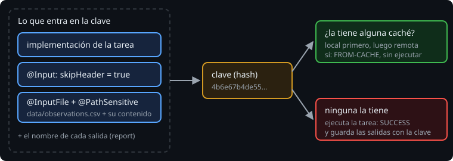

# Tareas cacheables

> Las tareas de los plugins de Gradle y de Kotlin ya son cacheables. Las tuyas no, hasta que lo digas. Antes de guardar nada, Gradle necesita saber exactamente qué entra en la tarea y cómo comparar sus archivos.

## 🎯 Objetivos

- Explicar de qué se calcula la clave de caché de una tarea
- Marcar una tarea propia como cacheable con `@CacheableTask`
- Elegir la normalización de un archivo de entrada con `@PathSensitive`

## 1. La clave



La clave es un hash de todo lo que puede cambiar el resultado de la tarea:

- **La implementación**: la clase de la tarea y el classpath que la carga. Si cambias el código de la tarea, la clave cambia.
- **Los valores de entrada** (`@Input`): `skipHeader = true` y `skipHeader = false` dan claves distintas.
- **Los archivos de entrada** (`@InputFile`, `@InputFiles`, `@InputDirectory`): su contenido y, según la normalización, su ruta.
- **Los nombres de las salidas** (`@OutputFile`, `@OutputDirectory`).

Por eso las anotaciones de la semana 9 eran tan importantes. Una entrada sin declarar no entra en la clave, y la caché te daría un resultado calculado con otro valor.

## 2. `@CacheableTask`

Una tarea propia no se guarda en la caché si no lo pides:

```kotlin
@CacheableTask
abstract class CountObservations : DefaultTask() {
    @get:InputFile
    @get:PathSensitive(PathSensitivity.RELATIVE)
    abstract val source: RegularFileProperty

    @get:Input
    abstract val skipHeader: Property<Boolean>

    @get:OutputFile
    abstract val report: RegularFileProperty

    @TaskAction
    fun count() { /* ... */ }
}
```

Sin `@CacheableTask`, la tarea sigue quedando `UP-TO-DATE`, pero después de `clean` se ejecuta siempre (`SUCCESS`). Es opcional por una buena razón: guardar en la caché cuesta (comprimir, escribir y, con caché remota, subir). Para una tarea que tarda menos que eso, no compensa. Gradle lo decide así con `jar` y `processResources`.

## 3. La normalización: `@PathSensitive`

Al calcular la huella de un archivo de entrada, ¿cuenta su ruta? Depende de lo que haga la tarea con él:

| `PathSensitivity` | Qué entra en la clave | Para |
| --- | --- | --- |
| `NONE` | Solo el contenido | Tareas a las que no les importa cómo se llama el archivo |
| `NAME_ONLY` | Contenido y nombre del archivo | Tareas que usan el nombre (lo copian a la salida, por ejemplo) |
| `RELATIVE` | Contenido y ruta relativa al proyecto | Casi siempre: es la opción segura |
| `ABSOLUTE` | Contenido y ruta completa | Casi nunca: el resultado solo vale en esa carpeta |

Para el classpath hay anotaciones propias: `@Classpath` y `@CompileClasspath` (esta última ignora lo que no afecta a la compilación).

En una tarea cacheable, la normalización es **obligatoria**:

```
Type 'Build_gradle.CountObservations' property 'source' is annotated with @InputFile but missing a normalization strategy
  If you don't declare the normalization, outputs can't be re-used between machines or locations on the same machine, therefore caching efficiency drops significantly
  Possible solution: Declare the normalization strategy by annotating the property with either @PathSensitive, @Classpath or @CompileClasspath.
```

> 🔬 Medido en Gradle 9.8.2: con `@CacheableTask` y sin `@PathSensitive`, la tarea falla con ese problema. Sin `@CacheableTask`, Gradle no lo exige.

## 4. Qué pasa cuando cambia una entrada

La caché no tiene una sola entrada por tarea, sino **una por clave**. Si vuelves a unas entradas que ya conoce, recupera ese resultado:

```
$ ./gradlew countObservations                       → SUCCESS     observations=3
$ ./gradlew countObservations -PskipHeader=false    → SUCCESS     observations=4
$ ./gradlew countObservations                       → FROM-CACHE  observations=3
```

> 🔬 Medido: es el test `goingBackToAnOldInputHitsTheCacheAgain` del ejercicio 01. `UP-TO-DATE` no lo puede hacer: solo recuerda la última ejecución. En el día a día, esto es lo que hace que cambiar de rama y volver sea rápido.

## ✅ Comprueba

- [ ] ¿Qué cuatro cosas entran en la clave de una tarea?
- [ ] ¿Por qué `@CacheableTask` es opcional y no lo trae cada tarea por defecto?
- [ ] ¿Qué `PathSensitivity` usarías para el CSV de `countObservations` y por qué no `ABSOLUTE`?
