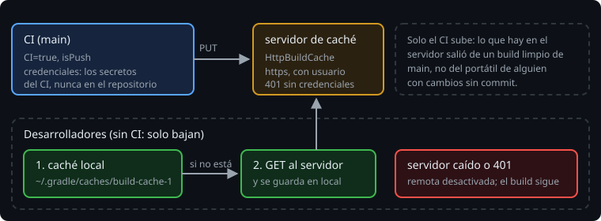

# La caché remota

> La caché local te ahorra repetir tu propio trabajo. La **remota** comparte el trabajo de todo el equipo: el CI construye `main` una vez y cada desarrollador descarga los resultados en vez de calcularlos.

## 🎯 Objetivos

- Configurar una caché remota HTTP en `settings.gradle.kts`
- Explicar por qué solo el CI sube resultados
- Sacar las credenciales del repositorio
- Saber qué hace Gradle cuando la caché remota falla

## 1. Quién sube y quién baja



Gradle busca una clave primero en la caché **local** y, si no está, en la **remota**. Lo que baja de la remota se guarda también en la local, así que la siguiente vez ni siquiera pregunta al servidor.

> 🔬 Medido en el ejercicio 02 (`theLocalCacheIsAskedFirst`): un desarrollador descarga una entrada (1 petición al servidor), hace `clean` y vuelve a construir: `FROM-CACHE` y ninguna petición nueva.

**Solo el CI sube.** Lo que hay en el servidor tiene que salir de un build limpio de `main`, no del portátil de alguien con cambios sin commit o con un JDK distinto. Una entrada mala en una caché compartida (*cache poisoning*) la descargan todos: es un problema de seguridad, no solo de calidad.

## 2. Configurarla

La caché remota va en `settings.gradle.kts`, porque vale para todo el build:

```kotlin
val cacheUrl = providers.gradleProperty("bitacora.cacheUrl").orNull

buildCache {
    if (cacheUrl != null) {
        remote<HttpBuildCache> {
            url = uri(cacheUrl)
            isPush = providers.environmentVariable("CI").isPresent
            credentials {
                username = providers.environmentVariable("CACHE_USER").orNull
                password = providers.environmentVariable("CACHE_PASSWORD").orNull
            }
        }
    }
}
```

- **La URL** sale de una propiedad (`-Pbitacora.cacheUrl=...`, o `~/.gradle/gradle.properties` en cada máquina). Sin ella, no hay caché remota: el build funciona igual, solo con la local.
- **`isPush`** es `true` solo si existe la variable `CI`. GitHub Actions y la mayoría de los CI la definen en todos sus trabajos.
- **Las credenciales** salen de variables de entorno, que en el CI vienen de su almacén de secretos. Nunca escritas en el archivo: `settings.gradle.kts` está en el repositorio y lo lee cualquiera que lo clone.

`HttpBuildCache` habla un protocolo muy sencillo: `GET /<clave>` para bajar (404 si no existe) y `PUT /<clave>` para subir. El servidor del ejercicio son unas cincuenta líneas con el `HttpServer` del JDK. En un equipo de verdad se usa un servidor preparado, como el nodo de caché de Gradle (Develocity Build Cache Node).

## 3. Solo HTTPS

```
Using insecure protocols with remote build cache, without explicit opt-in, is unsupported.
> Switch remote build cache to a secure protocol (like HTTPS) or allow insecure protocols.
```

> 🔬 Medido en Gradle 9.8.2: con `http://localhost:...` el build falla con ese mensaje; con `http://127.0.0.1:...` lo acepta. Gradle solo deja pasar `http` hacia la dirección de *loopback*, que no sale de la máquina. Por eso los tests usan `127.0.0.1` y no necesitan `isAllowInsecureProtocol`.

`isAllowInsecureProtocol = true` existe, pero con `http` las credenciales y los resultados viajan sin cifrar. Fuera de un test, siempre `https`.

## 4. Cuando la caché remota falla

Un servidor caído o una contraseña incorrecta **no rompen el build**: Gradle avisa, desactiva la caché remota durante esa ejecución y sigue con la local.

```
Could not load entry 4b6e67b4... from remote build cache: Loading entry from 'http://127.0.0.1:41153/cache/4b6e67b4...' response status 401: Unauthorized
The remote build cache was disabled during the build due to errors.
```

```
Could not load entry 4b6e67b4... from remote build cache: Connect to 127.0.0.1:39843 [/127.0.0.1] failed: Connection refused
The remote build cache was disabled during the build due to errors.
```

> 🔬 Medido: los dos builds terminan con `BUILD SUCCESSFUL` y la tarea en `SUCCESS`. Con la contraseña mala, el servidor recibe una sola petición: después del primer error, Gradle ya no pregunta más.

Es una buena decisión: la caché es una optimización, y una optimización no debería impedir construir. El precio es que un error de configuración puede pasar desapercibido. Si el CI tarda lo mismo que sin caché, busca esa línea en su salida.

## ✅ Comprueba

- [ ] ¿En qué orden busca Gradle una clave y qué hace con lo que baja de la remota?
- [ ] ¿Por qué solo el CI sube resultados?
- [ ] ¿Dónde van la URL, el usuario y la contraseña, y por qué no en `settings.gradle.kts`?
- [ ] ¿Qué pasa con el build si el servidor de caché está caído?
