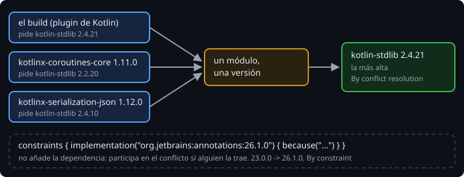

# Cómo resuelve Gradle las dependencias

> Tú declaras cuatro dependencias, pero en el classpath acaban muchas más: las que traen las tuyas. Varias piden versiones distintas del mismo módulo, y en el classpath solo cabe una. Esta lección va de cómo elige Gradle y de cómo preguntarle por qué.

## 🎯 Objetivos

- Leer el árbol de `dependencies` de una configuración
- Explicar qué hace Gradle cuando dos dependencias piden versiones distintas del mismo módulo
- Usar `dependencyInsight` para saber por qué un módulo tiene la versión que tiene

## 1. Dependencias transitivas

Cada biblioteca publica, junto a su jar, la lista de lo que necesita (en su `.pom` o su `.module`). Gradle la sigue y resuelve un **grafo**: tus dependencias, las de ellas, y así hasta el final. Lo que tú no declaras pero acaba en el classpath son las **transitivas**.

```
$ ./gradlew dependencies --configuration runtimeClasspath

runtimeClasspath - Runtime classpath of 'main'.
+--- org.jetbrains.kotlin:kotlin-stdlib:2.4.21
|    \--- org.jetbrains:annotations:13.0 -> 23.0.0
+--- org.jetbrains.kotlinx:kotlinx-coroutines-bom:1.11.0
|    +--- org.jetbrains.kotlinx:kotlinx-coroutines-core:1.11.0 (c)
|    \--- org.jetbrains.kotlinx:kotlinx-coroutines-core-jvm:1.11.0 (c)
+--- org.jetbrains.kotlinx:kotlinx-coroutines-core -> 1.11.0
|    \--- org.jetbrains.kotlinx:kotlinx-coroutines-core-jvm:1.11.0
|         +--- org.jetbrains:annotations:23.0.0
|         +--- org.jetbrains.kotlinx:kotlinx-coroutines-bom:1.11.0 (*)
|         \--- org.jetbrains.kotlin:kotlin-stdlib:2.2.20 -> 2.4.21 (*)
...
```

> 🔬 Medido en Gradle 9.8.2 con el build del ejercicio 01: Kotlin 2.4.21, el BOM de coroutines 1.11.0 y el de serialization 1.12.0.

| Marca | Significa |
| --- | --- |
| `a:b:1.0 -> 2.0` | Se pidió la 1.0, se usa la 2.0 |
| `a:b -> 1.11.0` | Se pidió sin versión (la pone el BOM) y se usa la 1.11.0 |
| `(c)` | Una **restricción**, no una dependencia: fija la versión si alguien trae el módulo |
| `(*)` | Ya aparece más arriba con sus dependencias; no se repite |

Las líneas `(c)` del BOM son eso: un BOM (`platform(...)`) no añade bibliotecas, añade restricciones de versión.

## 2. Una versión por módulo



`kotlin-stdlib` lo piden tres: el plugin de Kotlin (2.4.21), `kotlinx-coroutines-core` 1.11.0 (2.2.20) y `kotlinx-serialization-json` 1.12.0 (2.4.10). En el classpath solo puede haber una. Gradle resuelve el **conflicto** con una regla sencilla: **gana la versión más alta**.

Es una apuesta: que una biblioteca compilada contra la 2.2.20 funciona con la 2.4.21. Con bibliotecas que mantienen la compatibilidad, como la de Kotlin, sale bien casi siempre. Cuando no, el error aparece al ejecutar (`NoSuchMethodError`), no al compilar.

## 3. Preguntar por qué: `dependencyInsight`

```
$ ./gradlew dependencyInsight --dependency kotlin-stdlib --configuration runtimeClasspath

org.jetbrains.kotlin:kotlin-stdlib:2.4.21
   Selection reasons:
      - By conflict resolution: between versions 2.4.21, 2.2.20 and 2.4.10

org.jetbrains.kotlin:kotlin-stdlib:2.2.20 -> 2.4.21
\--- org.jetbrains.kotlinx:kotlinx-coroutines-core-jvm:1.11.0
     ...
```

> 🔬 Medido: es la salida real, recortada. Debajo de los motivos aparece, para cada versión pedida, quién la pidió.

`dependencies` enseña el árbol entero; `dependencyInsight`, un solo módulo: qué versión ganó, por qué y quién pidió cada una. Las dos miran **una configuración**: `compileClasspath` (para compilar) y `runtimeClasspath` (para ejecutar) pueden dar resultados distintos.

## 4. Convertir los conflictos en errores

Si prefieres que ningún conflicto se resuelva solo:

```kotlin
configurations.all {
    resolutionStrategy.failOnVersionConflict()
}
```

```
> Could not resolve org.jetbrains.kotlin:kotlin-stdlib:2.4.21.
   > Conflict found for module 'org.jetbrains.kotlin:kotlin-stdlib': between versions 2.4.21, 2.2.20 and 2.4.10
```

> 🔬 Medido: en un build tan pequeño ya salen dos conflictos (`kotlin-stdlib` y `annotations`). En un proyecto Android hay muchos más, casi todos inofensivos. Sirve para verlos todos de una vez, no para dejarlo activado.

## ✅ Comprueba

- [ ] ¿Qué significan `->`, `(c)` y `(*)` en el árbol de `dependencies`?
- [ ] Tres dependencias piden versiones distintas de `kotlin-stdlib`. ¿Cuál se usa y qué riesgo tiene?
- [ ] ¿Qué te dice `dependencyInsight` que `dependencies` no te dice?
