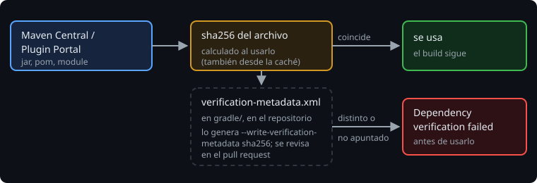

# Verificar lo que descargas

> Cada build descarga código de otros y lo ejecuta en tu máquina y en la del CI: las bibliotecas, y también los plugins, que corren con tus permisos mientras Gradle configura. Pinar versiones dice **qué** quieres. La verificación de dependencias comprueba que lo que llega **es** eso.

## 🎯 Objetivos

- Explicar qué problema resuelve la verificación de dependencias y cuál no
- Generar `gradle/verification-metadata.xml` y mantenerlo al día
- Reconocer los fallos de verificación y saber qué hacer con cada uno

## 1. El problema

Un ataque a la **cadena de suministro** no rompe tu código: cambia el de una dependencia. Un repositorio comprometido, un espejo de empresa mal configurado, un proxy que sirve otro archivo con el mismo nombre... El build sigue funcionando y tus tests siguen pasando, pero el jar ya no es el que se publicó.

La versión pinada no lo detecta: `1.12.0` es un nombre, no un contenido.

## 2. La verificación



Gradle puede comparar cada archivo que usa (jar, `.pom`, `.module`) con un **sha256** apuntado en `gradle/verification-metadata.xml`, que está en el repositorio:

```xml
<component group="org.jetbrains.kotlinx" name="kotlinx-serialization-json-jvm" version="1.12.0">
   <artifact name="kotlinx-serialization-json-jvm-1.12.0.jar">
      <sha256 value="..." origin="Generated by Gradle"/>
   </artifact>
   <artifact name="kotlinx-serialization-json-jvm-1.12.0.module">
      <sha256 value="..." origin="Generated by Gradle"/>
   </artifact>
</component>
```

Con ese archivo presente, la verificación está activada. No hay que escribir nada en el build.

## 3. Generarlo

No se escribe a mano:

```bash
./gradlew --write-verification-metadata sha256 help
```

> 🔬 Medido en Gradle 9.8.2: con `help`, Gradle resuelve todas las configuraciones, no solo las que necesita `help`. El del ejercicio 02, con cbor, tiene 60 componentes; el de la Bitácora, 101.

- **Incluye los plugins**: `kotlin-gradle-plugin`, el plugin de serialization y todo lo que traen. Son lo más delicado, porque se ejecutan al configurar.
- **En un build compuesto, un solo archivo**: el `gradle/verification-metadata.xml` del build raíz cubre también `build-logic` (`gradle-kotlin-dsl-plugins` 6.7.6 está en el de la Bitácora).
- **`sha256`**, no `sha1` ni `md5`: con estos dos se pueden fabricar archivos distintos con la misma suma.
- **Se revisa en el pull request**, como el código. Un cambio en el archivo que nadie esperaba es la señal.

## 4. Cuando falla

**Un archivo que no coincide:**

```
> Dependency verification failed for configuration ':compileClasspath'
  One artifact failed verification: annotations-26.1.0.jar (org.jetbrains:annotations:26.1.0) from repository MavenRepo
  This can indicate that a dependency has been compromised. Please carefully verify the checksums.
```

**Un archivo que no está apuntado** (una dependencia nueva):

```
> Dependency verification failed for configuration ':detachedConfiguration1'
  3 artifacts failed verification:
    - kotlinx-serialization-cbor-1.12.0.module (org.jetbrains.kotlinx:kotlinx-serialization-cbor:1.12.0) from repository MavenRepo
    ...
  If the artifacts are trustworthy, you will need to update the gradle/verification-metadata.xml file.
```

**Un plugin**, antes incluso de configurar:

```
Error resolving plugin [id: 'org.jetbrains.kotlin.jvm', version: '2.4.21']
> A problem occurred configuring project ':build-logic'.
   > Dependency verification failed for configuration 'classpath'
     One artifact failed verification: gradle-kotlin-dsl-plugins-6.7.6.jar (...) from repository Gradle Central Plugin Repository
```

> 🔬 Medido: los tres, cambiando un sha256 en el archivo o añadiendo una dependencia. También falla si el cambiado es el `.module`: con `verify-metadata` a `true` (lo que genera Gradle), se verifican los metadatos, no solo los jars.

| Fallo | Qué hacer |
| --- | --- |
| Dependencia nueva | Es lo esperado: vuelve a generar el archivo y revisa en el diff que solo entra lo que añadiste |
| Un sha256 que no coincide, sin haber cambiado nada | **Para.** No regeneres el archivo: eso es aceptar el archivo cambiado. Averigua de dónde viene (repositorio, proxy, caché) |
| Necesitas saber qué cambiaría | `--write-verification-metadata sha256 --dry-run`: escribe `verification-metadata.dryrun.xml` y deja el original |

## 5. Límites

- **Confía en la primera vez.** El archivo apunta lo que había cuando lo generaste. Si esa versión ya era maliciosa al publicarse, la apuntas como buena. Por eso las versiones del curso se verifican antes de pinarlas (`docs/stack-versions.md`).
- **No borra lo que sobra.** Si quitas una dependencia y regeneras, sus entradas siguen en el archivo. 🔬 Medido: al quitar `cbor` y regenerar, sus 5 entradas siguen ahí. Bórralas a mano de vez en cuando.
- **Las firmas son otra capa.** `verify-signatures` (falso por defecto) comprueba además la firma PGP de quien publica. Es más fuerte y también más trabajo de mantener; no se usa en el curso.
- **`--dependency-verification lenient`** convierte los fallos en avisos y deja seguir. 🔬 Medido: con un sha256 cambiado, el build termina en `BUILD SUCCESSFUL` y solo avisa. Sirve para ver todos los fallos de una vez mientras actualizas, nunca para dejarlo así en el repositorio ni en el CI.

## ✅ Comprueba

- [ ] ¿Por qué pinar una versión no basta contra un ataque a la cadena de suministro?
- [ ] ¿Por qué los plugins son la parte más delicada del archivo?
- [ ] Un sha256 no coincide y no has cambiado nada. ¿Por qué no regeneras el archivo?
- [ ] ¿Qué no puede detectar la verificación?
