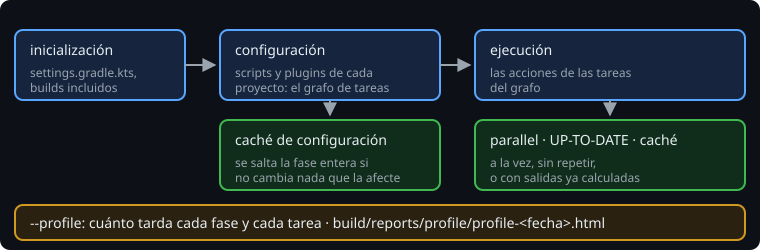

# Medir y acelerar el build

> Un build lento no se arregla con trucos sueltos: se mide, se encuentra la fase o la tarea que se lleva el tiempo, se cambia una cosa y se vuelve a medir. Gradle da las herramientas para cada fase.

## 🎯 Objetivos

- Medir cuánto tarda cada fase y cada tarea con `--profile`
- Saber qué acelera la caché de configuración y qué `org.gradle.parallel`
- Decidir cuándo un Build Scan es una buena idea y cuándo no

## 1. Tres fases, tres remedios



| Fase | Qué pasa | Qué la acelera |
| --- | --- | --- |
| Inicialización | `settings.gradle.kts`, builds incluidos (`build-logic`) | Poco que hacer: que `build-logic` no cambie a menudo |
| Configuración | Los scripts y plugins de cada proyecto, el grafo de tareas | La caché de configuración (semana 9); `register` en vez de crear tareas que no se usan |
| Ejecución | Las acciones de las tareas | `UP-TO-DATE`, la caché de build (semana 13), `org.gradle.parallel` |

## 2. Medir: `--profile`

```
$ ./gradlew :app:jar --profile
See the profiling report at: file:///.../build/reports/profile/profile-2026-10-27-00-09-29.html
```

> 🔬 Medido en Gradle 9.8.2. El informe es una página local, sin conexión, con el tiempo de cada fase y de cada tarea.

Para comparar, mide siempre lo mismo y en las mismas condiciones:

- **El caso que te importa.** `clean build` mide un build desde cero. El día a día es "cambio una línea en `core` y compilo": mide eso también.
- **Varias veces.** La primera ejecución arranca el daemon de Gradle y calienta la JVM. Tira la primera y quédate con las siguientes.
- **Un cambio cada vez.** Si activas tres cosas a la vez y mejora, no sabrás cuál fue.

## 3. Caché de configuración y paralelo

En `gradle.properties`, para todo el equipo:

```properties
org.gradle.configuration-cache=true
org.gradle.parallel=true
```

```
$ ./gradlew help --info
Operational build model parameters: {..., configurationCache=true, ..., parallelProjectExecution=true, ...}
```

> 🔬 Medido: es la línea que confirma que las dos están activas. En la Bitácora de la semana 13, `build` entero, con los tests de TestKit y `build-logic` incluidos, es compatible con la caché de configuración: `Configuration cache entry stored.`, y la segunda vez `Configuration cache entry reused.`

- **La caché de configuración** se salta la fase de configuración cuando nada de lo que la afecta ha cambiado. En un build de tres módulos se nota poco. En uno Android de veinte, son segundos en cada ejecución.
- **`org.gradle.parallel`** ejecuta a la vez tareas de proyectos distintos que no dependen entre sí: `:core:test` y `:data:compileKotlin`, por ejemplo. Sin ella, Gradle ejecuta una tarea cada vez, salvo el trabajo que una tarea reparte por dentro, aunque tengas ocho núcleos. Funciona mejor cuando ningún proyecto configura a otro, que es lo que ya consiguen los convention plugins (semana 11).

## 4. Build Scans

`./gradlew build --scan` genera un informe mucho más detallado que `--profile`, y además compara dos builds. Pero **lo sube a un servidor de Gradle** (`scans.gradle.com`): nombres de tareas y proyectos, rutas, versiones, el nombre de la máquina y del usuario. La primera vez pide aceptar unas condiciones.

| | `--profile` | `--scan` |
| --- | --- | --- |
| Dónde queda | `build/reports/profile`, en tu máquina | En un servidor externo, con un enlace |
| Detalle | Fases y tareas | Todo: dependencias, caché, cada tarea, comparaciones |
| Para | Siempre | Proyectos públicos, o con el servidor propio de la empresa (Develocity) |

En el proyecto de un cliente, no subas nada a un servidor externo sin permiso.

## 5. Otros ajustes

- **`org.gradle.jvmargs=-Xmx2g`**: memoria del daemon. Si un build grande tarda cada vez más, mira el uso de memoria antes de tocar otra cosa.
- **`org.gradle.caching=true`** (semana 13): la caché de build, en el mismo archivo.

Los ajustes de rendimiento van en `gradle.properties`, en el repositorio: así los tiene todo el equipo y el CI.

## ✅ Comprueba

- [ ] ¿Qué fase acelera la caché de configuración y cuál `org.gradle.parallel`?
- [ ] ¿Cómo compruebas que las dos están activas?
- [ ] ¿Por qué tiras la primera medición?
- [ ] ¿Qué diferencia hay entre `--profile` y `--scan`, y cuándo no usarías el segundo?
