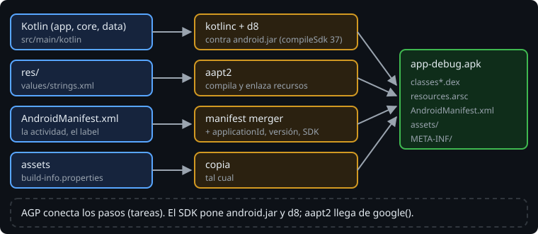

# El SDK de Android y AGP

> Hasta ahora, Gradle compilaba Kotlin para la JVM con lo que traía el JDK. Una app Android necesita más: las clases de Android contra las que compilar, herramientas que convierten el bytecode y los recursos al formato del móvil, y un plugin que sepa usarlas. Son el **SDK de Android** y el **Android Gradle Plugin** (AGP).

## 🎯 Objetivos

- Distinguir qué pone el SDK y qué pone AGP en un build Android
- Instalar y localizar el SDK sin Android Studio (`sdkmanager`, `ANDROID_HOME`)
- Explicar `compileSdk`, `minSdk` y `targetSdk` y por qué son tres números distintos

## 1. Dos piezas

| Pieza | Qué es | De dónde sale |
| --- | --- | --- |
| **SDK de Android** | Una carpeta con plataformas (`android.jar` de cada versión de Android), herramientas de línea de comandos (`sdkmanager`, `apkanalyzer`), `adb` y el emulador | Se instala con `sdkmanager` o con Android Studio |
| **AGP** (`com.android.application`) | Un plugin de Gradle: añade las tareas que convierten tu código y tus recursos en un APK | El repositorio de Google, `google()`, como cualquier plugin |

AGP es un plugin más, como el de Kotlin de la fase 2: tiene versión en el catálogo, entra en la verificación y se puede leer su código. El SDK, en cambio, no se descarga con el build: AGP lo busca en tu máquina.

## 2. Dónde está el SDK

AGP busca el SDK en la variable de entorno `ANDROID_HOME` o en `sdk.dir`, dentro de `local.properties`. En este curso usamos la variable: `local.properties` tiene una ruta de tu máquina y no va al repositorio.

```bash
export ANDROID_HOME="$HOME/.local/android-sdk"
export PATH="$ANDROID_HOME/cmdline-tools/latest/bin:$ANDROID_HOME/platform-tools:$PATH"
```

Si no la encuentra, el build falla al calcular las tareas de compilación:

```text
> SDK location not found. Define a valid SDK location with an ANDROID_HOME environment variable or by setting the sdk.dir path in your project's local properties file
```

> 🔬 Medido en AGP 9.4.1 con `env -u ANDROID_HOME ./gradlew --no-daemon assembleDebug`. El daemon de Gradle recuerda las variables con las que arrancó: si defines `ANDROID_HOME` después, `./gradlew --stop`.

Lo que necesita la semana, instalado con `sdkmanager` ([docs/setup.md](../../../docs/setup.md)):

| Paquete | Versión | Para qué |
| --- | --- | --- |
| `cmdline-tools;latest` | 19.0 | `sdkmanager` y `apkanalyzer` |
| `platforms;android-37.0` | revisión 2 | El `android.jar` contra el que compilas (`compileSdk = 37`) |
| `build-tools;36.0.0` | 36.0.0 | `d8`, `zipalign`, `apksigner` |
| `platform-tools` | 37.0.1 | `adb`, para instalar en un móvil |

Si falta la plataforma de tu `compileSdk`, el error lo dice con el nombre exacto del paquete:

```text
> Failed to find Platform SDK with path: platforms;android-38.0
```

> 🔬 Medido con `compileSdk = 38`, que no existe.

## 3. Tres números



```kotlin
android {
    compileSdk = 37
    defaultConfig {
        minSdk = 26
        targetSdk = 36
    }
}
```

- **`compileSdk`**: contra qué versión de Android **compilas**. Decide qué APIs existen para el compilador. No viaja al móvil como requisito: es la plataforma del SDK que usa el build.
- **`minSdk`**: la versión más vieja en la que **se instala**. Con 26 (Android 8.0), un móvil con Android 7 no puede instalarla. Si usas una API más nueva que `minSdk`, `lint` te lo dice.
- **`targetSdk`**: con qué versión **declaras que has probado** la app. Android activa los comportamientos nuevos (permisos, seguridad) solo para las apps que la declaran. Google Play exige 36 desde el 31 de agosto de 2026 ([stack-versions](../../../docs/stack-versions.md)).

Lo normal es `minSdk ≤ targetSdk ≤ compileSdk`. Subir `compileSdk` es barato (ves APIs nuevas); subir `targetSdk` es un trabajo (cambia cómo se comporta tu app) y por eso va aparte.

## 4. Y Android Studio

Android Studio es un IntelliJ con el SDK y herramientas visuales encima, y es lo que usarás a diario a partir de aquí. Pero no construye nada: abre el proyecto, ejecuta Gradle y enseña el resultado. Todo lo de esta semana funciona igual desde la terminal, y es lo que ejecuta el CI. La versión del curso está en [stack-versions](../../../docs/stack-versions.md).

## ✅ Comprueba

- [ ] ¿Qué pasa si clonas el repositorio en otra máquina y `local.properties` no está? ¿Y si estuviera en el repositorio?
- [ ] Tu app usa una API de Android 31 y tienes `minSdk = 26`. ¿Compila? ¿Quién te avisa?
- [ ] ¿Por qué subir `targetSdk` es una decisión del equipo y no una línea más en un pull request de dependencias?
