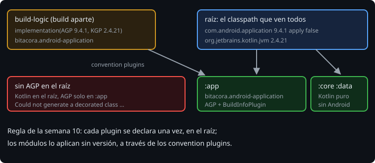

# AGP en el build de la Bitácora

> Los ejercicios tienen un build de juguete. La Bitácora tiene el de la fase 2: `build-logic`, catálogo, verificación, caché de configuración. AGP entra en todo eso como un plugin más, con tres sitios donde hay que tener cuidado: los repositorios, el classpath de los plugins y la verificación.

## 🎯 Objetivos

- Añadir AGP a un build con `build-logic` sin romper el classpath de los plugins
- Escribir el convention plugin `bitacora.android-application`
- Regenerar la verificación con AGP dentro y saber por qué `aapt2` es un caso especial

## 1. Los repositorios

AGP y todo lo que trae están en el repositorio de Google, no en el Plugin Portal ni en Maven Central:

```kotlin
// settings.gradle.kts
pluginManagement {
    includeBuild("build-logic")
    repositories {
        google()
        gradlePluginPortal()
    }
}

dependencyResolutionManagement {
    repositoriesMode = RepositoriesMode.FAIL_ON_PROJECT_REPOS
    repositories {
        google()
        mavenCentral()
    }
}
```

`pluginManagement` es para los plugins del bloque `plugins { }`; `dependencyResolutionManagement`, para las dependencias de los módulos y para lo que AGP descarga al construir (`aapt2`). `build-logic` es otro build, con su propio `settings.gradle.kts`: también necesita `google()`, porque compila contra AGP.

## 2. El classpath de los plugins



Cada build tiene un classpath de plugins por proyecto, encadenados: lo que carga el raíz lo ven todos los módulos. En la Bitácora, el raíz aplica el plugin de Kotlin (para los tests de TestKit) y `app` aplica AGP a través de `build-logic`. Si nadie más hace nada, el plugin de Kotlin se carga en el raíz y AGP más abajo, en `app`. AGP configura Kotlin (sección 1 de la teoría 03), y desde ahí no puede crear las clases de Kotlin que necesita:

```text
An exception occurred applying plugin request [id: 'bitacora.android-application']
> Failed to apply plugin 'com.android.internal.application'.
   > Could not create an instance of type org.jetbrains.kotlin.gradle.plugin.mpp.KotlinAndroidTarget.
      > Could not generate a decorated class for type KotlinAndroidTarget.
```

> 🔬 Medido en la Bitácora quitando `alias(libs.plugins.android.application) apply false` del raíz. El error sale en `help`, al configurar.

El arreglo es la regla de la semana 10: los plugins se declaran una vez, en el raíz, con `apply false`. Así AGP y Kotlin se cargan juntos, en el mismo sitio, y los módulos los usan desde ahí:

```kotlin
plugins {
    alias(libs.plugins.android.application) apply false
    alias(libs.plugins.kotlin.jvm)
    alias(libs.plugins.kotlin.serialization) apply false
}
```

## 3. El convention plugin

`build-logic` depende de AGP para poder escribir `android { }` en un convention plugin:

```kotlin
// build-logic/build.gradle.kts
dependencies {
    implementation(libs.kotlin.gradle.plugin)
    implementation(libs.android.gradle.plugin)
}
```

Y `bitacora.android-application` hace por las apps lo que `bitacora.kotlin-application` hacía por los programas de consola: todo lo que no cambia de una app a otra.

```kotlin
// build-logic/src/main/kotlin/bitacora.android-application.gradle.kts
plugins {
    id("com.android.application")
}

android {
    namespace = "dev.bitacora"
    compileSdk = 37
    defaultConfig {
        minSdk = 26
        targetSdk = 36
        versionCode = 1
        versionName = project.version.toString()
    }
}

kotlin {
    jvmToolchain(21)
    compilerOptions {
        allWarningsAsErrors.set(true)
    }
}

pluginManager.apply(BuildInfoPlugin::class.java)
```

En `app` queda lo que es suyo: el plugin, el `applicationId` con el dominio, sus dependencias y `buildInfo { domain = ... }`.

## 4. La verificación

AGP trae muchas dependencias: el archivo de verificación de la Bitácora pasa de 101 componentes a 260. Se regenera como en la semana 14, con una diferencia:

```bash
./gradlew --write-verification-metadata sha256 --no-build-cache clean help assembleDebug assembleRelease
```

`aapt2`, el compilador de recursos, no es una dependencia de AGP: AGP lo descarga de `google()` **cuando lo necesita**, al compilar recursos. Si la app no tiene `res/`, o si las tareas de recursos salen `UP-TO-DATE` o de la caché, el modo de escritura no lo ve y no lo apunta. Pero con la caché de configuración activada, Gradle lo resuelve igual al guardar la caché, y ahí sí lo verifica:

```text
Configuration cache state could not be cached: field `__binaryDirectory__` of `com.android.build.gradle.internal.services.Aapt2Input_Decorated` bean found in field `__aapt2__` of task `:app:packageDebugResources` (...)
Caused by: (...) DependencyVerificationException: Dependency verification failed for configuration ':app:detachedConfiguration1'
One artifact failed verification: aapt2-9.4.1-15978811.pom (com.android.tools.build:aapt2:9.4.1-15978811) from repository Google
```

> 🔬 Medido en Gradle 9.8.2 y AGP 9.4.1: sin `res/`, o sin `--no-build-cache clean`, salen 259 componentes y `./gradlew build` falla así. Con `res/values/strings.xml` y el comando de arriba, 260, y `aapt2` dentro. Sin caché de configuración (`--no-configuration-cache`) el build pasa: el fallo solo se ve con ella.

No se arregla escribiendo el sha256 a mano, ni con `lenient`: se arregla haciendo que Gradle lo vea. `aapt2` tiene además un jar por sistema operativo (`aapt2-9.4.1-15978811-linux.jar`); el archivo apunta el de la máquina que lo generó. En un equipo con Linux, macOS y Windows, cada uno lo regenera y el pull request junta los tres.

## 5. Lo demás sigue igual

- **Caché de configuración y paralelo**: AGP 9 es compatible. `build -x test` guarda la caché (`Configuration cache entry stored.`) y la segunda ejecución la reutiliza.
- **`build` incluye `lint`**: el análisis de Android. En la Bitácora avisa de `MissingApplicationIcon` (no hay icono). Los avisos no paran el build; los errores, sí.
- **Avisos de Gradle 10**: `Deprecated Gradle features were used in this build` sale de AGP y KGP, no de tu build. Compruébalo con `--warning-mode all` antes de dar nada por bueno.
- **Memoria**: con AGP, el daemon puede quedarse sin `Metaspace` con los valores por defecto (512 MiB de heap, 384 MiB de metaspace) y Gradle lo avisa. Se sube con `org.gradle.jvmargs` en `gradle.properties`; mide antes y después.

> 🔬 Medido: `./gradlew build -x test` en la Bitácora son 100 tareas (`100 actionable tasks`); en la semana 14, sin Android, 21.

## ✅ Comprueba

- [ ] ¿Por qué `build-logic` necesita `google()` si no aplica AGP a ningún proyecto suyo?
- [ ] Un compañero arregla el error de `KotlinAndroidTarget` aplicando AGP en el raíz sin `apply false`. ¿Qué pasa?
- [ ] Tu CI falla con `Configuration cache state could not be cached` y `aapt2` en el mensaje, pero en tu máquina va bien con `--no-configuration-cache`. ¿Qué ha pasado y qué haces?
