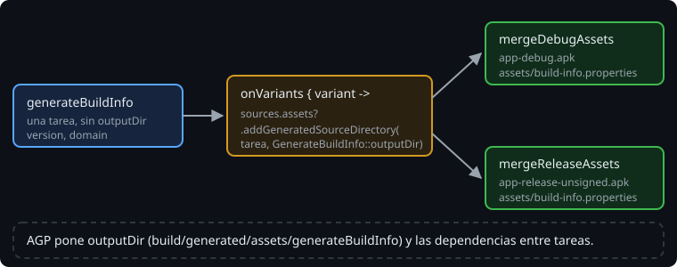

# Variantes y la Variant API

> Un módulo Kotlin produce un jar. Una app Android produce un APK por **variante**: de serie, `debug` y `release`. Cada una tiene sus propias fuentes, sus tareas y su salida. Para meter algo tuyo en ellas, como `build-info.properties`, AGP tiene una API pensada para eso: la **Variant API**.

## 🎯 Objetivos

- Explicar qué es una variante y qué tareas añade
- Conectar la salida de una tarea a los assets de cada variante con `androidComponents`
- Saber por qué no se escriben rutas de `build/` a mano en un build Android

## 1. Variantes

Un **tipo de build** (*build type*) dice cómo se construye: `debug` (firmado con una clave de desarrollo, depurable, rápido de construir) y `release` (para publicar: sin depurar, optimizable, sin firmar hasta que configures una firma). Más adelante en la fase 3 añadirás **flavors**, que dicen qué se construye (por ejemplo, una edición por cliente). Cada combinación es una variante.

Cada variante tiene sus tareas: `assembleDebug`, `assembleRelease`, `compileDebugKotlin`, `mergeDebugAssets`... y su APK:

```text
app/build/outputs/apk/debug/app-debug.apk
app/build/outputs/apk/release/app-release-unsigned.apk
```

`assemble` construye todas.

## 2. Lo que no hay que hacer

En la semana 9, `generateBuildInfo` escribía en `build/generated/build-info` y el programa lo leía de los recursos. La tentación en Android es la misma: escribir directamente en `src/main/assets`, o en una carpeta de `build/` que creas que AGP lee, y añadir un `dependsOn`. Eso falla de tres maneras: la carpeta de fuentes se llena de archivos generados, la ruta interna de AGP cambia entre versiones, y Gradle no sabe que `mergeDebugAssets` depende de tu tarea, así que la caché y `UP-TO-DATE` dejan de ser fiables.

## 3. La Variant API



AGP ofrece una extensión, `androidComponents`, con un punto de entrada por variante:

```kotlin
val generateBuildInfo = tasks.register<GenerateBuildInfo>("generateBuildInfo") {
    appVersion = project.version.toString()
    domain = "agro"
}

androidComponents {
    onVariants { variant ->
        variant.sources.assets?.addGeneratedSourceDirectory(generateBuildInfo, GenerateBuildInfo::outputDir)
    }
}
```

`addGeneratedSourceDirectory` dice tres cosas a la vez: esta tarea genera assets; su salida es esta propiedad (`outputDir`); y la variante los tiene que incluir. AGP pone él la carpeta en `outputDir` y conecta la tarea con las que la usan. Tú no escribes ni la ruta ni el `dependsOn`.

> 🔬 Medido en el ejercicio 02: sin dar `outputDir`, la tarea escribe en `app/build/generated/assets/generateBuildInfo/`, y `assembleDebug` y `assembleRelease` la ejecutan antes de juntar los assets. Una sola tarea sirve a las dos variantes; la segunda vez sale `UP-TO-DATE`.

`variant.sources.assets` es nullable porque no todos los tipos de módulo tienen assets. Hay un equivalente para `java`, `kotlin`, `res`, `manifests`...

## 4. Un plugin que funciona con y sin Android

En la Bitácora, la tarea vive en el plugin `bitacora.build-info` (semana 12), que se aplicaba a un programa de consola. Con `withPlugin`, el plugin reacciona a lo que haya en el proyecto, sin obligar a nadie a aplicar nada antes:

```kotlin
project.pluginManager.withPlugin("com.android.application") {
    project.extensions.getByType(ApplicationAndroidComponentsExtension::class.java).onVariants { variant ->
        variant.sources.assets?.addGeneratedSourceDirectory(task, GenerateBuildInfo::outputDir)
    }
}

project.pluginManager.withPlugin("java") {
    // la rama de la semana 12: resources.srcDir(...)
}
```

Desde Kotlin (en un plugin binario) no hay acceso al bloque `androidComponents { }` del DSL: se pide la extensión por su tipo, `ApplicationAndroidComponentsExtension`.

> 🔬 Medido en la Bitácora: el plugin da a la tarea su propio `outputDir` (`build/generated/build-info`) para la rama de `java`, y con Android el archivo llega igual a los assets de los dos APK. La rama que se aplica es la del plugin que tiene el proyecto.

La app lo lee de los assets, no de los recursos de Java:

```kotlin
val info = Properties().apply { assets.open("build-info.properties").use { load(it) } }
```

## ✅ Comprueba

- [ ] ¿Qué diferencia hay entre un tipo de build y una variante?
- [ ] ¿Qué pasaría con la caché de build si `generateBuildInfo` escribiera en `src/main/assets`?
- [ ] ¿Por qué `bitacora.build-info` usa `withPlugin` en lugar de aplicar `com.android.application` él mismo?
