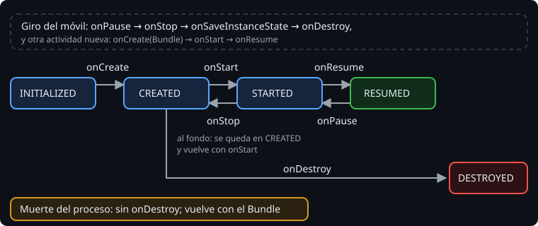

# La actividad y su ciclo de vida

> En un programa de consola, `main` empieza y termina cuando tú decides. Una actividad no: la crea Android, la pone delante y detrás, la para y la destruye cuando le conviene. Tu código no controla ese ciclo: reacciona a él. Esta semana aprendes en qué orden pasa y qué toca hacer en cada momento.

## 🎯 Objetivos

- Nombrar los estados de una actividad y los métodos que los separan
- Predecir el orden de llamadas al arrancar, al irse al fondo, al volver y al cerrarse
- Saber qué se hace en cada método y qué no

## 1. Estados y métodos



Una actividad pasa por cinco **estados** (`Lifecycle.State`): `INITIALIZED`, `CREATED`, `STARTED`, `RESUMED` y `DESTROYED`. Android avisa de cada paso llamando a un método:

| Método | Pasa a | Qué significa |
| --- | --- | --- |
| `onCreate(savedInstanceState)` | `CREATED` | La actividad existe. Se monta la pantalla. Si `savedInstanceState` no es `null`, viene de una anterior |
| `onStart()` | `STARTED` | Es visible, aunque quizá no esté delante |
| `onResume()` | `RESUMED` | Está delante y recibe lo que toca el usuario |
| `onPause()` | `STARTED` | Deja de estar delante: un diálogo del sistema, otra app encima, multiventana |
| `onStop()` | `CREATED` | Ya no se ve |
| `onDestroy()` | `DESTROYED` | Se acaba: el usuario la cierra, o Android la recrea (teoría 02) |

`ComponentActivity` (de `androidx.activity`) es la actividad de la que parten todas las de este curso. Añade a `Activity` lo que necesita el resto de AndroidX: el `Lifecycle` observable (teoría 04), los `ViewModel` y el estado guardado (teoría 03). Compose también la usa.

## 2. El orden, medido

Al arrancar:

```text
onCreate → onStart → onResume
```

Al irse al fondo (el usuario pulsa Inicio o abre otra app) y volver:

```text
onPause → onStop          ...          onStart → onResume
```

Al cerrarse:

```text
onPause → onStop → onDestroy
```

Y si Android la va a recrear (un giro, teoría 02), guarda su estado entre medias:

```text
onPause → onStop → onSaveInstanceState → onDestroy
```

> 🔬 Medido con Robolectric 4.17 sobre Android 16 (API 36, el `targetSdk`), en el ejercicio 01. `onSaveInstanceState` va **después** de `onStop` desde Android 9 (API 28). Antes iba antes de `onStop`, y hay mucho código y mucha documentación vieja que lo da por hecho.

`onPause` no va solo: siempre le sigue `onStop` cuando la actividad deja de verse. Pero puede haber `onPause` sin `onStop`, por ejemplo con un diálogo del sistema encima o en multiventana.

## 3. Qué hacer en cada método

| Método | Sí | No |
| --- | --- | --- |
| `onCreate` | Montar la pantalla, pedir el `ViewModel`, registrar observadores | Trabajo lento (red, disco): bloquea la pantalla |
| `onStart` / `onStop` | Empezar y parar lo que solo tiene sentido mientras se ve: animaciones, escuchar la ubicación | Guardar datos del usuario: `onStop` puede no llegar si el proceso muere |
| `onResume` / `onPause` | Lo que necesita estar delante: la cámara, por ejemplo | Nada lento: la siguiente actividad no aparece hasta que `onPause` termina |
| `onDestroy` | Liberar lo que no libera nadie más | Contar con que se llame: si Android mata el proceso, no se llama |

Y en todos, `super.onXxx()`. Sin él, `ComponentActivity` no se entera del cambio de estado y lanza `SuperNotCalledException`.

## ✅ Comprueba

- [ ] El usuario está escribiendo una observación y le entra una llamada. ¿Qué métodos se llaman? ¿Y cuando cuelga y vuelve?
- [ ] ¿Por qué no se guarda nada importante solo en `onDestroy`?
- [ ] ¿Qué estado tiene la actividad mientras un diálogo del sistema la tapa a medias?
