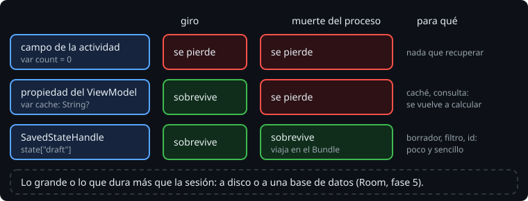

# Guardar el estado

> Hay dos maneras de perder una actividad sin que el usuario la cierre: un cambio de configuración, y la **muerte del proceso**. Para el usuario, las dos son "estaba aquí y ya no está". Cada dato de una pantalla tiene un sitio según lo que tiene que aguantar.

## 🎯 Objetivos

- Explicar qué es la muerte del proceso y por qué el usuario no la ve
- Elegir entre un campo, un `ViewModel` y un `SavedStateHandle` para cada dato
- Conocer los límites de lo que se guarda en un `Bundle`

## 1. La muerte del proceso

Una app en segundo plano no tiene garantizado su proceso. Si el sistema necesita memoria, lo mata sin avisar: no se llama a `onDestroy` ni a nada. Cuando el usuario vuelve desde la lista de apps recientes, Android crea un proceso nuevo y una actividad nueva, y le da el `Bundle` que la anterior guardó en `onSaveInstanceState`. Para el usuario es la misma pantalla. Para tu código, todo lo que estaba en memoria ha desaparecido: campos, `ViewModel`, singletons.



## 2. Tres sitios

| Sitio | Giro | Muerte del proceso | Para qué |
| --- | --- | --- | --- |
| Campo de la actividad | ❌ | ❌ | Nada que el usuario deba recuperar |
| Propiedad de un `ViewModel` | ✅ | ❌ | Datos caros que se pueden volver a calcular o cargar: una caché, el resultado de una consulta |
| `SavedStateHandle` del `ViewModel` | ✅ | ✅ | Lo mínimo que el usuario espera recuperar: el borrador, la pestaña, el filtro, un id |

> 🔬 Medido en el ejercicio 02 con Robolectric: la muerte del proceso se simula guardando el `Bundle` de una actividad y creando otra, desde cero, con él (`Robolectric.buildActivity(...).setup(bundle)`). El campo y la propiedad del `ViewModel` vuelven a su valor inicial; el `SavedStateHandle` conserva el suyo.

## 3. El `ViewModel`

```kotlin
class FieldNotesViewModel(private val state: SavedStateHandle) : ViewModel() {
    var draft: String
        get() = state["draft"] ?: ""
        set(value) {
            state["draft"] = value
        }

    var cache: String? = null
}

class MainActivity : ComponentActivity() {
    private val notes: FieldNotesViewModel by viewModels()
}
```

Un `ViewModel` vive mientras vive la pantalla para el usuario: pasa por todos los giros y se borra (`onCleared`) cuando la actividad se cierra de verdad. `by viewModels()` lo pide a la actividad: la primera vez lo crea y, después de un giro, devuelve el mismo.

El `SavedStateHandle` es un mapa que Android mete en el `Bundle` de `onSaveInstanceState` y le devuelve al `ViewModel` nuevo después de la muerte del proceso. Con un constructor `(SavedStateHandle)`, `by viewModels()` sabe crearlo solo. Con otro constructor necesitas una *factory*, y si no la das:

```text
java.lang.RuntimeException: Cannot create an instance of class dev.bitacora.FieldNotesViewModel
```

> 🔬 Medido añadiendo un segundo parámetro al constructor en el ejercicio 02.

También puedes escribir en el `Bundle` a mano (`onSaveInstanceState` y `onCreate`). Funciona, pero entonces el estado vive en la actividad, que es lo que querías evitar. El `SavedStateHandle` lo deja en el `ViewModel`, junto a la lógica que lo usa, y se puede probar sin actividad.

## 4. Lo que cabe en un `Bundle`

El `Bundle` viaja al proceso del sistema y vuelve, así que tiene límites:

- **Tipos**: primitivos, `String`, `Parcelable`, `Serializable` y listas de ellos. Una `List<Observation>` no entra tal cual. La Bitácora la guarda como el JSON que ya produce `data`.
- **Tamaño**: la documentación de Android recomienda menos de 50 KB. Un `Bundle` demasiado grande hace fallar la transacción con el sistema (`TransactionTooLargeException`) en el dispositivo.

Lo grande o lo que debe durar más que la sesión (las observaciones de verdad, las fotos) no va en el estado de la pantalla. Va a una base de datos o a disco, y eso llega en la fase 5 con Room. En el `SavedStateHandle`, lo justo para volver a encontrar el resto: un id, un filtro, un borrador.

## ✅ Comprueba

- [ ] El usuario rellena medio formulario, cambia a la cámara, y Android mata la Bitácora en segundo plano. ¿Qué datos del formulario recupera, según dónde los guardaste?
- [ ] ¿Dónde guardarías la lista de parcelas descargada del servidor? ¿Y la parcela que el usuario tiene seleccionada?
- [ ] ¿Por qué no basta con guardarlo todo en el `SavedStateHandle`?
